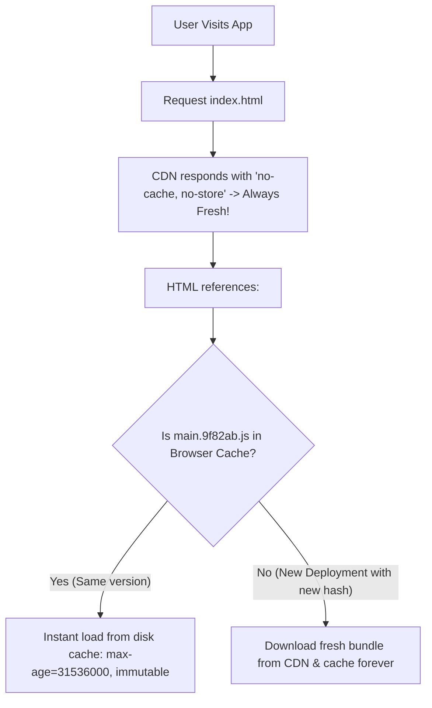

## Scenario

> **How would you handle browser caching issues?**

You deploy a critical hotfix to production, but users continue seeing old bugs because their browser cached old JS bundles. Interviewers test your mastery of caching architectures and content-hashing.

## Fast Revision (10-Second Recall)

- **The Universal Golden Rule of Frontend Caching:**
- 1. **`index.html`:** MUST NEVER BE CACHED $\rightarrow$ `Cache-Control: no-cache, no-store, must-revalidate`.
- 2. **Static Bundles (`.js`, `.css`, images):** CACHED FOREVER with Content Hashes $\rightarrow$ `Cache-Control: public, max-age=31536000, immutable`.
- **How It Works:** When code changes, bundler outputs `main.a8f9c2.js`. Because `index.html` is never cached, the browser fetches the new HTML, sees the new filename, and downloads the new bundle instantly.
- **Chunk Load Error Recovery:** Catch `Failed to fetch dynamically imported module` in an Error Boundary and auto-reload the page.

## The 30-Second Spoken Script

If asked this in an interview, deliver this structured response:

> *I handle browser caching by enforcing a strict split-caching architecture between our HTML entrypoint and our static hashed assets.*
>
> *The core principle is:
First, index.html must never be cached by the browser or intermediate proxies. I configure our CDN and origin server to serve index.html with 'Cache-Control: no-cache, no-store, must-revalidate'. Every time a user visits the site, their browser checks for the latest HTML.*
>
> *Second, all static JavaScript, CSS, and font chunks are generated with deterministic content hashes in their filenames—for example, app.7b3e1a.js. Because the filename changes whenever the code changes, these assets can be safely cached forever with 'Cache-Control: public, max-age=31536000, immutable'.*
>
> *When a new release deploys, the user receives the fresh index.html pointing to the new hashed asset URLs, bypassing browser cache immediately.*
>
> *Finally, to handle chunk load failures when old hashed chunks are deleted from the server while a user has a tab open, I implement an Error Boundary that catches dynamic import errors and reloads the page automatically.*

## Diagnostic Lifecycle



## Root Causes & Solutions Matrix

| Suspected Layer | Symptoms & Evidence | Immediate Resolution |
| :--- | :--- | :--- |
| **Cached `index.html`** | Users stuck on old release for days after deployment until hard-refreshing. | Set `Cache-Control: no-cache, no-store, must-revalidate` on `index.html`. |
| **Missing Content Hash** | Bundler outputs `bundle.js`; browser refuses to download new version. | Configure bundler with `[name].[contenthash].js`. |
| **ChunkLoadError After Deploy** | User navigating lazy route encounters `Failed to fetch dynamic module`. | Catch chunk load error and trigger `window.location.reload()`. |
| **Stale Service Worker** | Service worker holds old cache and never activates new worker. | Call `registration.update()` and trigger `skipWaiting()` on new worker install. |

## Practical Debugging Commands & Code

### Vite Content Hashing & Chunk Load Error Boundary
```typescript
// 1. vite.config.ts - Enforce Content Hashing
import { defineConfig } from 'vite';

export default defineConfig({
  build: {
    rollupOptions: {
      output: {
        entryFileNames: 'assets/[name].[hash].js',
        chunkFileNames: 'assets/[name].[hash].js',
        assetFileNames: 'assets/[name].[hash].[ext]',
      },
    },
  },
});

// 2. React Chunk Load Recovery Component
import React, { Component, ReactNode } from 'react';

export class ChunkLoadErrorBoundary extends Component<{ children: ReactNode }> {
  componentDidCatch(error: Error) {
    const isChunkLoadFailed =
      error.message.includes('Failed to fetch dynamically imported module') ||
      error.message.includes('Loading chunk') ||
      error.name === 'ChunkLoadError';

    if (isChunkLoadFailed) {
      // Guard against infinite reload loops
      const lastReload = sessionStorage.getItem('last_chunk_reload');
      const now = Date.now();

      if (!lastReload || now - Number(lastReload) > 10000) {
        sessionStorage.setItem('last_chunk_reload', String(now));
        console.warn('New deployment detected! Reloading page to fetch latest chunks...');
        window.location.reload();
      }
    }
  }

  render() {
    return this.props.children;
  }
}
```

## Prevention & Senior Best Practices

1. **Retain Old Chunks on CDN for 24 Hours:** After a new deployment, keep prior hashed chunks available on S3/CloudFront so active user sessions don't crash mid-navigation.
2. **Verify Nginx / Cloudflare Rules:** Ensure web servers do not apply static asset cache rules (`max-age=31536000`) to `.html` files.
3. **Version Notification Banner:** Use WebSockets or a light `/version.json` poll to display a non-intrusive "New version available - Refresh" notification.
