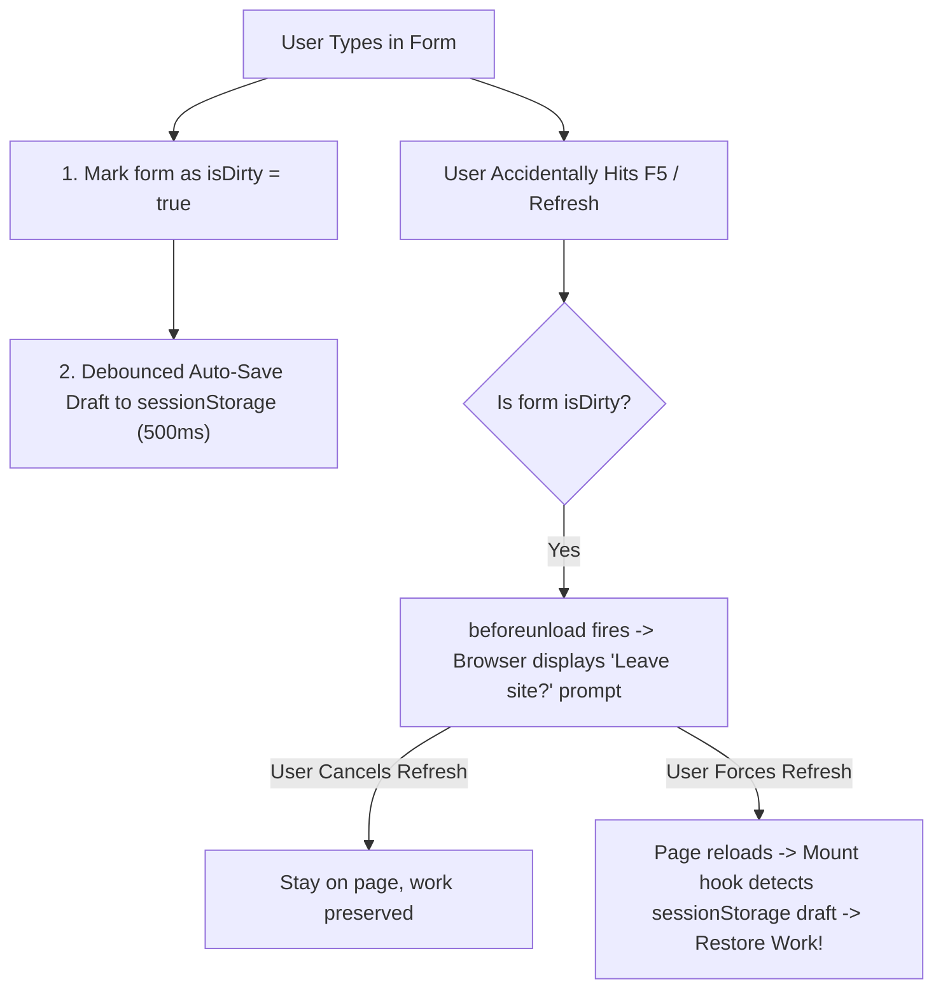

## Scenario

> **How would you handle an unexpected browser refresh?**

A user accidentally hits Cmd+R or F5 while typing a 20-minute survey or financial transfer. Interviewers test your ability to protect user data through browser lifecycle hooks and auto-persistence.

## Fast Revision (10-Second Recall)

- **First Move:** Listen to the **`beforeunload`** event when form is dirty to trigger the browser's native "Leave site? Changes you made may not be saved" dialog.
- **The 3 Protection Strategies:**
- 1. **Dirty Form Guard:** Track `formState.isDirty`; if true, call `event.preventDefault()` in `window.onbeforeunload`.
- 2. **Auto-Saving Drafts:** Debounce-save form input to `localStorage` or `sessionStorage` on every keystroke.
- 3. **Draft Recovery Prompt:** On mount, check if a draft exists; prompt user: "We found unsaved work from your previous session. Would you like to restore it?"

## The 30-Second Spoken Script

If asked this in an interview, deliver this structured response:

> *To handle unexpected browser refreshes and prevent user data loss, I implement a two-pronged strategy: preventive navigation guards and continuous draft auto-saving.*
>
> *First, for prevention, I listen to the window beforeunload event whenever an active form has unsaved modifications (using formState.isDirty from React Hook Form). When isDirty is true, calling event.preventDefault() and setting event.returnValue triggers the browser's native confirmation prompt, warning the user: 'Changes you made may not be saved' before the tab reloads.*
>
> *Second, because users might still force-refresh or suffer a browser crash, I continuously auto-save form inputs into sessionStorage or IndexedDB debounced at 500 milliseconds.*
>
> *When the component mounts, it checks for an existing saved draft. If found, it either automatically restores the inputs or displays a prompt: 'We recovered an unsaved draft from your previous session. Restore draft?'. Once the user successfully submits the form, the draft is cleared. This guarantees zero lost data even during catastrophic browser crashes.*

## Diagnostic Lifecycle



## Root Causes & Solutions Matrix

| Suspected Layer | Symptoms & Evidence | Immediate Resolution |
| :--- | :--- | :--- |
| **Accidental Key Press (F5 / Cmd+R)** | User accidentally reloads page and loses 15 minutes of typed inputs. | Hook into `window.addEventListener("beforeunload")` when `isDirty` is true. |
| **Custom BeforeUnload String** | Developer writes custom warning text; browser shows generic message. | Modern browsers ignore custom strings for security; standard dialog is enforced. |
| **Browser Crash / Power Loss** | Browser force-closes; `beforeunload` never fired. | Continuously auto-save drafts to `localStorage` or `sessionStorage`. |
| **Stale Draft Leakage** | Old draft from last week restores into a brand new submission form. | Include timestamp on drafts and expire drafts older than 24 hours. |

## Practical Debugging Commands & Code

### Auto-Save Hook with beforeunload Navigation Guard
```typescript
import { useEffect } from 'react';
import { useForm } from 'react-hook-form';

export function useFormDraftGuard<T>(
  formKey: string,
  watch: any,
  isDirty: boolean,
  setValue: any
) {
  // 1. Native beforeunload warning when form is dirty
  useEffect(() => {
    const handleBeforeUnload = (e: BeforeUnloadEvent) => {
      if (isDirty) {
        e.preventDefault();
        e.returnValue = ''; // Required for Chrome/Safari standard prompt
      }
    };

    window.addEventListener('beforeunload', handleBeforeUnload);
    return () => window.removeEventListener('beforeunload', handleBeforeUnload);
  }, [isDirty]);

  // 2. Debounced Auto-Saving to sessionStorage
  useEffect(() => {
    const subscription = watch((values: any) => {
      if (isDirty) {
        sessionStorage.setItem(formKey, JSON.stringify(values));
      }
    });
    return () => subscription.unsubscribe();
  }, [watch, isDirty, formKey]);

  // 3. Restore Draft on Mount
  useEffect(() => {
    const savedDraft = sessionStorage.getItem(formKey);
    if (savedDraft) {
      try {
        const parsed = JSON.parse(savedDraft);
        Object.keys(parsed).forEach((key) => {
          setValue(key, parsed[key]);
        });
      } catch (err) {
        sessionStorage.removeItem(formKey);
      }
    }
  }, [formKey, setValue]);
}
```

## Prevention & Senior Best Practices

1. **Always Clear Draft on Successful Submit:** Call `sessionStorage.removeItem(formKey)` inside `onSuccess` so completed submissions don't linger.
2. **Use `sessionStorage` Over `localStorage` for Forms:** `sessionStorage` isolates drafts to the current tab and cleans up automatically when the tab is closed.
3. **Integrate with Router Blockers:** In React Router v6+, use `useBlocker` or `usePrompt` to intercept in-app SPA route transitions as well as browser refreshes.
