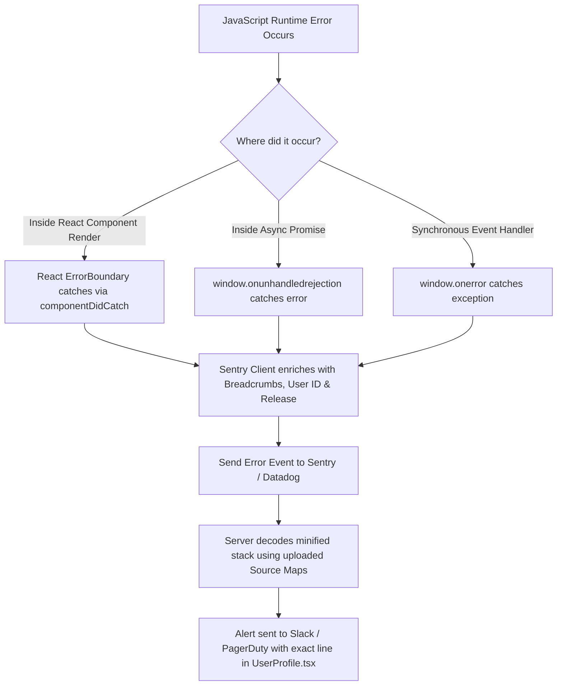

## Scenario

> **How would you identify a JavaScript runtime error?**

When an uncaught exception hits a user in production, you can't open their browser DevTools. The interviewer wants to know how you capture, deduplicate, and triage client-side errors in production.

## Fast Revision (10-Second Recall)

- **First Move:** Implement **Real User Monitoring (RUM)** with Sentry, Datadog, or Rollbar.
- **The 3 Global Error Traps:**
- 1. **`window.onerror`:** Catches synchronous JavaScript runtime errors.
- 2. **`window.onunhandledrejection`:** Catches uncaught Promise rejections (failed async/await).
- 3. **React `ErrorBoundary` (`componentDidCatch`):** Catches errors during component rendering and prevents full blank screens.
- **Critical Prerequisite:** Upload **Source Maps** to Sentry during CI builds so minified traces (`at a.js:1:342`) map back to real source code (`UserProfile.tsx:42`).

## The 30-Second Spoken Script

If asked this in an interview, deliver this structured response:

> *To identify and track JavaScript runtime errors in production, I implement a multi-tiered observability pipeline utilizing Error Boundaries, global error listeners, source maps, and Sentry.*
>
> *First, within the React component tree, I wrap key feature boundaries with React Error Boundaries. When an unhandled error occurs during rendering, the Error Boundary catches it via componentDidCatch, logs the error and componentStack to Sentry, and presents a graceful fallback UI rather than crashing into a blank white screen.*
>
> *Second, at the browser window level, I configure global listeners for window.onerror to capture uncaught synchronous exceptions, and window.addEventListener('unhandledrejection') to catch unhandled async Promise rejections.*
>
> *Third, in our CI/CD pipeline, I ensure hidden source maps are uploaded directly to our error monitoring service (like Sentry or Datadog) during the build and deleted from public web servers. This transforms minified, unreadable stack traces into exact TypeScript file paths and line numbers.*
>
> *Finally, I attach user breadcrumbs, session IDs, and release tags to error events, enabling our engineering team to instantly reproduce the user journey leading up to the crash.*

## Diagnostic Lifecycle



## Root Causes & Solutions Matrix

| Suspected Layer | Symptoms & Evidence | Immediate Resolution |
| :--- | :--- | :--- |
| **Minified Stack Traces** | Sentry logs error as `TypeError at bundle.min.js:1:48291`; impossible to diagnose. | Upload source maps to Sentry in CI build step using `@sentry/vite-plugin`. |
| **Whole App Crashing to White** | One broken review card crashes entire 50-component page. | Wrap individual widgets in modular React `ErrorBoundary` components. |
| **Unhandled Async Rejections** | Network failure in `async` function silently fails without alerting. | Add `window.addEventListener("unhandledrejection")` handler. |
| **Sensitive Data Leak in Logs** | Sentry captures user passwords or PII in form error payloads. | Configure `beforeSend` hook in Sentry to sanitize and scrub PII. |

## Practical Debugging Commands & Code

### React Error Boundary & Global Unhandled Rejection Setup
```typescript
import React, { Component, ErrorInfo, ReactNode } from 'react';

interface Props {
  children: ReactNode;
  fallback?: ReactNode;
}

interface State {
  hasError: boolean;
  error: Error | null;
}

export class GlobalErrorBoundary extends Component<Props, State> {
  public state: State = { hasError: false, error: null };

  public static getDerivedStateFromError(error: Error): State {
    return { hasError: true, error };
  }

  public componentDidCatch(error: Error, errorInfo: ErrorInfo) {
    console.error('Uncaught error caught by ErrorBoundary:', error, errorInfo);
    
    // Send to Sentry / Datadog with component stack trace
    // Sentry.captureException(error, { extra: { componentStack: errorInfo.componentStack } });
  }

  public render() {
    if (this.state.hasError) {
      return (
        this.fallback || (
          <div className="p-6 text-center border border-red-200 bg-red-50 rounded-lg">
            <h2 className="text-lg font-bold text-red-700">Something went wrong</h2>
            <p className="text-sm text-red-600 mt-1">Our engineering team has been notified.</p>
            <button
              onClick={() => this.setState({ hasError: false })}
              className="mt-4 px-4 py-2 bg-red-600 text-white rounded"
            >
              Try Again
            </button>
          </div>
        )
      );
    }

    return this.props.children;
  }
}

// Global Promise Rejection Listener
if (typeof window !== 'undefined') {
  window.addEventListener('unhandledrejection', (event) => {
    console.warn('Unhandled promise rejection:', event.reason);
    // Sentry.captureException(event.reason);
  });
}
```

## Prevention & Senior Best Practices

1. **Delete Public Source Maps:** Never expose `.js.map` files publicly on production web servers; upload them private-only to Sentry to prevent reverse engineering.
2. **Sanitize PII in Errors:** Always scrub passwords, credit card numbers, and tokens in the error reporting client before dispatch.
3. **Group Errors by Fingerprint:** Configure custom Sentry fingerprints so 10,000 identical network drops roll into a single issue.
