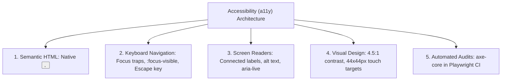

## Scenario

> **How would you improve frontend accessibility?**

Accessibility is legally required (ADA, European Accessibility Act) and crucial for inclusive software. Interviewers evaluate whether you know how to build accessible web applications beyond superficial aria tags.

## Fast Revision (10-Second Recall)

- **First Rule of ARIA:** **Do NOT use ARIA if a native HTML element already exists** (use `<button>` instead of `<div role="button">`).
- **The 4 Pillars of WCAG 2.1 AA Compliance:**
- 1. **Keyboard Navigation:** Everything clickable must be reachable via `Tab` and actionable with `Enter`/`Space`; visible `:focus-visible` ring.
- 2. **Semantic HTML:** `<header>`, `<main>`, `<nav>`, `<aside>`, `<h1>` to `<h6>` hierarchical landmarks.
- 3. **Screen Reader Support:** Form labels connected with `htmlFor`, images with descriptive `alt` text, dynamic updates via `aria-live`.
- 4. **Visual Contrast:** Minimum 4.5:1 text-to-background contrast ratio (3:1 for large text).

## The 30-Second Spoken Script

If asked this in an interview, deliver this structured response:

> *To improve frontend accessibility to WCAG 2.1 AA standards, I focus on semantic HTML first, keyboard navigation second, and automated CI auditing third.*
>
> *The first rule of accessibility is: the best ARIA is no ARIA. I always prefer native semantic HTML elements—such as button, nav, main, and form—over styled div elements with custom role attributes. Native elements provide built-in keyboard interaction, focusability, and screen reader announcements without extra code.*
>
> *Second, I ensure 100% keyboard accessibility. A user must be able to navigate the entire app using Tab and Shift+Tab, activate elements with Enter and Space, and close modals with Escape. I never disable outline: none without providing a high-contrast :focus-visible ring, and I enforce focus traps inside open dialogs.*
>
> *Third, for forms and dynamic content, I explicitly link labels to inputs with htmlFor and id, and use aria-live='polite' regions for dynamic toast notifications so screen readers announce background updates.*
>
> *Finally, I automate accessibility testing by integrating axe-core and eslint-plugin-jsx-a11y into our build and CI pipelines to prevent regressions.*

## Diagnostic Lifecycle



## Root Causes & Solutions Matrix

| Suspected Layer | Symptoms & Evidence | Immediate Resolution |
| :--- | :--- | :--- |
| **Div Click Handlers** | `<div onClick={...}>` cannot be focused via keyboard or activated by Enter key. | Replace with native `<button type="button">`. |
| **Hidden Focus Outlines** | CSS has `* { outline: none; }`; keyboard users cannot see active focus. | Use `:focus-visible { outline: 2px solid #2563eb; }`. |
| **Unlabeled Icons/Buttons** | Screen reader announces icon button as "button" with no context. | Add `aria-label="Close dialog"` to icon-only buttons. |
| **Dynamic Content Silence** | Cart updates in background; blind user has no idea item was added. | Wrap notification badge in `<div aria-live="polite">`. |

## Practical Debugging Commands & Code

### Accessible Modal Dialog with Focus Trap & Escape Listener
```typescript
import React, { useEffect, useRef } from 'react';

interface ModalProps {
  isOpen: boolean;
  onClose: () => void;
  title: string;
  children: React.ReactNode;
}

export function AccessibleModal({ isOpen, onClose, title, children }: ModalProps) {
  const modalRef = useRef<HTMLDivElement | null>(null);

  useEffect(() => {
    if (!isOpen) return;

    // 1. Close on Escape key press
    const handleKeyDown = (e: KeyboardEvent) => {
      if (e.key === 'Escape') onClose();

      // 2. Keyboard Focus Trap (keep Tab inside modal)
      if (e.key === 'Tab' && modalRef.current) {
        const focusables = modalRef.current.querySelectorAll<HTMLElement>(
          'button, [href], input, select, textarea, [tabindex]:not([tabindex="-1"])'
        );
        const first = focusables[0];
        const last = focusables[focusables.length - 1];

        if (e.shiftKey && document.activeElement === first) {
          last.focus();
          e.preventDefault();
        } else if (!e.shiftKey && document.activeElement === last) {
          first.focus();
          e.preventDefault();
        }
      }
    };

    window.addEventListener('keydown', handleKeyDown);
    return () => window.removeEventListener('keydown', handleKeyDown);
  }, [isOpen, onClose]);

  if (!isOpen) return null;

  return (
    <div className="fixed inset-0 bg-black/50 flex items-center justify-center" role="dialog" aria-modal="true" aria-labelledby="modal-title">
      <div ref={modalRef} className="bg-white p-6 rounded-lg max-w-md w-full shadow-xl">
        <div className="flex justify-between items-center mb-4">
          <h2 id="modal-title" className="text-xl font-bold text-gray-900">{title}</h2>
          <button
            onClick={onClose}
            aria-label="Close modal dialog"
            className="p-1 rounded hover:bg-gray-100 focus-visible:ring-2 focus-visible:ring-blue-500"
          >
            ✕
          </button>
        </div>
        <div>{children}</div>
      </div>
    </div>
  );
}
```

## Prevention & Senior Best Practices

1. **Install `eslint-plugin-jsx-a11y`:** Catch missing alt tags and aria anti-patterns directly in your code editor.
2. **Automated Axe-Core in Playwright:** Run `@axe-core/playwright` on all critical page journeys during CI.
3. **Tab-Only Navigation Testing:** Perform weekly manual testing using only the keyboard (`Tab`, `Space`, `Enter`, `Esc`) with monitors dimmed.
