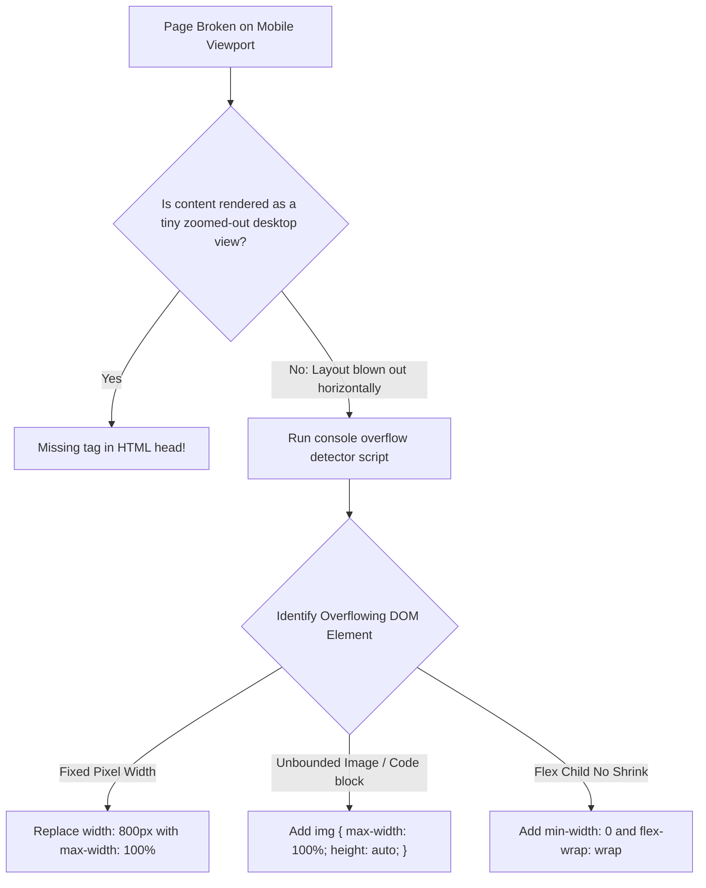

## Scenario

> **Your page displays correctly on desktop but breaks on mobile. How would you troubleshoot it?**

Over 60% of web traffic originates from mobile devices. If a page breaks on mobile (unwanted horizontal scrollbars, tiny unreadable text, broken touch clicks), the app is unusable. The interviewer tests responsive design debugging.

## Fast Revision (10-Second Recall)

- **First Move:** Check for horizontal overflow: Run `document.querySelectorAll("*")` script in DevTools to find elements wider than `window.innerWidth`.
- **Top Mobile Regressions:**
- 1. **Missing Viewport Meta Tag:** `<meta name="viewport" content="width=device-width, initial-scale=1.0">` omitted (renders desktop site zoomed out).
- 2. **Hardcoded Pixel Widths:** `width: 1200px` or fixed-width containers blowing out mobile screens.
- 3. **Unbounded Media/Pre Tags:** Large ``, `<video>`, or `<pre>` code blocks without `max-width: 100%`.
- 4. **Sticky / Fixed Positioning Overlaps:** Modals or fixed headers covering content when mobile keyboard opens.

## The 30-Second Spoken Script

If asked this in an interview, deliver this structured response:

> *When a page works on desktop but breaks on mobile, the most common issues are unwanted horizontal scrollbars, missing viewport meta configurations, or fixed pixel widths.*
>
> *My troubleshooting process:
First, I verify the HTML head has the standard responsive viewport meta tag: width=device-width, initial-scale=1.0. Without this, mobile browsers emulate a 980px desktop screen and zoom out, making text illegible.*
>
> *Second, if the mobile page has horizontal scrolling or content bleeding off the right edge, I run a one-line JavaScript snippet in the console to identify the exact overflowing element: inspecting which element's scrollWidth exceeds window.innerWidth.*
>
> *Common culprits include tables, preformatted code blocks, or images lacking max-width: 100%, and fixed pixel widths like width: 800px instead of max-width: 100%.*
>
> *Third, for touch interactions, I verify that buttons and touch targets meet the WCAG minimum of 44 by 44 pixels, and test with the virtual keyboard open to ensure fixed elements don't obscure active inputs.*

## Diagnostic Lifecycle



## Root Causes & Solutions Matrix

| Suspected Layer | Symptoms & Evidence | Immediate Resolution |
| :--- | :--- | :--- |
| **Missing Viewport Meta** | Page renders zoomed out like a 1999 desktop website. | Add `<meta name="viewport" content="width=device-width, initial-scale=1.0">`. |
| **Horizontal Scrollbar Blowout** | User can drag page horizontally; white gutter on right side of screen. | Run overflow snippet; add `max-width: 100%` and `overflow-x: hidden`. |
| **Virtual Keyboard Shift** | Opening mobile keyboard pushes fixed footer over input fields. | Use `interactive-widget=resizes-content` in viewport meta tag. |
| **Undersized Touch Targets** | Users struggle to tap icons; accidental adjacent clicks. | Ensure clickable elements are at least 44x44px (`min-h-[44px] min-w-[44px]`). |

## Practical Debugging Commands & Code

### Mobile Overflow Detector Script & CSS Reset Guards
```typescript
// 1. One-Line Console Script to Find Elements Causing Horizontal Scroll
function findOverflowingElements() {
  const docWidth = document.documentElement.offsetWidth;
  const elements = document.querySelectorAll('*');
  const overflowing: HTMLElement[] = [];

  elements.forEach((el) => {
    const htmlEl = el as HTMLElement;
    if (htmlEl.offsetWidth > docWidth) {
      overflowing.push(htmlEl);
      console.warn('⚠️ Overflowing Element:', htmlEl, {
        elementWidth: htmlEl.offsetWidth,
        documentWidth: docWidth,
      });
    }
  });

  return overflowing;
}

// 2. Bulletproof Responsive CSS Reset Guard
/*
* {
  box-sizing: border-box;
}

html, body {
  max-width: 100%;
  overflow-x: hidden;
}

img, picture, video, canvas, svg {
  display: block;
  max-width: 100%;
  height: auto;
}

input, button, textarea, select {
  font: inherit;
}

// Prevent iOS font zooming on input focus
input, select, textarea {
  font-size: 16px; // iOS Safari auto-zooms if font-size < 16px!
}
*/
```

## Prevention & Senior Best Practices

1. **Set Input Font Size >= 16px:** iOS Safari forcefully zooms the entire viewport if an input font size is less than 16px.
2. **Use Mobile-First Media Queries:** Write base CSS for mobile (`min-width: 0`), then add `@media (min-width: 768px)` for larger screens.
3. **Test on Real Devices:** Browser DevTools device emulation does not replicate mobile virtual keyboards, touch gestures, or Safari URL bar dynamics.
