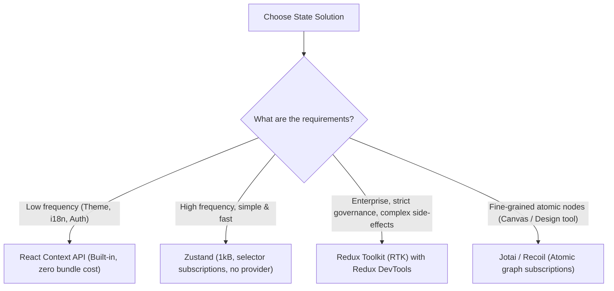

## Scenario

> **When would you use Context API, Redux, or another state manager?**

Every frontend developer has an opinion, but senior engineers evaluate technical trade-offs: bundle size, developer ergonomics, selector subscriptions, and rendering performance.

## Fast Revision (10-Second Recall)

- **First Move:** Understand that **React Context is NOT a state management tool**—it is a dependency injection mechanism.
- **Decision Criteria:**
- 1. **React Context API:** Low-frequency updates, static application config (Theme, Locale/i18n, Auth Tokens). Avoid for high-frequency state due to re-render cascades.
- 2. **Zustand (Recommended for most modern apps):** 1kB bundle, zero boilerplate, hook-based, supports selector subscriptions and middleware (persist/devtools).
- 3. **Redux Toolkit (RTK):** Large enterprise apps with complex state machines, team-wide strict patterns, time-travel debugging, and heavy middleware requirements.
- 4. **Jotai / Recoil:** Bottom-up atomic state, ideal for canvas/node editors (Figma-like apps).

## The 30-Second Spoken Script

If asked this in an interview, deliver this structured response:

> *I choose state management solutions based on update frequency, component tree depth, and team scale.*
>
> *First, React Context is not a state manager; it is a dependency injection mechanism. Because any update to a Context value re-renders all consuming components regardless of whether they read the specific mutated property, I reserve Context strictly for low-frequency, near-static data like theme, localization, or authentication tokens.*
>
> *Second, for modern applications, my default choice is Zustand. Zustand provides a 1kB bundle, requires zero wrapper providers, and supports granular selector subscriptions. If a component subscribes to useStore(s => s.cartCount), it will only re-render when cartCount changes, completely avoiding unnecessary re-renders.*
>
> *Third, I choose Redux Toolkit for large enterprise environments with strict architectural standards, complex distributed side-effects, or where team members benefit from time-travel debugging and rigid action-reducer contracts.*
>
> *Finally, for atomic, dynamic dependency graphs—such as graph visualizers or canvas design tools—I prefer Jotai.*

## Diagnostic Lifecycle



## Root Causes & Solutions Matrix

| Suspected Layer | Symptoms & Evidence | Immediate Resolution |
| :--- | :--- | :--- |
| **React Context API** | Theme toggle re-renders thousands of unrelated table rows. | Use only for low-frequency static values, or split contexts. |
| **Zustand** | Need clean, testable state without JSX wrapper nesting or boilerplate. | Best-in-class choice for 90% of React applications. |
| **Redux Toolkit** | Large team requires strict conventions, undo/redo, or audit logging. | Ideal for large enterprise codebases with extensive state pipelines. |
| **Jotai / Atomic** | Hundreds of independent canvas shapes need independent position state. | Atomic state managers isolate re-renders to the single active node. |

## Practical Debugging Commands & Code

### Comparing Context vs Zustand Implementation
```typescript
// 1. Context API (Causes re-renders in all consumers when ANY property changes)
import React, { createContext, useContext, useState } from 'react';

const AppContext = createContext<{ count: number; theme: string } | null>(null);

export function ContextConsumer() {
  // Even if this component only cares about theme, it RE-RENDERS on count changes!
  const context = useContext(AppContext);
  return <div>Theme: {context?.theme}</div>;
}

// 2. Zustand (Fine-grained selector subscriptions: RE-RENDERS ONLY ON TARGET MATCH)
import { create } from 'zustand';

interface AppStore {
  count: number;
  theme: string;
  increment: () => void;
}

export const useAppStore = create<AppStore>((set) => ({
  count: 0,
  theme: 'dark',
  increment: () => set((s) => ({ count: s.count + 1 })),
}));

export function ZustandConsumer() {
  // Subscribes strictly to 'theme'. Will NOT re-render when count increments!
  const theme = useAppStore((state) => state.theme);
  return <div>Theme: {theme}</div>;
}
```

## Prevention & Senior Best Practices

1. **Never Put Server Data in Redux/Zustand:** Let TanStack Query manage cache lifetimes; keeping server data in Redux introduces manual sync bugs.
2. **Split Context Providers:** If using Context, create separate `StateContext` and `DispatchContext` to prevent components that only dispatch actions from re-rendering.
3. **Evaluate Bundle Impact:** Redux Toolkit adds ~12kB gzipped; Zustand adds ~1kB.
