## Scenario

> **How would you implement a reusable form component?**

Poorly architected form components become 2,000-line monsters with 40 boolean props (`isDatePicker`, `hasIcon`, `showError`). The interviewer tests compound component design, accessibility, and headless form integration.

## Fast Revision (10-Second Recall)

- **First Move:** Apply the **Compound Component Pattern** or **Slots/Composition** instead of a monolithic prop-heavy component.
- **The Anatomy of a Senior Form Field:**
- 1. **Compositional Structure:** `<FormField><Label /><Input /><ErrorMessage /></FormField>`.
- 2. **Accessibility (a11y):** Connect `<label htmlFor={id}>` with `<input id={id}>` and link error messages with `aria-describedby={errorId}` and `aria-invalid={true}`.
- 3. **Headless Integration:** Use `react-hook-form` `FormProvider` and `useFormContext` to bind inputs without manual prop drilling.
- 4. **Polymorphic Controls:** Support text, select, checkbox, and date pickers with unified validation styling.

## The 30-Second Spoken Script

If asked this in an interview, deliver this structured response:

> *To design a truly reusable form architecture, I avoid the common trap of creating a single monolithic Form component filled with dozens of boolean props. Instead, I use the Compound Component pattern backed by headless form state from React Hook Form.*
>
> *The architecture consists of three layers:
First, a Form container that wraps React Hook Form's FormProvider, providing validation context and handling onSubmit.*
>
> *Second, a composite FormField component that manages field-level layout: tying together the Label, the input control, helper text, and the ErrorMessage.*
>
> *Third, I prioritize accessibility out of the box. The FormField automatically generates a unique ID linking the label's htmlFor to the input's id. When a validation error occurs, it sets aria-invalid='true' on the input and points aria-describedby to the error message element so screen readers immediately announce errors to visually impaired users.*
>
> *This compound pattern allows developers to customize layouts freely while maintaining consistent validation, error messaging, and accessibility across the entire application.*

## Diagnostic Lifecycle

```mermaid
flowchart TD
    A["<Form {...formMethods} onSubmit={save}>"] --> B["<FormField name='email'>"]
    B --> C["<FormLabel>Email Address</FormLabel> (htmlFor='email-id')"]
    B --> D["<FormInput /> (id='email-id', aria-invalid, aria-describedby)"]
    B --> E["<FormErrorMessage /> (id='email-id-error')"]
    subgraph Accessibility Contract
    C -.->|"htmlFor = id"| D
    D -.->|"aria-describedby = id"| E
    end
```



## Root Causes & Solutions Matrix

| Suspected Layer | Symptoms & Evidence | Immediate Resolution |
| :--- | :--- | :--- |
| **Monolithic Prop Hell** | `<InputField hasError={true} isBlue={false} isEmail={true} isRequired={true} />`. | Use compound components: `<FormField><Label/><Input/></FormField>`. |
| **Broken Screen Readers (a11y)** | Screen reader does not announce validation error when input fails. | Link input to error via `aria-describedby="field-error-id"` and `aria-invalid`. |
| **Performance Degradation** | Typing in one input re-renders all 30 fields on a large enterprise form. | Use uncontrolled inputs via `register` in React Hook Form. |
| **Inconsistent Error Styles** | Different engineers style error banners differently across pages. | Centralize error presentation in a shared `<FormErrorMessage />` component. |

## Practical Debugging Commands & Code

### Accessible Compound Form Field Component
```typescript
import React, { useId } from 'react';
import { useFormContext, Controller } from 'react-hook-form';

interface FormFieldProps {
  name: string;
  label: string;
  placeholder?: string;
  type?: string;
}

export function TextField({ name, label, placeholder, type = 'text' }: FormFieldProps) {
  const { register, formState: { errors } } = useFormContext();
  const id = useId();
  const error = errors[name];
  const errorId = `${id}-error`;

  return (
    <div className="flex flex-col gap-1 mb-4">
      {/* 1. Accessible Label linked via htmlFor */}
      <label htmlFor={id} className="text-sm font-medium text-gray-700">
        {label}
      </label>

      {/* 2. Accessible Input */}
      <input
        id={id}
        type={type}
        placeholder={placeholder}
        aria-invalid={Boolean(error)}
        aria-describedby={error ? errorId : undefined}
        {...register(name)}
        className={`p-2 border rounded transition ${
          error ? 'border-red-500 focus:ring-red-200' : 'border-gray-300'
        }`}
      />

      {/* 3. Accessible Error Announcement */}
      {error && (
        <span id={errorId} role="alert" className="text-xs text-red-600 font-medium">
          {String(error.message)}
        </span>
      )}
    </div>
  );
}
```

## Prevention & Senior Best Practices

1. **Always Test with Keyboard and Screen Reader:** Ensure users can tab through fields and hear errors announced via NVDA or VoiceOver.
2. **Use Uncontrolled Inputs:** Prefer React Hook Form `register` over controlled `useState` to prevent typing re-render cascades.
3. **Standardize Schema Validation:** Pair the form component with a shared Zod resolver to decouple validation rules from UI components.
