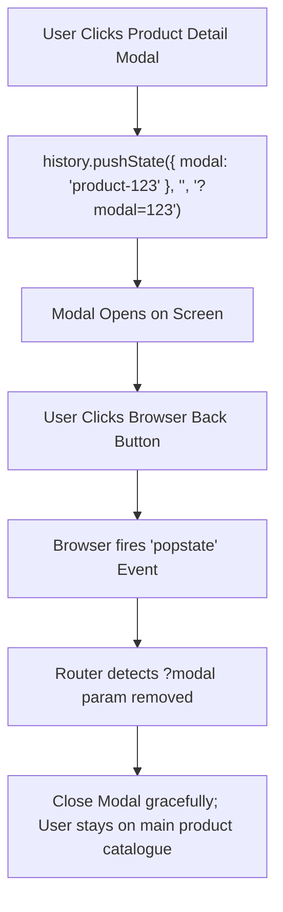

## Scenario

> **How would you handle browser back and forward navigation?**

Users expect the browser Back button to close modals, preserve scroll positions, and reload previous search states. Interviewers test your mastery of the HTML5 History API and bfcache optimization.

## Fast Revision (10-Second Recall)

- **First Move:** Leverage the **History API (`pushState`, `replaceState`, `popstate`)** and modern routers (React Router).
- **The 3 Crucial Navigation Requirements:**
- 1. **Scroll Restoration:** Ensure the browser remembers exact scroll coordinates when returning (`history.scrollRestoration = "manual"`).
- 2. **Modals in History:** Push state when opening a modal (`?modal=edit-profile`) so clicking Back closes the modal instead of navigating away from the page.
- 3. **bfcache (Back/Forward Cache):** Avoid `unload` event listeners so the browser can instantaneously restore page memory from cache.

## The 30-Second Spoken Script

If asked this in an interview, deliver this structured response:

> *Handling browser back and forward navigation properly requires syncing application state with the browser History stack and supporting the browser's Back/Forward Cache (bfcache).*
>
> *First, any view change that a user intuitively expects to step back from—such as active search filters, open drawers, or photo preview modals—should be reflected in the URL or History state. For example, opening a detail drawer should push a query parameter like ?drawer=details. When the user hits the browser Back button, the popstate event fires, the parameter clears, and the drawer closes gracefully without unloading the page.*
>
> *Second, I ensure robust scroll restoration. When navigating away from a long list, I save the scroll coordinates and restore them on return, or rely on React Router's built-in ScrollRestoration component.*
>
> *Third, I optimize for the browser bfcache (Back/Forward Cache), which preserves the entire JavaScript execution and DOM state in memory for instant transitions. To ensure pages remain eligible for bfcache, I avoid using window 'unload' listeners, clean up open WebSocket/IndexedDB connections on pagehide, and listen to the 'pageshow' event to refresh stale data.*

## Diagnostic Lifecycle



## Root Causes & Solutions Matrix

| Suspected Layer | Symptoms & Evidence | Immediate Resolution |
| :--- | :--- | :--- |
| **Modal Trap on Back Click** | User clicks browser Back button intending to close modal, but gets kicked off the website. | Sync modal state to URL query parameter or push history state on open. |
| **Lost Scroll Position** | User scrolls 2,000px down feed, clicks post, clicks Back, and page resets to top. | Implement scroll restoration using `sessionStorage` or `<ScrollRestoration />`. |
| **bfcache Ineligibility** | Navigating Back triggers full network re-download and re-render. | Remove `window.onunload` handlers; use `pagehide` and `pageshow` instead. |
| **Stale bfcache Data** | User logs out on Page B, clicks Back to Page A, and stale profile is still visible. | Check `event.persisted` in `pageshow` listener and revalidate auth. |

## Practical Debugging Commands & Code

### URL-Driven Modal & bfcache Lifecycle Management
```typescript
// 1. URL Query Parameter Driven Modal (Back Button closes modal!)
import React from 'react';
import { useSearchParams } from 'react-router-dom';

export function ProductCatalogue() {
  const [searchParams, setSearchParams] = useSearchParams();
  const activeProductId = searchParams.get('product');

  const openProduct = (id: string) => {
    // Pushes new history entry
    setSearchParams({ product: id });
  };

  const closeProduct = () => {
    // Back button automatically triggers this because searchParams changes!
    searchParams.delete('product');
    setSearchParams(searchParams);
  };

  return (
    <div>
      <button onClick={() => openProduct('p123')}>View Product #123</button>

      {activeProductId && (
        <div className="modal">
          <h2>Product Details: {activeProductId}</h2>
          <button onClick={closeProduct}>Close</button>
        </div>
      )}
    </div>
  );
}

// 2. bfcache Lifecycle Handling
if (typeof window !== 'undefined') {
  window.addEventListener('pageshow', (event) => {
    if (event.persisted) {
      console.log('Page restored from bfcache! Revalidating fresh user state...');
      // Re-check authentication or invalidate stale queries
    }
  });

  // Modern replacement for window.onunload
  window.addEventListener('pagehide', (event) => {
    // Teardown connections cleanly so browser can cache page in memory
  });
}
```

## Prevention & Senior Best Practices

1. **Never Use `window.onunload`:** Even a single empty `window.onunload = () => {}` listener permanently disables bfcache in Chrome, Firefox, and Safari.
2. **Use `history.replaceState` for Non-Navigational Updates:** For auto-saving form drafts, use `replaceState` so users don't have to click Back 50 times.
3. **Verify Scroll Restoration:** In SPAs, configure `window.history.scrollRestoration = "manual"` when taking control of scroll coordinates.
