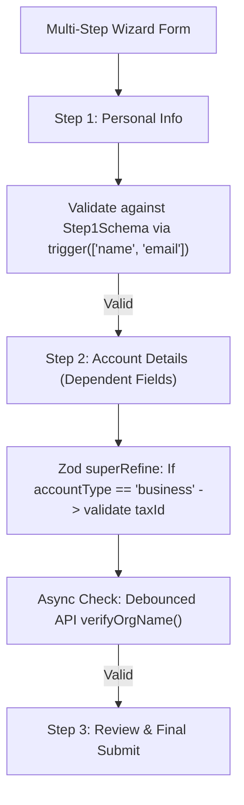

## Scenario

> **How would you handle complex form validation?**

Real-world enterprise forms feature dependent fields (if country == USA, zip code is required), asynchronous checks (is username available?), and multi-step wizard stages. The interviewer tests schema design mastery.

## Fast Revision (10-Second Recall)

- **First Move:** Use **Zod Schema-Driven Validation** with `@hookform/resolvers/zod`.
- **Complex Validation Scenarios:**
- 1. **Dependent / Conditional Fields:** Use Zod `.refine()` or `superRefine()` to validate field B based on field A.
- 2. **Asynchronous Server Checks:** Debounced async username/email availability check via `.refine(async (val) => checkAvailability(val))`.
- 3. **Multi-Step Wizards:** Split schema into step-specific sub-schemas (`step1Schema`, `step2Schema`) and validate only active step fields using `trigger(["stepFields"])`.
- 4. **Cross-Field Passwords:** Verify `password === confirmPassword` in a single schema rule.

## The 30-Second Spoken Script

If asked this in an interview, deliver this structured response:

> *I handle complex form validation by separating validation logic entirely from UI components using schema-driven validation with Zod and React Hook Form.*
>
> *For conditional and dependent validation—such as requiring a tax ID only when corporate account is selected—I use Zod's superRefine method. It provides full access to the entire form payload, allowing me to attach specific errors directly to the targeted field path.*
>
> *For asynchronous server-side validation—such as checking if an email or username is already taken—I incorporate async refinement rules debounced at 400 milliseconds, ensuring we don't flood the backend on every keystroke.*
>
> *For multi-step wizard forms, I define modular schemas for each individual step and combine them into a master union schema. On each step transition, I call React Hook Form's trigger() with the specific field names of that step. The user cannot proceed until the current step passes validation, while unmounted future steps don't block progress.*

## Diagnostic Lifecycle



## Root Causes & Solutions Matrix

| Suspected Layer | Symptoms & Evidence | Immediate Resolution |
| :--- | :--- | :--- |
| **Conditional Field Validation** | Zip code validation fails when user selects country without zip codes. | Use Zod `.superRefine((data, ctx) => { ... })` for conditional logic. |
| **Multi-Step Wizard Bleed** | Step 1 submit button validates hidden fields from Step 3 and blocks navigation. | Validate only active step fields using `form.trigger(["field1", "field2"])`. |
| **Laggy Async Validation** | Checking username availability on every keystroke fires 10 API requests. | Debounce the async check or validate on input `onBlur`. |
| **Password Match Mismatch** | Error for non-matching passwords attached to root form instead of confirmPassword field. | Use `ctx.addIssue({ path: ["confirmPassword"], message: "Passwords must match" })`. |

## Practical Debugging Commands & Code

### Complex Zod Validation: Conditional Fields & Async Checking
```typescript
import { z } from 'zod';

// Mock server validation
async function checkUsernameAvailable(username: string): Promise<boolean> {
  const res = await fetch(`/api/check-username?u=${username}`);
  const data = await res.json();
  return data.isAvailable;
}

export const RegistrationSchema = z
  .object({
    accountType: z.enum(['personal', 'business']),
    taxId: z.string().optional(),
    username: z
      .string()
      .min(3, 'Username must be at least 3 characters')
      // Async server validation check
      .refine(async (val) => await checkUsernameAvailable(val), {
        message: 'Username is already taken',
      }),
    password: z.string().min(8, 'Password must be at least 8 characters'),
    confirmPassword: z.string(),
  })
  // 1. Cross-field validation: Password match
  .refine((data) => data.password === data.confirmPassword, {
    message: 'Passwords do not match',
    path: ['confirmPassword'], // Attach error specifically to confirmPassword field
  })
  // 2. Conditional validation: Business requires tax ID
  .superRefine((data, ctx) => {
    if (data.accountType === 'business' && (!data.taxId || data.taxId.trim() === '')) {
      ctx.addIssue({
        code: z.ZodIssueCode.custom,
        message: 'Tax ID is required for business accounts',
        path: ['taxId'],
      });
    }
  });

export type RegistrationFormValues = z.infer<typeof RegistrationSchema>;
```

## Prevention & Senior Best Practices

1. **Decouple Validation from Components:** Keep Zod schemas in dedicated `.schema.ts` files to enable reuse on both frontend and backend.
2. **Validate on Blur for Async:** Set `mode: "onBlur"` for asynchronous field checks to prevent mid-keystroke network storms.
3. **Preserve Form State Across Steps:** Store wizard data in a parent hook or persistent store so going back to Step 1 does not wipe inputs.
