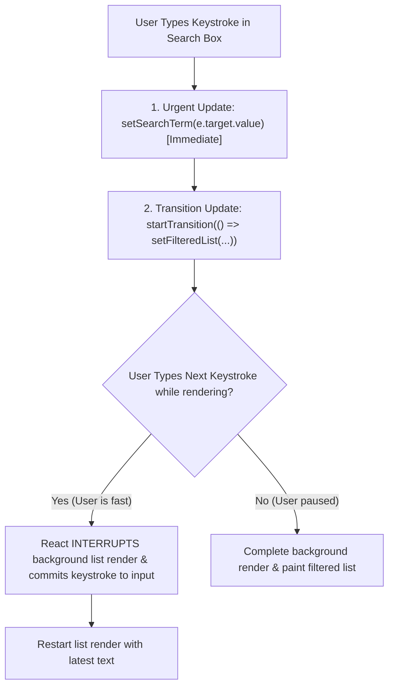

## Scenario

> **How would you handle concurrent state updates?**

When heavy computations (filtering a 5,000-item table) collide with urgent user interactions (typing into an input), the UI freezes. The interviewer evaluates your knowledge of React 18+ concurrency primitives.

## Fast Revision (10-Second Recall)

- **First Move:** Classify state updates into **Urgent Updates** (typing, clicking, toggles) vs **Transition Updates** (filtering, chart rendering, data fetching).
- **The 2 Core Concurrency Primitives:**
- 1. **`startTransition(() => { setFilter(val); })`:** Marks state update as interruptible; browser yields to user keystrokes.
- 2. **`useDeferredValue(query)`:** Defers updating a heavy child tree until the main thread finishes urgent input rendering.
- **Key Metric:** Improves **Interaction to Next Paint (`INP < 200ms`)** and eliminates typing lag.

## The 30-Second Spoken Script

If asked this in an interview, deliver this structured response:

> *To handle concurrent state updates without degrading UI responsiveness, I leverage React 18 and 19's Concurrent Features to separate urgent updates from transition updates.*
>
> *An urgent update—such as typing into a text field, hovering a menu, or pressing a button—requires immediate feedback within 16 milliseconds to prevent perceived lag. In contrast, transition updates—like filtering a large dataset, re-rendering a heavy chart, or switching tabs—can afford to take 100 milliseconds without frustrating the user.*
>
> *When both happen simultaneously, I use startTransition or useDeferredValue. *
>
> *By wrapping the expensive state setter inside startTransition, React marks that render work as low priority and interruptible. If the user types another character while React is halfway through rendering the filtered list, React yields the main thread, renders the new keystroke immediately, and restarts the list render with the latest character.*
>
> *This guarantees a snappy 60 FPS input experience while keeping Interaction to Next Paint (INP) well under the 200ms threshold.*

## Diagnostic Lifecycle



## Root Causes & Solutions Matrix

| Suspected Layer | Symptoms & Evidence | Immediate Resolution |
| :--- | :--- | :--- |
| **Typing Latency (Input Lag)** | Typing in a search box feels sluggish; letters appear with 100ms delay. | Wrap heavy filtering state in `startTransition` or `useDeferredValue`. |
| **Screen Tearing / Freezing** | Clicking a tab freezes the whole page until heavy tab content renders. | Wrap tab navigation in `startTransition` so previous tab remains interactive. |
| **Uncommunicated Pending Work** | User clicks tab; nothing happens visually for 200ms. | Use `isPending` from `useTransition()` to show a subtle loading bar. |
| **Race Condition in Debounce** | Manual timer debounce causes out-of-order rendering on rapid keystrokes. | Replace manual debounce with native `useDeferredValue`. |

## Practical Debugging Commands & Code

### Concurrent Rendering with useTransition and useDeferredValue
```typescript
import React, { useState, useTransition, useDeferredValue } from 'react';

export function ResponsiveFilterableList({ allItems }: { allItems: string[] }) {
  const [inputVal, setInputVal] = useState('');
  const [isPending, startTransition] = useTransition();

  // Urgent update: Always updates the input at 60 FPS
  const handleInputChange = (e: React.ChangeEvent<HTMLInputElement>) => {
    setInputVal(e.target.value);
  };

  // Defer the heavy list calculation: Marks child rendering as interruptible
  const deferredQuery = useDeferredValue(inputVal);

  const filteredItems = React.useMemo(() => {
    if (!deferredQuery) return allItems.slice(0, 100);
    return allItems
      .filter((item) => item.toLowerCase().includes(deferredQuery.toLowerCase()))
      .slice(0, 100);
  }, [allItems, deferredQuery]);

  return (
    <div>
      <input
        type="text"
        value={inputVal}
        onChange={handleInputChange}
        placeholder="Search 10,000 items..."
        className="border p-2 rounded w-full"
      />

      {/* Visual cue when background render is catching up */}
      <div style={{ opacity: inputVal !== deferredQuery ? 0.6 : 1 }}>
        <ul>
          {filteredItems.map((item, idx) => (
            <li key={idx}>{item}</li>
          ))}
        </ul>
      </div>
    </div>
  );
}
```

## Prevention & Senior Best Practices

1. **Prefer `useDeferredValue` over Debounce for Local Data:** Debounce adds an artificial delay; `useDeferredValue` executes as fast as the device CPU allows without lagging.
2. **Keep Urgent Handlers Lightweight:** Never perform array mapping or sorting inside the immediate `onChange` event handler.
3. **Track INP in Production:** Monitor Interaction to Next Paint via `web-vitals` library to detect concurrency bottlenecks on low-end mobile devices.
