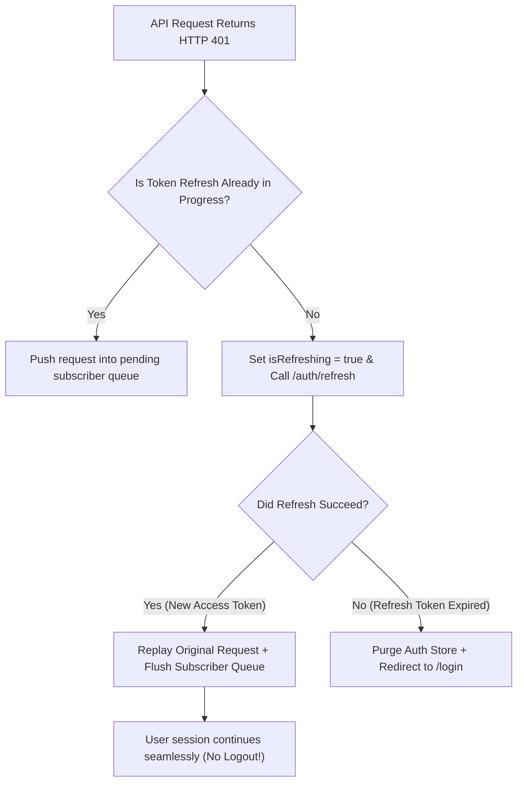

## Scenario

> **How would you handle session expiration?**

A user is typing notes or filling out a form when their 15-minute access token expires. Do you kick them out and wipe their work, or silently refresh the token? Interviewers look for seamless session continuation.

## Fast Revision (10-Second Recall)

- **First Move:** Implement an **Axios / Fetch Response Interceptor** that catches HTTP 401 Unauthorized.
- **The Silent Refresh Queue Pattern:**
- 1. Intercept 401 error response.
- 2. If refresh is already in-flight, push request promise to a subscriber queue.
- 3. Trigger `POST /api/auth/refresh` with httpOnly refresh token.
- 4. If refresh succeeds: Replay all queued failed requests with the new token.
- 5. If refresh fails (refresh token expired): Redirect to `/login?session_expired=true`.

## The 30-Second Spoken Script

If asked this in an interview, deliver this structured response:

> *To handle session expiration gracefully without disrupting active users, I implement a silent token refresh workflow using Axios response interceptors and a request replay queue.*
>
> *When an API call fails with HTTP 401 Unauthorized, our Axios interceptor catches the error. Rather than abruptly redirecting the user to login and discarding their work, the interceptor pauses the request.*
>
> *If a refresh request is already underway, subsequent failed requests are pushed into a pending queue. If this is the first 401, the interceptor calls our POST /auth/refresh endpoint using an httpOnly refresh cookie.*
>
> *If the refresh succeeds, we update our in-memory access token, replay all queued requests with the new token, and resolve their promises. The user never notices anything happened—their screen continues updating without interruption.*
>
> *If the refresh token itself has expired or been revoked, the refresh call fails. Only then do I clear client state, display a friendly toast stating 'Your session has expired', and redirect to /login while saving their current form draft in sessionStorage so no data is lost.*

## Diagnostic Lifecycle



## Root Causes & Solutions Matrix

| Suspected Layer | Symptoms & Evidence | Immediate Resolution |
| :--- | :--- | :--- |
| **Disruptive Logout on Expiration** | User kicked out to login screen in middle of writing a 1,000-word report. | Implement silent refresh token rotation in HTTP response interceptor. |
| **Thundering Herd of Refresh Calls** | 5 parallel API calls 401 at the same time, firing 5 concurrent `/refresh` calls. | Lock with `isRefreshing` flag and queue pending promises. |
| **Infinite Refresh 401 Loop** | `/auth/refresh` itself returns 401, causing interceptor to trigger itself infinitely. | Check `if (error.config.url.includes("/refresh"))` and bypass interceptor. |
| **Lost Drafts on Hard Expiration** | Refresh fails and form data vanishes. | Persist active form draft to `sessionStorage` before navigating to `/login`. |

## Practical Debugging Commands & Code

### Axios Interceptor Silent Token Refresh with Request Queueing
```typescript
import axios, { AxiosError, InternalAxiosRequestConfig } from 'axios';

const apiClient = axios.create({ baseURL: '/api' });

let isRefreshing = false;
let failedQueue: Array<{
  resolve: (value?: any) => void;
  reject: (reason?: any) => void;
}> = [];

const processQueue = (error: any, token: string | null = null) => {
  failedQueue.forEach((prom) => {
    if (error) {
      prom.reject(error);
    } else {
      prom.resolve(token);
    }
  });
  failedQueue = [];
};

apiClient.interceptors.response.use(
  (response) => response,
  async (error: AxiosError) => {
    const originalRequest = error.config as InternalAxiosRequestConfig & { _retry?: boolean };

    // 1. If 401 and not already retried
    if (error.response?.status === 401 && !originalRequest._retry) {
      // Avoid looping if the refresh call itself failed
      if (originalRequest.url?.includes('/auth/refresh')) {
        window.location.href = '/login?expired=true';
        return Promise.reject(error);
      }

      if (isRefreshing) {
        // Queue this request until current refresh finishes
        return new Promise((resolve, reject) => {
          failedQueue.push({ resolve, reject });
        }).then(() => apiClient(originalRequest));
      }

      originalRequest._retry = true;
      isRefreshing = true;

      try {
        // 2. Call refresh endpoint (sends httpOnly cookie)
        const { data } = await axios.post('/api/auth/refresh');
        const newAccessToken = data.accessToken;

        processQueue(null, newAccessToken);
        return apiClient(originalRequest); // Replay original failed request
      } catch (refreshErr) {
        processQueue(refreshErr, null);
        window.location.href = '/login?expired=true';
        return Promise.reject(refreshErr);
      } finally {
        isRefreshing = false;
      }
    }

    return Promise.reject(error);
  }
);
```

## Prevention & Senior Best Practices

1. **Proactive Pre-Expiry Refresh:** Inspect JWT `exp` timestamp in background and refresh 60 seconds before expiration to prevent 401s completely.
2. **Secure Cookie Storage:** Always store refresh tokens in `httpOnly, Secure, SameSite` cookies to prevent XSS theft.
3. **Save Unsaved Work Before Redirect:** Listen to beforeunload or write drafts to `sessionStorage` on session invalidation.
