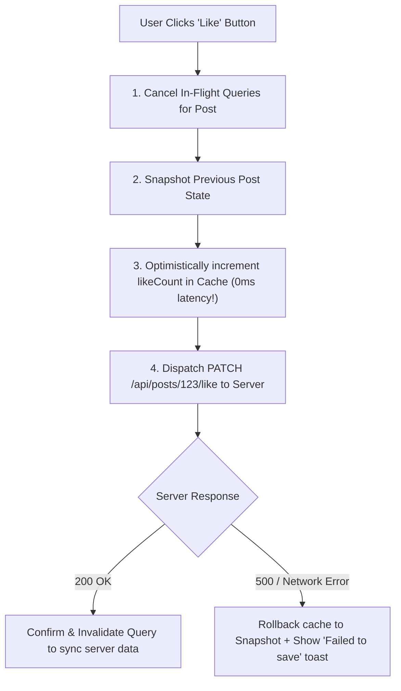

## Scenario

> **How would you implement optimistic UI updates?**

When a user likes a tweet or toggles a task, waiting 400ms for an API response feels sluggish. Optimistic UI updates the screen immediately, assuming success while handling failure rollbacks. The interviewer tests your rollback architecture.

## Fast Revision (10-Second Recall)

- **First Move:** Apply changes to **Client Cache Immediately** before the network request resolves.
- **The 4 Steps of Optimistic UI:**
- 1. **Snapshot:** Save the previous state before mutating for rollback safety.
- 2. **Optimistic Apply:** Mutate local cache immediately (`completed: !todo.completed`).
- 3. **Rollback on Error:** If the server rejects (500/timeout), revert cache to snapshot and alert the user.
- 4. **Revalidate on Settle:** Invalidate query on completion to synchronize with authoritative server state.

## The 30-Second Spoken Script

If asked this in an interview, deliver this structured response:

> *I implement optimistic UI updates to eliminate perceived latency for frequent, high-confidence user actions like liking a post, toggling a checkbox, or favoriting an item.*
>
> *The architecture follows a four-step cycle:
First, when the user triggers the action, I cancel any in-flight queries for that resource to avoid race conditions.*
>
> *Second, I snapshot the current cache state into context so we have an exact rollback reference if anything fails.*
>
> *Third, I immediately apply the predicted update directly to the client-side cache using TanStack Query's setQueryData. To the user, the UI response is instantaneous—0 milliseconds of perceived delay.*
>
> *Fourth, I handle the outcome: If the API succeeds, onSettled revalidates the cache to ensure server consistency. If the API fails with an error or timeout, onError restores the cache from the snapshot and displays an unobtrusive toast notification alerting the user that the action could not be saved.*

## Diagnostic Lifecycle



## Root Causes & Solutions Matrix

| Suspected Layer | Symptoms & Evidence | Immediate Resolution |
| :--- | :--- | :--- |
| **Slow Perceived Latency** | User clicks favorite button; 500ms delay before star turns yellow. | Update state optimistically before dispatching HTTP request. |
| **Silent Server Failure** | Network fails; user thinks item was saved, but refresh loses changes. | Catch server rejection and rollback local state with an error toast. |
| **In-Flight Race Overwrite** | Background refetch overwrites optimistic state before server processes mutation. | Cancel active queries in `onMutate` using `queryClient.cancelQueries()`. |
| **Temporary ID Desync** | Optimistically created item has no real server ID for immediate deletion. | Assign temporary UUID (`temp-123`), replaced with server ID upon 201 Created. |

## Practical Debugging Commands & Code

### Production Optimistic Mutation with TanStack Query
```typescript
import { useMutation, useQueryClient } from '@tanstack/react-query';
import axios from 'axios';

interface Post {
  id: string;
  title: string;
  likes: number;
  isLiked: boolean;
}

export function useOptimisticLike() {
  const queryClient = useQueryClient();

  return useMutation({
    mutationFn: (postId: string) => axios.post(`/api/posts/${postId}/like`),
    
    // 1. Before mutation fires:
    onMutate: async (postId: string) => {
      // Cancel queries to prevent background fetch from overwriting optimistic data
      await queryClient.cancelQueries({ queryKey: ['post', postId] });

      // Snapshot current state for rollback
      const previousPost = queryClient.getQueryData<Post>(['post', postId]);

      // Optimistically update cache IMMEDIATELY
      if (previousPost) {
        queryClient.setQueryData<Post>(['post', postId], {
          ...previousPost,
          likes: previousPost.isLiked ? previousPost.likes - 1 : previousPost.likes + 1,
          isLiked: !previousPost.isLiked,
        });
      }

      // Return context containing snapshot
      return { previousPost };
    },

    // 2. If server call fails: Rollback to snapshot!
    onError: (err, postId, context) => {
      if (context?.previousPost) {
        queryClient.setQueryData(['post', postId], context.previousPost);
      }
      alert('Failed to update like status. Reverted to previous state.');
    },

    // 3. Always revalidate after settlement
    onSettled: (data, error, postId) => {
      queryClient.invalidateQueries({ queryKey: ['post', postId] });
    },
  });
}
```

## Prevention & Senior Best Practices

1. **Use Only for High-Confidence Actions:** Never use optimistic UI for irreversible or sensitive operations like bank transfers, deleting accounts, or booking flights.
2. **Always Provide Clear Rollback Notifications:** If an action fails, explicitly notify the user that their change was reverted.
3. **Generate Temporary Client IDs:** When creating new records optimistically, use `crypto.randomUUID()` so children can be rendered with stable keys.
