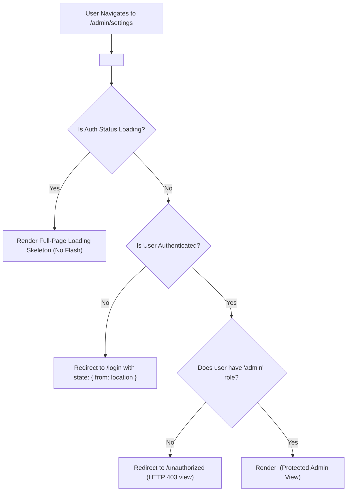

## Scenario

> **How would you implement protected routes?**

Preventing unauthorized users from viewing sensitive pages (e.g. /dashboard or /admin) while preserving smooth authentication redirects. The interviewer evaluates security awareness and routing mastery.

## Fast Revision (10-Second Recall)

- **First Move:** Create a **Route Wrapper Component (`<ProtectedRoute />`)** that inspects authentication state before rendering `<Outlet />`.
- **The 3 Golden Features of Route Guards:**
- 1. **Auth Inspection:** If unauthenticated, redirect to `/login` with `state: { from: location }` to preserve return path.
- 2. **Role / Permission Check:** Verify user has required role (`user.roles.includes("admin")`); otherwise redirect to `/unauthorized`.
- 3. **Loading State Guard:** While auth status is verifying (token verification in flight), render a loading skeleton rather than flashing the login page.
- **Security Axiom:** Frontend route guards protect UX only; **the backend API must always enforce authentication on every request**.

## The 30-Second Spoken Script

If asked this in an interview, deliver this structured response:

> *I implement protected routes in React by creating a composable ProtectedRoute wrapper using React Router.*
>
> *The guard component performs three sequential checks:*
>
> *First, it checks authentication loading status. While the auth token is being validated or refreshed from the server, it displays a loading spinner or skeleton, preventing the embarrassing bug where an authenticated user is prematurely redirected to the login page on a page refresh.*
>
> *Second, if authentication resolves to false, it redirects the user to `/login` using React Router's Navigate component, passing the current location in the navigation state: `state: { from: location }`. Once the user logs in, the login page redirects them straight back to the deep link they were originally trying to access.*
>
> *Third, for role-based authorization, the guard accepts an allowedRoles prop. If an authenticated user lacks the required role, they are redirected to a dedicated 403 /unauthorized page.*
>
> *Finally, I always emphasize that frontend route guards are purely for user experience and navigation flow; the backend API must enforce authentication and permissions on every single API endpoint.*

## Diagnostic Lifecycle



## Root Causes & Solutions Matrix

| Suspected Layer | Symptoms & Evidence | Immediate Resolution |
| :--- | :--- | :--- |
| **Premature Login Redirect** | Page refresh momentarily redirects user to /login before token initializes. | Check `if (isLoading) return <LoadingSpinner />` before evaluating `isAuthenticated`. |
| **Lost Target Destination** | User clicks link to `/orders/999`, logs in, and gets dumped on generic dashboard. | Pass `state={{ from: location }}` and navigate to `state.from` after login. |
| **Insufficient Privilege (403)** | Standard user accesses `/admin` and sees broken blank page with 403 API errors. | Check `user.roles` in guard and route to a clean "Access Denied" page. |
| **False Security Sense** | Hiding frontend routes believed to protect backend data. | Always enforce JWT validation and RBAC checks at API gateway. |

## Practical Debugging Commands & Code

### Production React Router ProtectedRoute & RBAC Implementation
```typescript
import React from 'react';
import { Navigate, Outlet, useLocation } from 'react-router-dom';

interface User {
  id: string;
  roles: string[];
}

interface AuthContextType {
  user: User | null;
  isAuthenticated: boolean;
  isLoading: boolean;
}

// Mock auth hook
declare function useAuth(): AuthContextType;

interface ProtectedRouteProps {
  allowedRoles?: string[];
}

export function ProtectedRoute({ allowedRoles }: ProtectedRouteProps) {
  const { user, isAuthenticated, isLoading } = useAuth();
  const location = useLocation();

  // 1. While auth state is initializing from cookie/token, show skeleton
  if (isLoading) {
    return <div className="h-screen flex items-center justify-center">Verifying session...</div>;
  }

  // 2. If unauthenticated, redirect to login, preserving intended URL
  if (!isAuthenticated || !user) {
    return <Navigate to="/login" state={{ from: location }} replace />;
  }

  // 3. RBAC: Check role requirements
  if (allowedRoles && !allowedRoles.some((role) => user.roles.includes(role))) {
    return <Navigate to="/unauthorized" replace />;
  }

  // 4. Authorized: Render child route
  return <Outlet />;
}

// Router Configuration
// <Route element={<ProtectedRoute allowedRoles={['admin']} />}>
//   <Route path="/admin/dashboard" element={<AdminDashboard />} />
// </Route>
```

## Prevention & Senior Best Practices

1. **Preserve Deep Links:** Always save `location.pathname + location.search` in redirect state so logins return users to their exact destination.
2. **Backend API is the Source of Truth:** Never rely on frontend route guards for data security.
3. **Clean Cookie Invalidation:** When user logs out, purge auth state from memory and invoke backend logout endpoint to clear httpOnly cookies.
