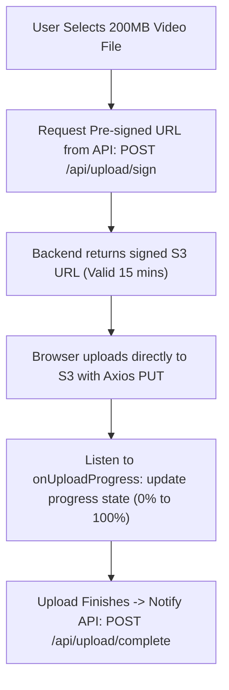

## Scenario

> **How would you manage file uploads with progress indicators?**

Uploading 100MB videos or PDF bundles without progress bars leaves users wondering if the app froze. Interviewers evaluate knowledge of upload streams, XMLHttpRequest vs fetch limitations, and presigned URLs.

## Fast Revision (10-Second Recall)

- **First Move:** Use **Axios `onUploadProgress`** or **XMLHttpRequest `xhr.upload.onprogress`** (native `fetch()` does NOT support request upload progress!).
- **The 3 Upload Architectures:**
- 1. **Small Files (under 10MB):** Multipart form-data via Axios to backend API.
- 2. **Large Files (10MB-5GB):** Direct-to-Cloud (S3/GCS) upload via pre-signed URL (bypasses application server).
- 3. **Massive Files (>5GB / Unstable Network):** Chunked resumable uploads using Tus protocol or S3 Multipart Upload.
- **Progress Math:** `Math.round((event.loaded * 100) / event.total)`.

## The 30-Second Spoken Script

If asked this in an interview, deliver this structured response:

> *To manage file uploads with progress indicators effectively, I choose the transport mechanism based on file size and use Axios or XMLHttpRequest because native fetch() cannot measure upload progress.*
>
> *For standard uploads, native fetch() only tracks download progress on the response; it does not expose progress events for outgoing request payloads. Therefore, I use Axios or XMLHttpRequest to listen to the upload progress event and calculate percentage using event.loaded divided by event.total.*
>
> *For large files exceeding 20MB, uploading through our backend server consumes server memory and ties up API worker threads. Instead, I implement direct-to-storage uploads using Pre-signed URLs. 
The client asks the API for a signed S3 upload URL, and then uploads the binary file directly to S3/Cloud Storage with a PUT request, tracking upload progress on the browser-to-S3 connection.*
>
> *For multi-gigabyte files or spotty network conditions, I use chunked resumable upload protocols like Tus or S3 Multipart Upload, allowing uploads to pause and resume without starting from scratch if the connection drops.*

## Diagnostic Lifecycle



## Root Causes & Solutions Matrix

| Suspected Layer | Symptoms & Evidence | Immediate Resolution |
| :--- | :--- | :--- |
| **Native Fetch Limitation** | Developer tries to track upload progress using `fetch()`; cannot find API. | Use Axios `onUploadProgress` or native `XMLHttpRequest.upload`. |
| **Server Memory Exhaustion** | Multiple concurrent 500MB uploads crash backend application servers. | Bypass backend server: upload directly to S3 via Pre-Signed URLs. |
| **Failed Upload at 98%** | Network drops at 98% of 2GB upload; user has to start over from 0%. | Implement chunked resumable uploads via Tus.io or AWS S3 Multipart Upload. |
| **Client-Side Memory Bloat** | Browser tab consumes 1GB RAM reading file into memory as Base64. | Pass raw `File` object directly into `FormData` or binary stream. |

## Practical Debugging Commands & Code

### Axios Direct Upload with Real-Time Progress Indicator
```typescript
import React, { useState } from 'react';
import axios from 'axios';

export function FileUploader() {
  const [file, setFile] = useState<File | null>(null);
  const [progress, setProgress] = useState<number>(0);
  const [isUploading, setIsUploading] = useState<boolean>(false);
  const [uploadedUrl, setUploadedUrl] = useState<string | null>(null);

  const handleUpload = async () => {
    if (!file) return;

    setIsUploading(true);
    setProgress(0);

    try {
      // 1. Get Pre-signed URL from Backend
      const { data: { presignedUrl, fileUrl } } = await axios.post('/api/upload/presign', {
        filename: file.name,
        contentType: file.type,
      });

      // 2. Upload directly to S3 with progress tracking
      await axios.put(presignedUrl, file, {
        headers: { 'Content-Type': file.type },
        onUploadProgress: (progressEvent) => {
          if (progressEvent.total) {
            const percentCompleted = Math.round(
              (progressEvent.loaded * 100) / progressEvent.total
            );
            setProgress(percentCompleted);
          }
        },
      });

      setUploadedUrl(fileUrl);
    } catch (error) {
      console.error('Upload failed:', error);
      alert('Upload failed. Please check connection and try again.');
    } finally {
      setIsUploading(false);
    }
  };

  return (
    <div className="p-4 border rounded max-w-md">
      <input
        type="file"
        onChange={(e) => setFile(e.target.files?.[0] || null)}
        disabled={isUploading}
      />

      <button
        onClick={handleUpload}
        disabled={!file || isUploading}
        className="mt-3 px-4 py-2 bg-blue-600 text-white rounded disabled:opacity-50"
      >
        {isUploading ? 'Uploading...' : 'Upload File'}
      </button>

      {/* Progress Bar UI */}
      {isUploading && (
        <div className="mt-4">
          <div className="w-full bg-gray-200 rounded-full h-3">
            <div
              className="bg-blue-600 h-3 rounded-full transition-all duration-150"
              style={{ width: `${progress}%` }}
            />
          </div>
          <span className="text-xs text-gray-600 mt-1 block text-right">{progress}%</span>
        </div>
      )}

      {uploadedUrl && (
        <p className="mt-3 text-sm text-green-600 font-medium">
          Upload complete! File available at storage.
        </p>
      )}
    </div>
  );
}
```

## Prevention & Senior Best Practices

1. **Client-Side File Validation:** Validate file size (`file.size > MAX_SIZE`) and MIME type before initiating the upload request.
2. **Cancelable Uploads:** Attach an `AbortController` signal to the upload request so users can cancel long uploads midway.
3. **Drag-and-Drop Feedback:** Show clear visual dragging states (`onDragOver`, `onDragLeave`) to enhance user experience.
