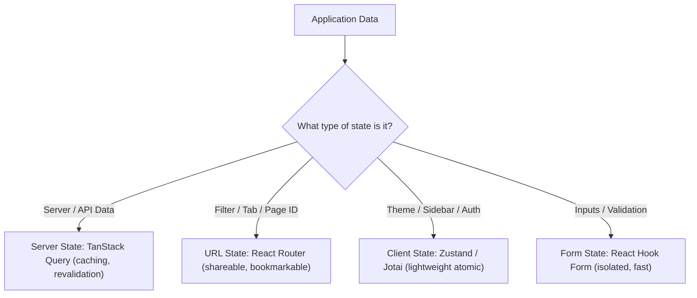

## Scenario

> **How would you manage global application state?**

In legacy React, everything was dumped into a single monolithic Redux store. Today, senior engineers categorize state into distinct operational domains.

## Fast Revision (10-Second Recall)

- **First Move:** Separate state into **4 Distinct Domains** rather than dumping everything into one global store.
- **The 4 Modern State Domains:**
- 1. **Server Cache State:** TanStack Query / SWR / RTK Query (handles caching, fetching, revalidation).
- 2. **URL / Route State:** React Router / Nuxt Router (filters, sorting, active tabs, modal IDs).
- 3. **Client UI State:** Zustand / Jotai / Context (theme, sidebar collapsed, auth session).
- 4. **Ephemeral Form State:** React Hook Form / Formik (validation, touched fields, dirty checks).

## The 30-Second Spoken Script

If asked this in an interview, deliver this structured response:

> *I manage global state by dividing it into four distinct architectural domains rather than maintaining a single monolithic store.*
>
> *First is Server State. Data fetched from an API—such as user profiles, order lists, and product catalogs—does not belong in client state managers. I manage this exclusively with TanStack Query, which provides automatic caching, background revalidation, deduplication, and garbage collection.*
>
> *Second is URL State. Any state that affects what data is shown—such as search queries, filters, active tabs, and pagination offsets—belongs in the URL query string. This ensures users can bookmark, share, and use browser back/forward buttons seamlessly.*
>
> *Third is Client UI State. For true global client-side state like dark mode, sidebar collapsed state, or active modal visibility, I use a lightweight store like Zustand. Zustand avoids the boilerplate of Redux and eliminates the re-render cascades of React Context.*
>
> *Finally, Form State is kept local and isolated using React Hook Form to avoid re-rendering entire component trees on every keystroke. This separation keeps our application modular, scalable, and fast.*

## Diagnostic Lifecycle



## Root Causes & Solutions Matrix

| Suspected Layer | Symptoms & Evidence | Immediate Resolution |
| :--- | :--- | :--- |
| **Server State in Global Store** | Manual Redux reducers for `FETCH_START`, `FETCH_SUCCESS`, `FETCH_ERROR`. | Replace with TanStack Query; eliminates 80% of boilerplate code. |
| **Lost Filter State on Reload** | Refreshing page loses active table filters and sort orders. | Move filter state to URL search parameters (`?sort=desc&status=active`). |
| **Typing Lag from Global State** | Form input keystrokes update global Redux store, re-rendering full layout. | Keep form state local with `react-hook-form`. |
| **Monolithic Context Re-renders** | Toggling dark mode causes data tables and charts to re-render. | Migrate global UI state to Zustand with shallow selectors. |

## Practical Debugging Commands & Code

### Clean Domain-Driven State Architecture
```typescript
// 1. Server State (TanStack Query)
import { useQuery } from '@tanstack/react-query';
export function useUserData(userId: string) {
  return useQuery({
    queryKey: ['users', userId],
    queryFn: () => fetch(`/api/users/${userId}`).then(r => r.json()),
    staleTime: 5 * 60 * 1000,
  });
}

// 2. Client UI State (Zustand)
import { create } from 'zustand';
import { persist } from 'zustand/middleware';

interface UIStore {
  theme: 'light' | 'dark';
  sidebarOpen: boolean;
  toggleSidebar: () => void;
}

export const useUIStore = create<UIStore>()(
  persist(
    (set) => ({
      theme: 'dark',
      sidebarOpen: true,
      toggleSidebar: () => set((s) => ({ sidebarOpen: !s.sidebarOpen })),
    }),
    { name: 'ui-storage' }
  )
);

// 3. URL State (React Router)
import { useSearchParams } from 'react-router-dom';
export function useFilterParams() {
  const [params, setParams] = useSearchParams();
  const search = params.get('q') || '';
  const setSearch = (q: string) => setParams({ q });
  return { search, setSearch };
}
```

## Prevention & Senior Best Practices

1. **Never Duplicate Server Cache:** Do not copy TanStack Query `data` into a `useState` or Zustand store; read directly from the query hook.
2. **Persist Only What is Necessary:** When using `zustand/persist`, whitelist only essential keys (theme, tokens) to prevent local storage quota saturation.
3. **Favor URL Parameters for Navigation:** If an action produces a view the user would expect to share or reload, store it in the URL.
