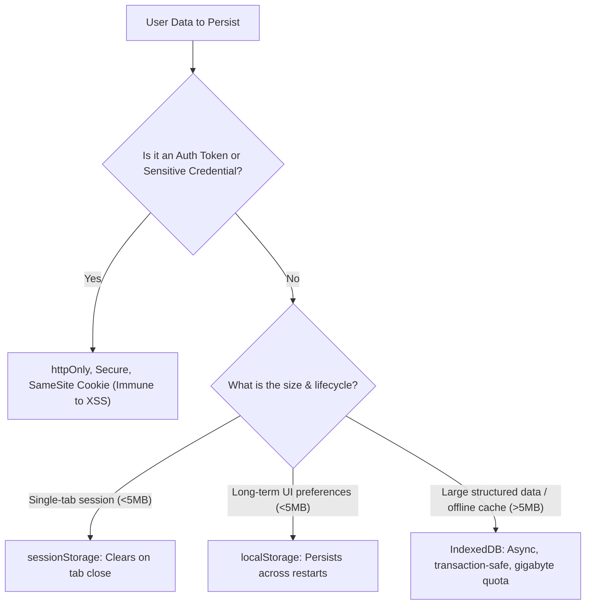

## Scenario

> **How would you persist user data after refreshing the page?**

When users refresh an SPA, in-memory JavaScript state resets to initial defaults. Interviewers evaluate your understanding of web storage mechanisms, security implications (XSS/CSRF), and SSR hydration reconciliation.

## Fast Revision (10-Second Recall)

- **First Move:** Choose storage based on **Data Sensitivity** and **Size Budget**.
- **Storage Decision Matrix:**
- 1. **`localStorage` (5-10MB):** Non-sensitive UI preferences (theme, collapsed sidebar, draft form inputs). Accessible by JS $\rightarrow$ NEVER store raw JWTs/passwords (XSS risk).
- 2. **`sessionStorage` (5MB):** Single-tab ephemeral state (multi-step wizard progress, scroll position). Clears on tab close.
- 3. **`IndexedDB` (Gigabytes):** Large structured datasets, offline document drafts, audio/image blobs.
- 4. **`httpOnly` Cookies:** Authentication session tokens (inaccessible to JavaScript $\rightarrow$ immune to XSS token theft).

## The 30-Second Spoken Script

If asked this in an interview, deliver this structured response:

> *To persist user data across page refreshes, I categorize data by sensitivity and lifecycle requirements.*
>
> *For non-sensitive UI settings—such as dark mode, dashboard layout preferences, or unsubmitted form drafts—I use localStorage. In React, I integrate this via Zustand's persist middleware or custom useLocalStorage hooks.*
>
> *For tab-specific ephemeral data—like multi-step checkout wizard progress—I use sessionStorage so state naturally resets when the tab is closed.*
>
> *For large datasets, cached files, or offline outbox queues exceeding 5MB, I use IndexedDB via Dexie.js for asynchronous, structured storage.*
>
> *Most importantly, for sensitive authentication tokens and session credentials, I avoid localStorage entirely due to XSS vulnerability. Instead, I enforce httpOnly, Secure, SameSite cookies. The browser handles cookie persistence and attaches it to requests automatically, completely shielded from malicious client-side scripts.*

## Diagnostic Lifecycle



## Root Causes & Solutions Matrix

| Suspected Layer | Symptoms & Evidence | Immediate Resolution |
| :--- | :--- | :--- |
| **XSS Token Theft** | JWT stored in `localStorage` stolen via a compromised npm package or script injection. | Store auth tokens in `httpOnly, Secure, SameSite=Strict` cookies. |
| **Synchronous Storage Blocking** | Reading large 5MB JSON string from `localStorage` freezes main thread during initial render. | Migrate large datasets to asynchronous `IndexedDB`. |
| **SSR Hydration Mismatch** | Server renders light mode; client reads dark mode from `localStorage`, throwing hydration error. | Render after mount or use an inline blocking script in HTML head to set theme class. |
| **Storage Quota Exceeded** | `QuotaExceededError` thrown when writing to localStorage on mobile Safari. | Catch quota errors and apply LRU eviction to cache entries. |

## Practical Debugging Commands & Code

### Safe Persistent State Hook with Storage Event Sync
```typescript
import { useState, useEffect } from 'react';

export function useLocalStorage<T>(key: string, initialValue: T): [T, (value: T | ((prev: T) => T)) => void] {
  // Read initial value safely
  const [storedValue, setStoredValue] = useState<T>(() => {
    try {
      const item = window.localStorage.getItem(key);
      return item ? JSON.parse(item) : initialValue;
    } catch (error) {
      console.warn(`Error reading localStorage key "${key}":`, error);
      return initialValue;
    }
  });

  const setValue = (value: T | ((prev: T) => T)) => {
    try {
      const valueToStore = value instanceof Function ? value(storedValue) : value;
      setStoredValue(valueToStore);
      window.localStorage.setItem(key, JSON.stringify(valueToStore));
    } catch (error) {
      console.error(`Error saving to localStorage key "${key}":`, error);
    }
  };

  // Cross-Tab Synchronization: Sync state if another tab modifies storage!
  useEffect(() => {
    const handleStorageChange = (e: StorageEvent) => {
      if (e.key === key && e.newValue) {
        setStoredValue(JSON.parse(e.newValue));
      }
    };

    window.addEventListener('storage', handleStorageChange);
    return () => window.removeEventListener('storage', handleStorageChange);
  }, [key]);

  return [storedValue, setValue];
}
```

## Prevention & Senior Best Practices

1. **Cross-Tab Sync:** Listen to `window.addEventListener("storage")` so changes in Tab A update Tab B without a reload.
2. **Always Wrap JSON.parse in try/catch:** Corrupted or legacy localStorage values will crash your app on startup without error handling.
3. **Never Store PII or Secrets in Web Storage:** Credit cards, passwords, and sensitive health info must never enter client-side storage.
