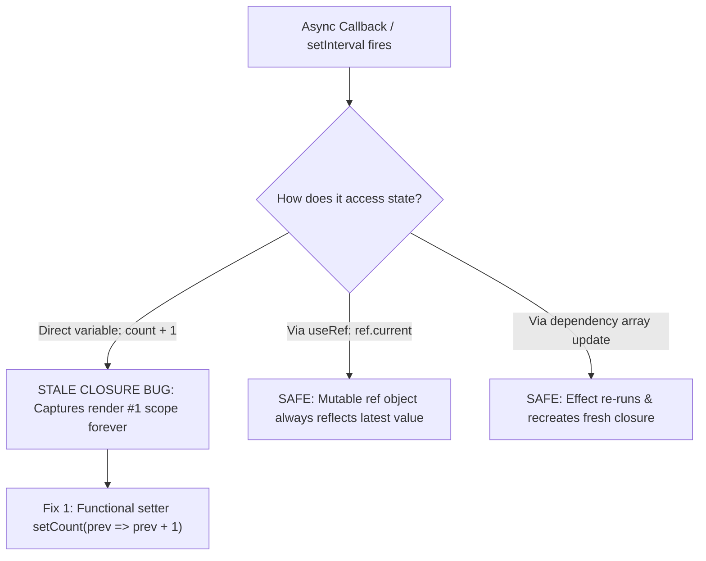

## Scenario

> **How would you prevent stale state issues?**

Stale closures are one of the most common sources of subtle bugs in React. You update state inside an interval, event listener, or async callback, but it reads the value from 5 renders ago. Interviewers expect a deep grasp of JS lexical scope.

## Fast Revision (10-Second Recall)

- **First Move:** Understand that **Functions capture variables at the time of creation**—if an effect closure does not update, it holds onto stale state forever.
- **The 3 Golden Fixes:**
- 1. **Functional State Updaters:** Replace `setCount(count + 1)` with `setCount(prev => prev + 1)` (always reads latest state).
- 2. **Complete Dependency Arrays:** Never lie to React by omitting variables from the `useEffect` / `useCallback` dependency array.
- 3. **`useRef` as Mutable Container:** Store fast-changing values in a ref (`stateRef.current = state`) so async callbacks always read the current value.

## The 30-Second Spoken Script

If asked this in an interview, deliver this structured response:

> *Stale state issues in React stem directly from JavaScript closure mechanics: an asynchronous function or effect callback captures the state variable from the specific render cycle in which it was created.*
>
> *If an interval or event listener is created once on mount with an empty dependency array, it closes over the initial state. Subsequent re-renders produce new state variables, but the original closure continues referencing the stale initial value forever.*
>
> *To prevent and fix stale closures, I use three battle-tested strategies:*
>
> *First, whenever next state depends on previous state, I use functional updates: setCount(prev => prev + 1). Because React passes the guaranteed latest state into the updater function at execution time, the closure never reads stale data.*
>
> *Second, I strictly follow the react-hooks/exhaustive-deps ESLint rule. Any state or prop read inside an effect or callback must be included in the dependency array so the closure is recreated when values change.*
>
> *Third, for long-lived callbacks like debounced functions or WebSocket handlers that cannot afford to recreate on every render, I use a useRef to hold the latest value, updating stateRef.current on every render.*

## Diagnostic Lifecycle



## Root Causes & Solutions Matrix

| Suspected Layer | Symptoms & Evidence | Immediate Resolution |
| :--- | :--- | :--- |
| **`setInterval` Counter Bug** | `setCount(count + 1)` inside `setInterval` increments from 0 to 1 and stays at 1 forever. | Use functional updater: `setCount(prev => prev + 1)`. |
| **Omitted Dependency Array** | Callback reads old prop value because developer suppressed ESLint warnings. | Add missing variable to dependencies or use `useRef`. |
| **Stale WebSocket Handler** | Socket listener only processes messages using initial auth state. | Store active handler in `useRef` and delegate socket events through the ref. |
| **Debounced Search Closure** | Debounced function executes with search query from 3 seconds ago. | Use a custom `useLatest` ref hook to bridge closures. |

## Practical Debugging Commands & Code

### Stale Interval Bug vs Functional Update vs useLatest Ref Hook
```typescript
import React, { useState, useEffect, useRef } from 'react';

// ❌ BROKEN: Stale closure inside setInterval
export function BrokenTimer() {
  const [count, setCount] = useState(0);

  useEffect(() => {
    const id = setInterval(() => {
      // count is ALWAYS 0 from initial render closure!
      setCount(count + 1); 
    }, 1000);
    return () => clearInterval(id);
  }, []); // Empty deps means closure is never refreshed!

  return <div>Count: {count}</div>;
}

// ✅ FIX 1: Functional State Updater (Cleanest for state math)
export function FixedTimer() {
  const [count, setCount] = useState(0);

  useEffect(() => {
    const id = setInterval(() => {
      // React injects the TRUE current value at execution time!
      setCount((prevCount) => prevCount + 1);
    }, 1000);
    return () => clearInterval(id);
  }, []);

  return <div>Count: {count}</div>;
}

// ✅ FIX 2: useLatest Ref Pattern (For complex callbacks/handlers)
export function useLatest<T>(value: T) {
  const ref = useRef(value);
  ref.current = value; // Always updated to latest render value!
  return ref;
}

export function SocketWatcher({ userId }: { userId: string }) {
  const latestUserId = useLatest(userId);

  useEffect(() => {
    const handleMessage = () => {
      // Always reads the current userId without re-subscribing socket!
      console.log('Processing for user:', latestUserId.current);
    };

    window.addEventListener('custom-socket-event', handleMessage);
    return () => window.removeEventListener('custom-socket-event', handleMessage);
  }, []); // No need to re-attach on userId change!

  return <div>Socket Active</div>;
}
```

## Prevention & Senior Best Practices

1. **Never Disable `exhaustive-deps`:** Treat ESLint dependency warnings as critical build errors.
2. **Use `useLatest` Hook:** Create a reusable `useLatest(value)` hook to read fresh props/state inside stable callbacks.
3. **Adopt React 19 `useEffectEvent`:** Use modern Effect Events to separate reactive logic from non-reactive event handlers.
