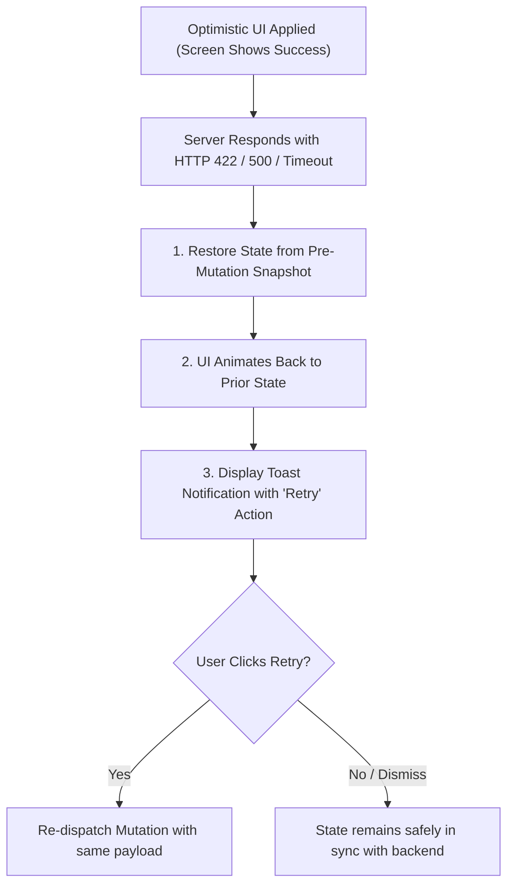

## Scenario

> **What would you do if an optimistic update fails on the server?**

Follow-up to optimistic UI: what happens when the optimistic assumption is wrong (server 500, validation error, permission denied)? The interviewer evaluates error recovery and user trust preservation.

## Fast Revision (10-Second Recall)

- **First Move:** Execute an **Atomic Rollback** from the stored pre-mutation snapshot.
- **The 3 Recovery Pillars:**
- 1. **Silent Rollback with Feedback:** Animate the element back to its prior state (e.g. switch flips back) and show an actionable error banner.
- 2. **Actionable Retry:** Provide a "Retry" button directly on the error toast so the user does not have to retype.
- 3. **Preserve Form Input:** Never clear form fields on server error; preserve user text so nothing is lost.

## The 30-Second Spoken Script

If asked this in an interview, deliver this structured response:

> *When an optimistic update fails on the server, the primary goal is restoring data integrity while transparently communicating the failure without frustrating the user.*
>
> *First, I immediately trigger the rollback using the pre-mutation snapshot captured in onMutate. In the UI, the state cleanly reverts to its prior value—for example, a toggled checkbox unchecks or an incremented counter decrements.*
>
> *Second, I provide contextual feedback rather than a generic error modal. I display a non-blocking toast notification: 'Unable to save change. Server unreachable.' *
>
> *Third, I provide an actionable recovery path. The toast includes an immediate 'Retry' button. If the failure was due to a transient network timeout, clicking retry attempts the mutation again without requiring the user to re-navigate.*
>
> *Fourth, if the failure was an optimistic creation—such as drafting a comment—I never wipe out the user's typed input. The comment card highlights in red with a 'Failed to send - Tap to retry' banner, ensuring zero user input is ever lost.*

## Diagnostic Lifecycle



## Root Causes & Solutions Matrix

| Suspected Layer | Symptoms & Evidence | Immediate Resolution |
| :--- | :--- | :--- |
| **Silent Inconsistency** | UI shows item as completed, but backend rejected it; page reload exposes discrepancy. | Rollback cache immediately on `onError`. |
| **Lost User Text** | Optimistically submitted comment fails; whole form is wiped out. | Keep draft comment in local state or outbox queue; flag with "Failed to send". |
| **Aggressive Error Modals** | A failed background like action interrupts user with a full-screen alert dialog. | Use non-intrusive floating toasts with undo/retry triggers. |
| **Concurrent Conflict (409)** | Another user edited the document while user was typing offline. | Present side-by-side diff modal allowing user to choose which version to keep. |

## Practical Debugging Commands & Code

### Resilient Failure Recovery with Outbox Retry Pattern
```typescript
import React, { useState } from 'react';

interface Task {
  id: string;
  text: string;
  completed: boolean;
  isSyncError?: boolean;
}

export function TaskItem({ task: initialTask }: { task: Task }) {
  const [task, setTask] = useState<Task>(initialTask);

  const toggleTask = async () => {
    // 1. Snapshot prior state
    const priorState = { ...task };

    // 2. Optimistic Update
    setTask((prev) => ({ ...prev, completed: !prev.completed, isSyncError: false }));

    try {
      const res = await fetch(`/api/tasks/${task.id}`, {
        method: 'PATCH',
        headers: { 'Content-Type': 'application/json' },
        body: JSON.stringify({ completed: !priorState.completed }),
      });

      if (!res.ok) throw new Error('Server rejected mutation');
    } catch (error) {
      // 3. Rollback to prior state + flag sync error
      setTask({
        ...priorState,
        isSyncError: true,
      });
    }
  };

  return (
    <div className="flex items-center gap-3 p-2 border rounded">
      <input
        type="checkbox"
        checked={task.completed}
        onChange={toggleTask}
      />
      <span className={task.completed ? 'line-through text-gray-400' : ''}>
        {task.text}
      </span>

      {/* 4. Actionable Recovery Toast / Banner */}
      {task.isSyncError && (
        <div className="text-xs text-red-500 flex items-center gap-1">
          <span>Failed to save.</span>
          <button onClick={toggleTask} className="underline font-semibold">
            Retry
          </button>
        </div>
      )}
    </div>
  );
}
```

## Prevention & Senior Best Practices

1. **Server Concurrency Checking:** Backend should support optimistic locking via `ETag` or `version` columns to reject outdated writes with HTTP 409 Conflict.
2. **Persistent Outbox for Critical Writes:** Queue failed writes in IndexedDB so they automatically retry when connectivity restores.
3. **Validate Client-Side Before Sending:** Run client-side Zod validation before optimistic application so client validation errors never trigger unnecessary rollbacks.
