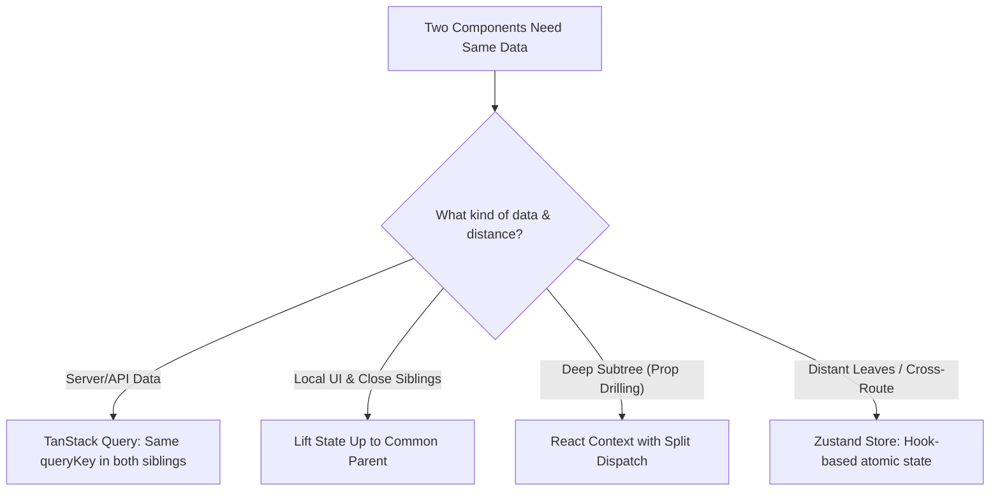

## Scenario

> **Two components need the same data. How would you share state?**

A fundamental architecture question: Component A (SearchInput) and Component B (ResultList) are siblings under a common parent. The interviewer wants to evaluate when to lift state vs when to introduce global stores.

## Fast Revision (10-Second Recall)

- **First Move:** Apply the simplest pattern first: **Lifting State Up** to their nearest common ancestor.
- **Decision Tree:**
- 1. **Close Siblings (1-2 levels):** Lift state to common parent and pass down via props/callbacks.
- 2. **Moderate Depth / Multiple Siblings:** React Context API (with split contexts to prevent over-rendering).
- 3. **Cross-Route or Distant Trees:** External micro-store like **Zustand** or **Jotai** (atomic state with fine-grained selectors).
- 4. **Server Data:** TanStack Query cache (both components query the same `queryKey`).

## The 30-Second Spoken Script

If asked this in an interview, deliver this structured response:

> *To share state between two sibling components, I choose the solution that introduces the least architectural complexity based on component distance.*
>
> *For close siblings sharing local UI state—such as a search input and a table inside the same card—the cleanest approach is Lifting State Up to their nearest common parent. The parent manages the useState hook and passes the value to one sibling and the updater callback to the other.*
>
> *If the siblings are deeply nested or separated by intermediary layout components where prop-drilling becomes tedious, I use React Context. I make sure to separate state from dispatch into two distinct contexts to avoid unnecessary re-renders.*
>
> *For distant siblings across completely different page sections or navigation routes, I avoid deep context trees and use a lightweight atomic state manager like Zustand. Zustand allows both components to subscribe to the exact same store without mounting a global provider.*
>
> *Finally, if the shared data originates from an API, I use TanStack Query. Both siblings call useQuery with the exact same queryKey; React Query automatically deduplicates the request and synchronizes state between both components.*

## Diagnostic Lifecycle



## Root Causes & Solutions Matrix

| Suspected Layer | Symptoms & Evidence | Immediate Resolution |
| :--- | :--- | :--- |
| **Close Siblings** | Search bar and filter pills inside same container need shared filter string. | Lift state to the common parent and pass via props. |
| **Prop Drilling Hell** | Passing `userTheme` through 6 levels of layout components that don't use it. | Wrap subtree in a React Context provider. |
| **Cross-Page Sync** | Header shopping cart count must sync with Product Card "Add to Cart" button. | Use a global Zustand store: `useCartStore(s => s.count)`. |
| **Cached API Sync** | Both UserMenu and SettingsPage fetch the user profile independently. | Use TanStack Query with `queryKey: ["user", "profile"]`. |

## Practical Debugging Commands & Code

### Lifting State Up vs Zustand Atomic Store
```typescript
// Approach 1: Lifting State Up (For local close siblings)
import React, { useState } from 'react';

function SearchInput({ value, onChange }: { value: string; onChange: (v: string) => void }) {
  return <input value={value} onChange={(e) => onChange(e.target.value)} placeholder="Filter items..." />;
}

function ItemList({ filter }: { filter: string }) {
  return <div>Filtered for: {filter}</div>;
}

export function ParentContainer() {
  const [filterText, setFilterText] = useState('');
  return (
    <div>
      <SearchInput value={filterText} onChange={setFilterText} />
      <ItemList filter={filterText} />
    </div>
  );
}

// Approach 2: Zustand Store (For distant siblings without prop drilling)
import { create } from 'zustand';

interface FilterStore {
  filter: string;
  setFilter: (val: string) => void;
}

export const useFilterStore = create<FilterStore>((set) => ({
  filter: '',
  setFilter: (filter) => set({ filter }),
}));

// Sibling A anywhere in the tree
export function SiblingSearch() {
  const { filter, setFilter } = useFilterStore();
  return <input value={filter} onChange={(e) => setFilter(e.target.value)} />;
}

// Sibling B anywhere in the tree
export function SiblingDisplay() {
  const filter = useFilterStore((state) => state.filter);
  return <div>Active Filter: {filter}</div>;
}
```

## Prevention & Senior Best Practices

1. **Do Not Over-Engineer:** Never reach for Redux/Zustand when a simple `useState` in a parent component suffices.
2. **Separate Server State from UI State:** Never copy API responses into Redux/Zustand; manage server data with TanStack Query and client state with Zustand.
3. **Colocate State:** Keep state as close as possible to the components that read and write it.
