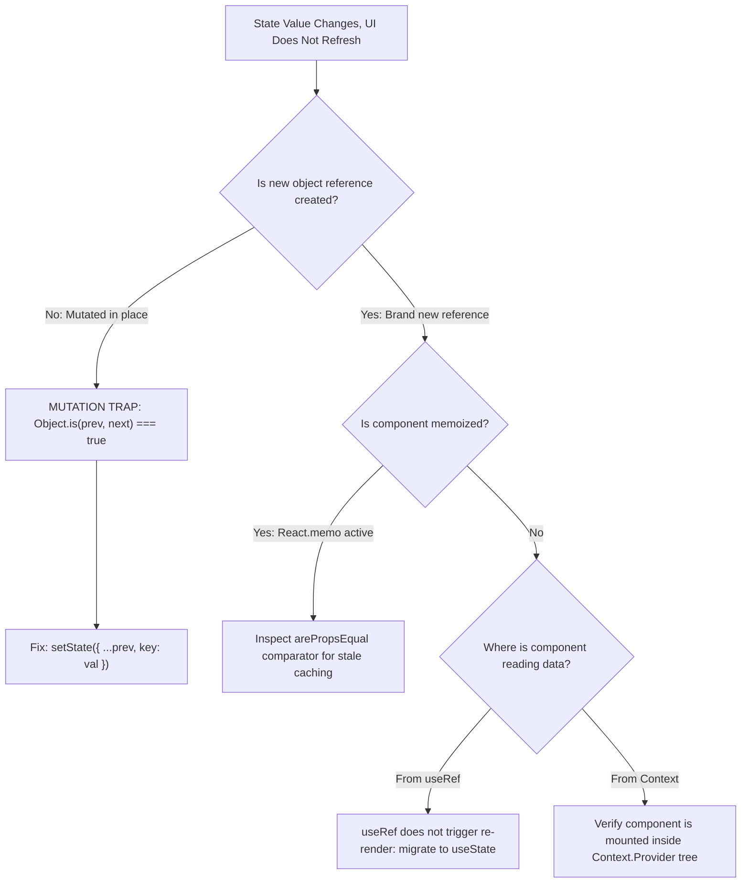

## Scenario

> **Your state updates, but the UI doesn't refresh. How would you debug it?**

You call setState or dispatch an action, React DevTools shows state changed, but the screen does not update. The interviewer tests your knowledge of React reconcile heuristics and reference identity.

## Fast Revision (10-Second Recall)

- **First Move:** Verify whether state was **mutated in-place** (e.g. `user.name = "Bob"; setUser(user)`). React compares `Object.is(prevState, nextState)`; if references match, React skips re-rendering!
- **Primary Suspects:**
- 1. **Mutated Object/Array:** Always return a new reference via spread (`{ ...user }`, `[...items]`).
- 2. **Component Not Subscribed:** Component reads from a ref (`useRef`) or parent prop that was not passed down.
- 3. **Memoization Trap:** `React.memo` or `shouldComponentUpdate` custom comparison returning `true` incorrectly.
- 4. **State in Unrelated Tree:** Updating a context that wraps a different sibling branch.

## The 30-Second Spoken Script

If asked this in an interview, deliver this structured response:

> *When state updates in code but the UI does not refresh, the primary culprit in React is direct object or array mutation violating reference equality.*
>
> *React uses Object.is() shallow comparison to decide whether a state update requires re-rendering. If a developer pushes to an array or updates an object property in-place and passes that same object reference into setState, React concludes that previous and next states are identical and skips the render phase.*
>
> *My debugging procedure is:
First, check the state update logic: are we creating a brand new reference with object spread, array spread, or structuredClone?*
>
> *Second, check if the component is wrapped in React.memo or has a custom arePropsEqual comparator that is shallowly comparing props and incorrectly reporting that props haven't changed.*
>
> *Third, verify if the component is reading from a useRef instead of useState. Changing a ref.current value does not trigger a re-render.*
>
> *Finally, verify that the component is actually placed inside the Context Provider whose state is mutating, rather than mounted outside or in a disconnected React portal.*

## Diagnostic Lifecycle



## Root Causes & Solutions Matrix

| Suspected Layer | Symptoms & Evidence | Immediate Resolution |
| :--- | :--- | :--- |
| **Reference Equality Violation** | `arr.push()` called followed by `setArr(arr)`; no render triggered. | Create a new array reference: `setArr([...arr, newItem])`. |
| **Custom React.memo Flaw** | Parent passes updated callbacks/props, but child never re-renders. | Audit custom `arePropsEqual(prev, next)` function; ensure new prop keys are checked. |
| **Reading from `useRef`** | `countRef.current++` executed; UI remains on old number. | Refs are for mutable non-visual values; use `useState` for visual data. |
| **Multiple Context Instances** | Nested providers shadow each other; component reads from upper unchanged provider. | Remove duplicate providers; verify provider hierarchy in React DevTools. |

## Practical Debugging Commands & Code

### Debugging Reference Equality & React.memo Prop Comparison
```typescript
import React, { useState } from 'react';

interface Profile {
  name: string;
  preferences: { theme: string };
}

// ❌ ANTI-PATTERN: In-place mutation
export function BuggyProfile() {
  const [profile, setProfile] = useState<Profile>({
    name: 'Alice',
    preferences: { theme: 'dark' }
  });

  const toggleTheme = () => {
    // BUG: Modifying nested property directly retains same root reference!
    profile.preferences.theme = 'light';
    setProfile(profile); // React skips render: Object.is(old, new) is true!
  };

  return <button onClick={toggleTheme}>Theme: {profile.preferences.theme}</button>;
}

// ✅ FIXED PATTERN: Deep Immutability via Spread or Immer
export function FixedProfile() {
  const [profile, setProfile] = useState<Profile>({
    name: 'Alice',
    preferences: { theme: 'dark' }
  });

  const toggleTheme = () => {
    setProfile(prev => ({
      ...prev,
      preferences: {
        ...prev.preferences,
        theme: prev.preferences.theme === 'dark' ? 'light' : 'dark'
      }
    }));
  };

  return <button onClick={toggleTheme}>Theme: {profile.preferences.theme}</button>;
}
```

## Prevention & Senior Best Practices

1. **Use Immutable Libraries:** Adopt Immer (`useImmer` or Zustand `immer` middleware) to safely write mutating-style code that produces immutable objects.
2. **TypeScript Readonly Modifier:** Mark state interfaces with `readonly` so mutating properties triggers IDE compile errors.
3. **Avoid Over-Memoization:** Do not wrap components in `React.memo` unless profiling proves rendering overhead.
