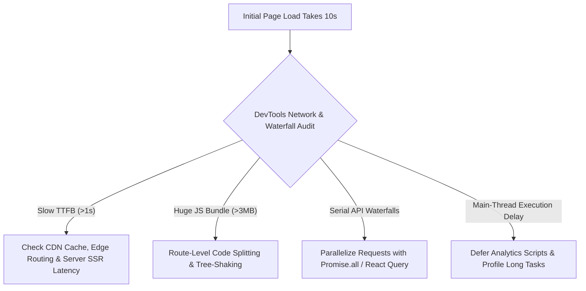

## Scenario

> **Your React/Angular application takes 10 seconds to load. How would you optimize it?**

Initial load latency (LCP/FCP) is the most critical frontend performance metric. The interviewer wants to test your knowledge of Chrome DevTools Network and Performance panels, bundle budgets, waterfall elimination, and modern rendering strategies (SSR/SSG vs CSR).

## Fast Revision (10-Second Recall)

- **First Move:** Open Chrome DevTools **Network & Performance panels** under 4G throttling to measure TTFB, Bundle download time, and Script execution time.
- **Primary Suspects:** Monolithic un-split JavaScript bundle (>5MB), blocking CSS/fonts in `<head>`, uncompressed static assets (no Brotli/Gzip), serial API waterfalls before rendering, and unoptimized high-res images.
- **Key Fixes:** Route-based code splitting (`React.lazy`), Brotli compression on CDN, defer/async third-party tags, preload critical fonts, and convert client-side data waterfalls to parallel requests or SSR/SSG.
- **Key Metrics:** First Contentful Paint (`FCP < 1.8s`), Largest Contentful Paint (`LCP < 2.5s`), Total Blocking Time (`TBT < 200ms`).

## The 30-Second Spoken Script

If asked this in an interview, deliver this structured response:

> *I diagnose frontend load times by analyzing the browser critical rendering path using Chrome DevTools Lighthouse and Network waterfalls.*
>
> *First, I determine where the 10 seconds are spent: is it network transfer time (massive bundles or slow TTFB) or main-thread JavaScript execution time?*
>
> *If network transfer is the bottleneck, I inspect bundle size with webpack-bundle-analyzer or rollup-plugin-visualizer. I split vendor chunks, implement route-based code splitting with React.lazy and Suspense, enable Brotli compression on our CDN, and optimize static assets with modern AVIF/WebP formats.*
>
> *If main-thread execution is blocking rendering, I audit third-party tracking scripts, defer non-critical JS, and consider server-side rendering (SSR) or streaming SSR to deliver fast first-paint HTML. Finally, I enforce Lighthouse CI bundle budgets in our PR pipeline to ensure regressions never reach production.*

## Diagnostic Lifecycle



## Root Causes & Solutions Matrix

| Suspected Layer | Symptoms & Evidence | Immediate Resolution |
| :--- | :--- | :--- |
| **Monolithic JS Bundle** | A single 6MB main.js downloaded over 4G; browser blocks parsing. | Implement route-based dynamic imports (`React.lazy`), split vendor chunks (`splitChunks.optimization`), and tree-shake unused exports. |
| **Uncompressed Assets** | Network tab shows Content-Encoding missing; raw text transfer. | Enable Brotli (`br`) and Gzip on Cloudflare / CloudFront / Nginx; reduces text bundles by up to 75%. |
| **Render-Blocking Resources** | Heavy sync `<script>` or web font downloads block DOM tree construction. | Add `defer` or `async` to non-critical scripts; use `font-display: swap` and `<link rel="preload">` for primary font. |
| **Client-Side API Waterfalls** | Parent component renders, fetches data, child mounts, fetches more data. | Parallelize data fetching at the route loader level (TanStack Query, Next.js page loaders) or prefetch on hover. |
| **Heavy Unoptimized Hero Image** | LCP element is a 4K PNG file taking 6s to download. | Convert to WebP/AVIF, serve responsive `srcset`, add `fetchpriority="high"`, and lazy-load below-the-fold media. |

## Practical Debugging Commands & Code

### Vite / Rollup Manual Chunks & Dynamic Route Splitting
```typescript
// 1. Route-Based Code Splitting in React
import React, { Suspense, lazy } from 'react';
import { BrowserRouter, Routes, Route } from 'react-router-dom';
import SkeletonLoader from './components/SkeletonLoader';

const Dashboard = lazy(() => import(/* webpackChunkName: "dashboard" */ './pages/Dashboard'));
const Settings = lazy(() => import(/* webpackChunkName: "settings" */ './pages/Settings'));

export function App() {
  return (
    <BrowserRouter>
      <Suspense fallback={<SkeletonLoader />}>
        <Routes>
          <Route path="/dashboard" element={<Dashboard />} />
          <Route path="/settings" element={<Settings />} />
        </Routes>
      </Suspense>
    </BrowserRouter>
  );
}

// 2. vite.config.ts - Vendor Chunk Splitting
import { defineConfig } from 'vite';

export default defineConfig({
  build: {
    rollupOptions: {
      output: {
        manualChunks: {
          vendor_react: ['react', 'react-dom', 'react-router-dom'],
          vendor_charts: ['recharts', 'd3'],
        },
      },
    },
    chunkSizeWarningLimit: 500, // Warn if single chunk exceeds 500kB
  },
});
```

## Prevention & Senior Best Practices

1. **Bundle Budget CI Gates:** Run `@bundlesize/audit` or Lighthouse CI on every pull request; fail builds if the initial JS bundle exceeds 150kB gzipped.
2. **Edge CDN Caching:** Serve static JS/CSS chunks with `Cache-Control: public, max-age=31536000, immutable` alongside content-hashed filenames.
3. **Eliminate Barrel Exports:** Avoid importing from root barrels (`import { Button } from "huge-ui-lib"`) if the library does not support ESM tree-shaking; import direct modules.
