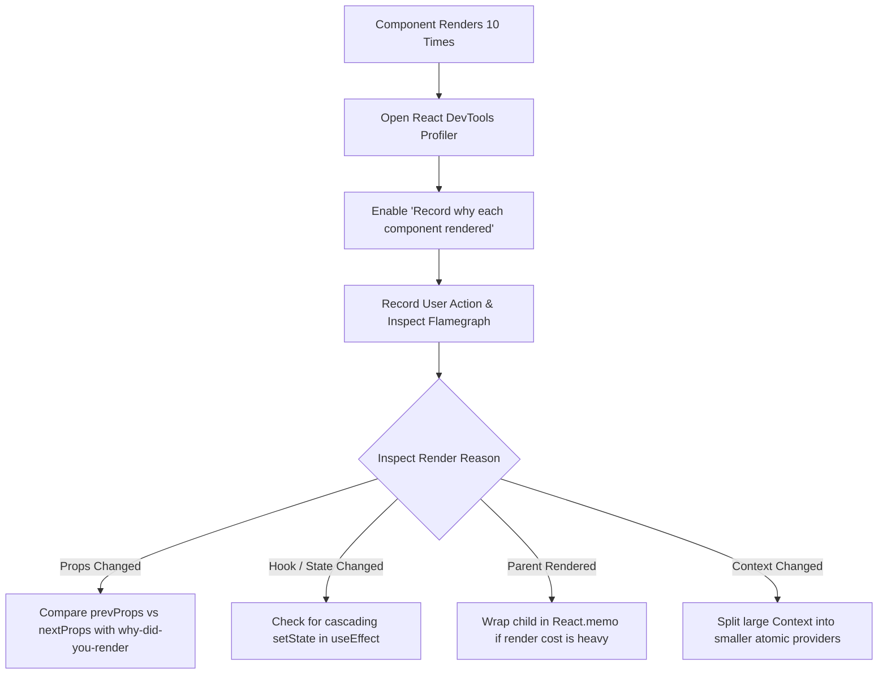

## Scenario

> **Your component renders 10 times unnecessarily. How would you identify the reason?**

Uncontrolled re-rendering degrades user interaction latency (INP). Interviewers want to see whether you understand how React trigger-render-commit phases work and how to track reference identity changes.

## Fast Revision (10-Second Recall)

- **First Move:** Open **React DevTools Profiler**, check "Record why each component rendered while profiling", perform the action, and inspect the flamegraph.
- **Primary Suspects:** Inline object/array literals passed as props (`style={{}}`, `onClick={() => {}}`), unstable parent state cascades, unmemoized context values triggering all consumers, or setting state inside effects.
- **Key Tool:** `@welldone-software/why-did-you-render` (WDYR) automatically logs shallow vs deep prop changes in console.
- **Fix:** Stabilize reference identities with `useCallback`, `useMemo`, and split bloated Context into targeted atomic stores.

## The 30-Second Spoken Script

If asked this in an interview, deliver this structured response:

> *To identify why a component is re-rendering 10 times, I avoid guessing and use profiling tools.*
>
> *First, I record the interaction in React DevTools Profiler with "Record why each component rendered" enabled in settings. When I click on the offending component in the flamegraph, React DevTools explicitly states: "Props changed: (foo, onClick)" or "Parent component rendered" or "Hook 2 changed".*
>
> *If props are reported as changed, I check if their values are identical by value but different by reference—such as inline functions, inline objects, or new array filters created directly in JSX.*
>
> *For persistent issues, I hook up why-did-you-render in development to print color-coded console diffs showing whether a re-render was avoidable. I then stabilize function and object references using useCallback and useMemo, or lift the state closer to the leaf nodes.*

## Diagnostic Lifecycle



## Root Causes & Solutions Matrix

| Suspected Layer | Symptoms & Evidence | Immediate Resolution |
| :--- | :--- | :--- |
| **Unstable Object/Function Props** | React Profiler shows `onClick` or `filterConfig` changed on every tick. | Wrap callbacks in `useCallback` and objects/arrays in `useMemo`. |
| **Cascading setState in Effects** | State change A triggers `useEffect`, which updates state B, which triggers state C. | Consolidate multiple states into a single `useReducer` or compute values during render. |
| **Bloated Context Provider** | Updating user avatar causes unrelated table components inside same provider to re-render. | Split Context into separate `UserDataContext` and `UserActionsContext`, or migrate to Zustand. |
| **Parent Re-rendering** | Parent re-renders on keystroke, causing all unmemoized children to execute. | Move state down into the input component, or use `React.memo` for expensive subtrees. |

## Practical Debugging Commands & Code

### Diagnosing Re-renders with why-did-you-render & Reference Stabilization
```typescript
// 1. Diagnosing with why-did-you-render (wdyr.ts)
import React from 'react';

if (process.env.NODE_ENV === 'development') {
  const whyDidYouRender = require('@welldone-software/why-did-you-render');
  whyDidYouRender(React, {
    trackAllPureComponents: true,
  });
}

// 2. Fixing Unstable References in Component
import React, { useState, useCallback, useMemo } from 'react';

interface RowItemProps {
  id: string;
  config: { theme: string };
  onSelect: (id: string) => void;
}

// Memoized leaf component
export const RowItem = React.memo(function RowItem({ id, config, onSelect }: RowItemProps) {
  return (
    <button onClick={() => onSelect(id)}>
      Item {id} ({config.theme})
    </button>
  );
});

// Parent container
export function TableList({ items }: { items: string[] }) {
  const [theme, setTheme] = useState('dark');

  // Stable function reference
  const handleSelect = useCallback((id: string) => {
    console.log('Selected:', id);
  }, []);

  // Stable object reference
  const config = useMemo(() => ({ theme }), [theme]);

  return (
    <div>
      {items.map((id) => (
        <RowItem key={id} id={id} config={config} onSelect={handleSelect} />
      ))}
    </div>
  );
}
```

## Prevention & Senior Best Practices

1. **Colocate State:** Keep state as close to where it is consumed as possible; do not lift state to root unless globally necessary.
2. **Use React Compiler (React 19):** Leverage automatic memoization to eliminate manual `useMemo` and `useCallback` boilerplate.
3. **Selector-Based Subscriptions:** Use libraries like Zustand or Redux Toolkit with shallow equality selectors so components re-render only when their targeted property changes.
