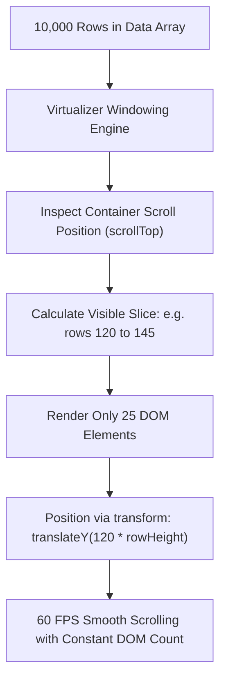

## Scenario

> **Your page contains 10,000 rows. How would you display them efficiently?**

Rendering 10,000 raw DOM elements destroys frame rates, spikes browser memory to hundreds of megabytes, and causes noticeable scrolling stutter (jank). Interviewers evaluate your knowledge of windowing/virtualization.

## Fast Revision (10-Second Recall)

- **First Move:** Implement **DOM Virtualization (Windowing)**—render only the 20-30 rows currently visible in the viewport plus a small buffer.
- **Key Concept:** Calculate total scrollable height dynamically (`totalItems * rowHeight`) with an absolute positioned container and translate visible rows using CSS `transform: translateY()`.
- **Top Libraries:** `@tanstack/react-virtual` (headless, modern, supports dynamic heights), `react-window`, or `react-virtualized`.
- **Alternative Strategy:** Cursor-based pagination or infinite scroll with backend filtering if 10k rows do not need to be loaded in memory.

## The 30-Second Spoken Script

If asked this in an interview, deliver this structured response:

> *Rendering 10,000 full DOM nodes simultaneously will cripple browser performance, consuming excessive memory and causing severe scroll jank.*
>
> *The production solution is DOM Virtualization, commonly implemented using TanStack Virtual or react-window.*
>
> *Instead of mounting 10,000 DOM elements, virtualization computes the scroll offset and renders only the small slice of elements—typically 20 to 30 rows—that are currently visible in the viewport, plus a 5-row buffer above and below. *
>
> *As the user scrolls, rows entering the viewport are mounted and rows leaving are unmounted, reusing the exact same minimal DOM footprint.*
>
> *If the rows have dynamic heights, I enable dynamic measurement with ResizeObserver. Combined with CSS contain-intrinsic-size and transform: translateY for GPU-accelerated positioning, 10,000 rows can be scrolled smoothly at a constant 60 frames per second.*

## Diagnostic Lifecycle



## Root Causes & Solutions Matrix

| Suspected Layer | Symptoms & Evidence | Immediate Resolution |
| :--- | :--- | :--- |
| **Naive Full Render** | Mounting 10k rows takes 4 seconds of main thread freezing; 500MB browser RAM. | Mount only visible rows using `@tanstack/react-virtual`. |
| **Dynamic Row Heights** | Text wrapping causes rows to have unpredictable heights, breaking static math. | Use `virtualizer.measureElement` with a `ref` on each row to compute heights dynamically via ResizeObserver. |
| **Scroll Stuttering / Blank Gaps** | Fast scrolling reveals blank space momentarily before rows render. | Increase the `overscan` buffer property (e.g., `overscan: 5` or `10`) to pre-render offscreen rows. |
| **Heavy Cell Components** | Even with 30 rows, each row has 20 interactive sub-widgets slowing scrolls. | CSS property `content-visibility: auto` and simplify DOM depth within table cells. |

## Practical Debugging Commands & Code

### Virtualizing a Table with @tanstack/react-virtual
```typescript
import React, { useRef } from 'react';
import { useVirtualizer } from '@tanstack/react-virtual';

interface RowData {
  id: number;
  name: string;
  email: string;
}

// 10,000 generated items
const data: RowData[] = Array.from({ length: 10000 }, (_, i) => ({
  id: i + 1,
  name: `User ${i + 1}`,
  email: `user${i + 1}@example.com`
}));

export function VirtualizedUserList() {
  const parentRef = useRef<HTMLDivElement | null>(null);

  const virtualizer = useVirtualizer({
    count: data.length,
    getScrollElement: () => parentRef.current,
    estimateSize: () => 40, // Estimated row height: 40px
    overscan: 5,            // Pre-render 5 items above and below viewport
  });

  return (
    <div
      ref={parentRef}
      style={{
        height: '500px',
        overflow: 'auto',
        border: '1px solid #e2e8f0',
      }}
    >
      {/* Phantom inner container providing total scroll height */}
      <div
        style={{
          height: `${virtualizer.getTotalSize()}px`,
          width: '100%',
          position: 'relative',
        }}
      >
        {/* Only the active ~25 visible rows rendered */}
        {virtualizer.getVirtualItems().map((virtualItem) => {
          const item = data[virtualItem.index];
          return (
            <div
              key={virtualItem.key}
              style={{
                position: 'absolute',
                top: 0,
                left: 0,
                width: '100%',
                height: `${virtualItem.size}px`,
                transform: `translateY(${virtualItem.start}px)`,
                display: 'flex',
                alignItems: 'center',
                padding: '0 12px',
                borderBottom: '1px solid #f1f5f9',
              }}
            >
              <span className="w-16 font-mono text-gray-500">#{item.id}</span>
              <span className="w-48 font-medium">{item.name}</span>
              <span className="text-gray-600">{item.email}</span>
            </div>
          );
        })}
      </div>
    </div>
  );
}
```

## Prevention & Senior Best Practices

1. **Backend Cursor Pagination:** Question whether 10,000 rows need to be in browser memory. Stream data in batches with `useInfiniteQuery`.
2. **Avoid Scroll Event Listeners:** Virtualizers use passive scroll listeners or ResizeObserver; never attach synchronous resize/scroll handlers to table rows.
3. **Use CSS contain:** Add `contain: strict` or `content-visibility: auto` to row containers to isolate browser layout reflow calculations.
