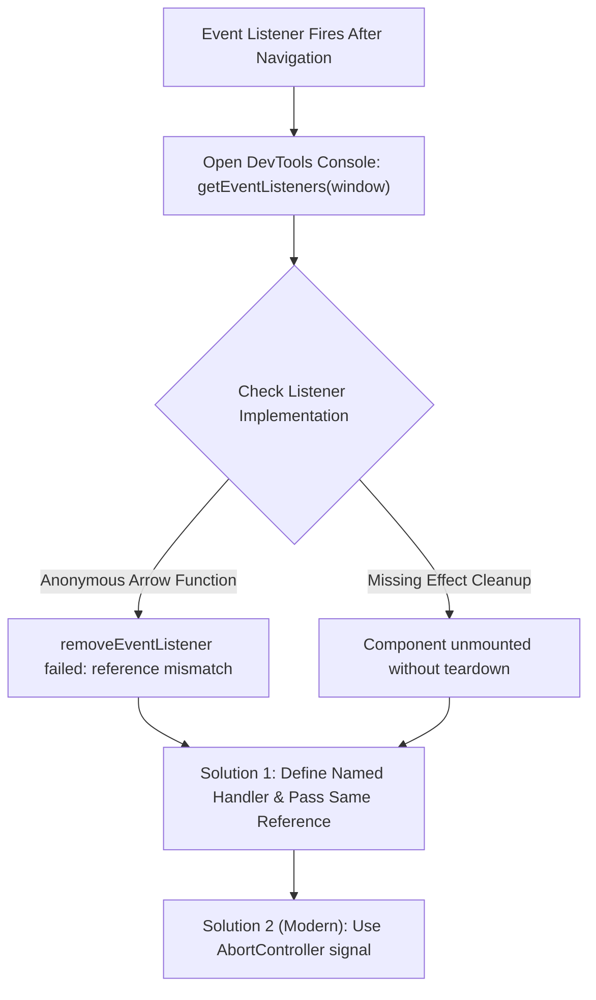

## Scenario

> **An event listener keeps executing even after navigating away. How would you fix it?**

A classic frontend bug: user navigates from Page A to Page B, but Page A's scroll or keydown handler still fires in the background. The interviewer tests your understanding of callback identity and lifecycle cleanup.

## Fast Revision (10-Second Recall)

- **First Move:** Inspect active listeners on `window` using DevTools Elements $\rightarrow$ Event Listeners tab, or run `getEventListeners(window)` in the console.
- **Root Cause:** Removing an event listener with an **anonymous inline arrow function** (`window.removeEventListener("scroll", () => ...)`). The function reference differs from the one added, so removal silently fails.
- **The Fix:** Store a stable function reference (or define the function inside `useEffect`) and pass the exact same reference to `removeEventListener`.
- **Modern Alternative:** Use `AbortController` signal to tear down multiple listeners with a single `controller.abort()` call.

## The 30-Second Spoken Script

If asked this in an interview, deliver this structured response:

> *This issue occurs when an event listener registered on a global object like window or document was not removed during component unmounting, or removal silently failed due to reference mismatch.*
>
> *The most common mistake is passing an inline arrow function to removeEventListener. Because the cleanup function defines a new function reference, removeEventListener cannot find a match and does nothing, leaving a zombie listener active.*
>
> *To fix it, I define the named handler inside useEffect and pass the exact same function reference to removeEventListener in the cleanup return.*
>
> *An even cleaner modern senior pattern is using the standard AbortController signal. By passing `{ signal: controller.signal }` to addEventListener, calling controller.abort() in the cleanup automatically removes all associated listeners cleanly without worrying about function reference matching.*

## Diagnostic Lifecycle



## Root Causes & Solutions Matrix

| Suspected Layer | Symptoms & Evidence | Immediate Resolution |
| :--- | :--- | :--- |
| **Anonymous Callback Mismatch** | `window.addEventListener("scroll", () => fn())` followed by identical code in cleanup; listener stays active. | Declare `const handleScroll = ...` and pass identical reference to `removeEventListener`. |
| **Missing Effect Return** | `useEffect` sets up listener but returns `undefined` instead of a cleanup function. | Return cleanup callback `return () => window.removeEventListener(...)`. |
| **Third-Party Event Emitter** | Listening to custom PubSub (`emitter.on("event")`) without corresponding `emitter.off()`. | Call `emitter.off("event", handler)` or use auto-cleanup hook. |
| **Stale Closure Trap in Listener** | Zombie listener continues executing and updates unmounted component state, throwing console warning. | Clean up listener + use an `isMounted` ref or AbortController. |

## Practical Debugging Commands & Code

### Fixing Leaked Event Listeners: Traditional vs AbortController Pattern
```typescript
import React, { useEffect } from 'react';

// ❌ BROKEN: Inline anonymous functions have different references!
export function BrokenScrollWatcher() {
  useEffect(() => {
    // Adds function reference #1
    window.addEventListener('scroll', () => console.log('Scrolling...'));

    return () => {
      // Tries to remove function reference #2 -> SILENTLY FAILS!
      window.removeEventListener('scroll', () => console.log('Scrolling...'));
    };
  }, []);

  return <div>Broken Watcher</div>;
}

// ✅ SENIOR PATTERN 1: Stable Named Handler Reference
export function FixedScrollWatcher() {
  useEffect(() => {
    const handleScroll = () => {
      console.log('Scroll offset:', window.scrollY);
    };

    window.addEventListener('scroll', handleScroll);

    // Exact same reference passed to removeEventListener
    return () => {
      window.removeEventListener('scroll', handleScroll);
    };
  }, []);

  return <div>Fixed with Stable Reference</div>;
}

// 🚀 SENIOR PATTERN 2: AbortController (Cleanest & Most Robust)
export function ModernListenerWatcher() {
  useEffect(() => {
    const controller = new AbortController();
    const { signal } = controller;

    // Pass signal to any number of listeners
    window.addEventListener('scroll', () => console.log('Scroll event'), { signal });
    window.addEventListener('keydown', (e) => console.log('Key:', e.key), { signal });
    window.addEventListener('resize', () => console.log('Resize event'), { signal });

    // Single abort call tears down ALL 3 listeners instantly!
    return () => {
      controller.abort();
    };
  }, []);

  return <div>Modern Clean Listener</div>;
}
```

## Prevention & Senior Best Practices

1. **Adopt Custom Hooks:** Use tested community hooks like `useEventListener` from `react-use` or `ahooks` to avoid re-implementing manual cleanup.
2. **Prefer AbortSignal:** Modern browser APIs (fetch, addEventListener, EventSource) all accept `{ signal }`; standardize on AbortController for lifecycle-bound events.
3. **ESLint Enforcement:** Configure ESLint rules to warn when `addEventListener` appears inside `useEffect` without corresponding removal.
