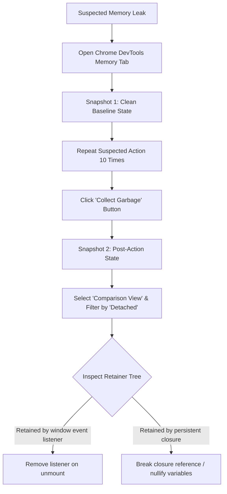

## Scenario

> **How would you identify memory leaks in a frontend application?**

Frontend memory leaks are silent killers: the browser tab slowly climbs to 1-2GB of RAM, freezes the machine, and eventually crashes with "Aw, Snap!". Interviewers want exact step-by-step DevTools methodology.

## Fast Revision (10-Second Recall)

- **First Move:** Open **Chrome DevTools Memory tab** $\rightarrow$ Select **Heap Snapshot** or **Allocation instrumentation on timeline**.
- **The 3-Snapshot Technique:**
- 1. Snapshot 1 at Baseline.
- 2. Perform user action (e.g., Open & Close Modal 10 times).
- 3. Force Garbage Collection (trash can icon) $\rightarrow$ Take Snapshot 2.
- 4. Compare snapshots; filter by **"Objects allocated between Snapshot 1 and 2"** or **"Detached"**.
- **Common Culprits:** Detached DOM nodes, uncleared timers (`setInterval`), closure retention, global event listeners.

## The 30-Second Spoken Script

If asked this in an interview, deliver this structured response:

> *To identify memory leaks in a frontend application, I follow the three-snapshot technique using the Chrome DevTools Memory tab.*
>
> *First, I establish a baseline by taking a heap snapshot on page load. *
>
> *Second, I perform the suspected repetitive action—for example, opening and closing a data modal or navigating to a subpage and back 10 times.*
>
> *Third, I click the garbage collection icon to eliminate transient objects, and record a second heap snapshot.*
>
> *In the snapshot viewer, I switch the perspective from 'Summary' to 'Comparison'. I sort by delta size and filter for 'Detached' elements. If I see Detached HTMLDivElement or thousands of retained closures, I inspect their retainers tree to see exactly what variable, event listener, or global state reference is preventing the garbage collector from reclaiming the memory.*

## Diagnostic Lifecycle



## Root Causes & Solutions Matrix

| Suspected Layer | Symptoms & Evidence | Immediate Resolution |
| :--- | :--- | :--- |
| **Detached DOM Elements** | DOM elements removed from screen remain in memory because JS retains a reference. | Search "Detached" in Class filter; nullify any module-level DOM refs. |
| **Console Logging in Dev/Prod** | Logging large objects (`console.log(hugePayload)`) retains them in memory indefinitely. | Strip `console.log` statements in production builds via bundler terser options. |
| **Uncleared Observables / EventBus** | Subscriptions to mitt, EventEmitter, or RxJS subjects pile up on every view mount. | Unsubscribe during component teardown (`subscription.unsubscribe()`). |
| **Closures Retaining Outer Scope** | A small callback retains a reference to an enormous outer data array. | Keep callback scopes tight; pass only primitive IDs rather than entire parent scopes. |

## Practical Debugging Commands & Code

### Diagnosing Detached DOM Nodes & Memory Leak Fix
```typescript
// ❌ LEAKY COMPONENT: Retains detached DOM node in global array
const leakedElements: HTMLElement[] = [];

export function LeakyTooltip({ text }: { text: string }) {
  useEffect(() => {
    const el = document.createElement('div');
    el.innerText = text;
    document.body.appendChild(el);
    
    // Leaks: Stores reference in persistent outer array
    leakedElements.push(el);

    return () => {
      document.body.removeChild(el); // Removed from DOM, but still in leakedElements!
    };
  }, [text]);

  return <div>Tooltip Trigger</div>;
}

// ✅ FIXED COMPONENT: Zero retained references
export function SafeTooltip({ text }: { text: string }) {
  useEffect(() => {
    const el = document.createElement('div');
    el.innerText = text;
    document.body.appendChild(el);

    return () => {
      document.body.removeChild(el);
      // No external reference retained; Garbage Collector cleanly frees memory
    };
  }, [text]);

  return <div>Tooltip Trigger</div>;
}
```

## Prevention & Senior Best Practices

1. **Automated CI Leak Audits:** Use tools like `memlab` (by Meta) to automatically detect memory leaks in React single-page apps during regression testing.
2. **Always Clean Up in `useEffect`:** Any subscription, timer, or DOM attachment initiated in an effect must have an inverse teardown in the return callback.
3. **WeakMap / WeakSet for Caches:** Use `WeakMap` or `WeakSet` when associating metadata with DOM elements so entries are automatically GC-collected when elements are removed.
