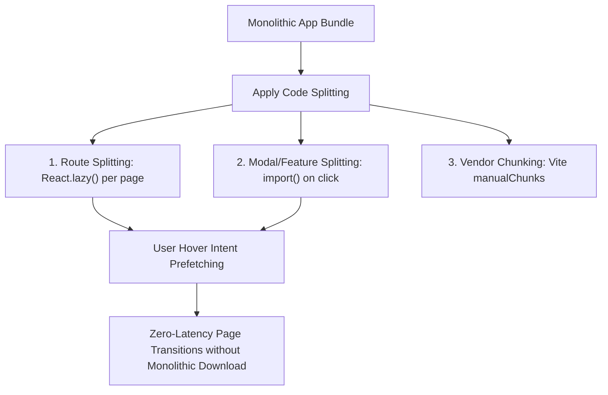

## Scenario

> **How would you implement code splitting?**

Without code splitting, single-page applications become unmaintainable monoliths. Interviewers test your proficiency with bundler mechanics, dynamic imports, and user-friendly fallback experiences.

## Fast Revision (10-Second Recall)

- **First Move:** Identify route boundaries and heavy interactive features (charts, modals, rich text editors).
- **The 3 Levels of Splitting:**
- 1. **Route-Based:** `React.lazy(() => import("./routes/Settings"))` wrapped in `<Suspense>`.
- 2. **Component/Modal-Based:** Lazy load dialogs and popups so their code only downloads upon user click.
- 3. **Vendor/Package-Based:** Configure bundler (`manualChunks`) to isolate large libraries (React, Three.js) into long-term cacheable chunks.
- **UX Polish:** Prefetch split chunks on link hover using `onMouseEnter={() => import("./NextRoute")}`.

## The 30-Second Spoken Script

If asked this in an interview, deliver this structured response:

> *I implement code splitting across three strategic tiers: route level, component/interaction level, and vendor chunk level.*
>
> *At the route level, I use React.lazy with dynamic ES import() statements wrapped in React Suspense. This ensures users download only the code necessary for their current route, cutting the initial bundle size dramatically.*
>
> *At the component level, I identify heavy interactive elements that are not immediately visible—such as a rich text editor modal, an export dialog, or interactive 3D charts. I defer loading these components until the user triggers the interaction, such as clicking an 'Open Editor' button.*
>
> *At the bundler level, I configure Vite or Rollup's manualChunks to separate stable vendor dependencies like React and UI libraries from volatile application code. This maximizes long-term browser cache hit rates.*
>
> *To eliminate loading spinners for the user, I implement intent-based prefetching, triggering the dynamic import when a user hovers over a navigation link.*

## Diagnostic Lifecycle



## Root Causes & Solutions Matrix

| Suspected Layer | Symptoms & Evidence | Immediate Resolution |
| :--- | :--- | :--- |
| **Route Splitting** | Visiting the public marketing page downloads the admin dashboard code. | Split each top-level route with `React.lazy()` and provide `<Suspense fallback={<Skeleton />}>`. |
| **Modal / Dialog Splitting** | Complex settings dialog loaded on initial paint even though 95% of users never open it. | Render `<LazyModal />` only when `isOpen === true`. |
| **Cache Busting Inefficiency** | A 1-line bug fix invalidates the entire 2MB bundle for returning users. | Separate `vendor.js` from `app.js` using `manualChunks` in bundler configuration. |
| **Network Fallback Jitter** | Navigating to a lazy route throws chunk loading errors after a new deployment. | Catch chunk load errors with an Error Boundary and trigger a seamless page reload. |

## Practical Debugging Commands & Code

### Route Splitting, Modal Splitting, and Intent-Based Prefetching
```typescript
import React, { useState, Suspense, lazy } from 'react';

// 1. Route-level lazy loading
const AnalyticsPage = lazy(() => import('./pages/Analytics'));

// 2. Component/Feature-level lazy loading
const HeavyMarkdownEditor = lazy(() => import('./components/HeavyMarkdownEditor'));

export function NavigationBar() {
  // Intent-based prefetching on hover!
  const prefetchAnalytics = () => {
    // Triggers network download before user clicks
    import('./pages/Analytics');
  };

  return (
    <nav>
      <a 
        href="/analytics" 
        onMouseEnter={prefetchAnalytics}
        onFocus={prefetchAnalytics}
      >
        Analytics
      </a>
    </nav>
  );
}

export function PostDetail() {
  const [showEditor, setShowEditor] = useState(false);

  return (
    <div>
      <h1>Post Content</h1>
      <button onClick={() => setShowEditor(true)}>Edit Post</button>

      {/* Editor bundle is ONLY fetched if user clicks button! */}
      {showEditor && (
        <Suspense fallback={<div>Loading Editor...</div>}>
          <HeavyMarkdownEditor onClose={() => setShowEditor(false)} />
        </Suspense>
      )}
    </div>
  );
}
```

## Prevention & Senior Best Practices

1. **Handle Chunk Load Failures:** When a new app version is deployed, old hashed chunks are deleted. Implement an Error Boundary that catches `Failed to fetch dynamically imported module` and reloads the page.
2. **Meaningful Loading Placeholders:** Always provide route-specific skeleton screens rather than generic spinners to avoid jarring layout shifts during chunk download.
3. **Avoid Micro-Splitting:** Do not code-split tiny 2kB components; the HTTP request overhead and waterfall latency will exceed the byte savings.
