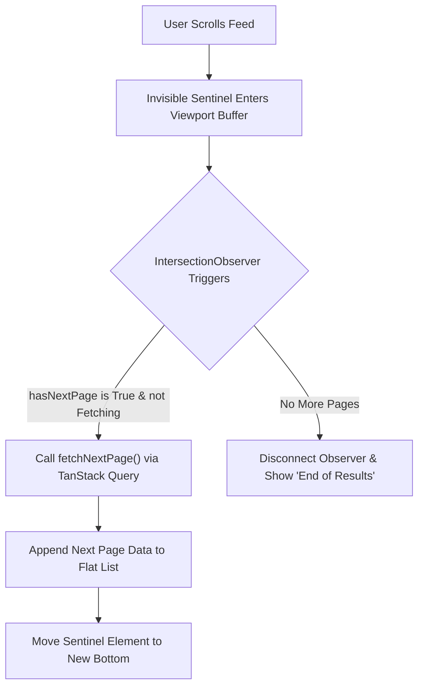

## Scenario

> **How would you implement infinite scrolling?**

Infinite scrolling is ubiquitous in feeds (social media, e-commerce). Interviewers test whether you understand IntersectionObserver vs legacy scroll listeners, pagination cursors, and DOM memory management.

## Fast Revision (10-Second Recall)

- **First Move:** Use modern **IntersectionObserver API** on a sentinel `<div ref={sentinelRef} />` at the bottom of the feed rather than listening to window scroll events.
- **Key Tool:** TanStack Query `useInfiniteQuery` for managing paginated cursor cache, deduplication, and loading/error states.
- **Memory Protection:** For feeds over 500+ items, combine infinite scrolling with **virtualization** to prevent DOM node bloating.
- **UX Essentials:** Provide scroll restoration when navigating away and clicking back.

## The 30-Second Spoken Script

If asked this in an interview, deliver this structured response:

> *To implement infinite scrolling cleanly, I avoid attaching synchronous scroll event listeners to window because they flood the main thread with reflow checks.*
>
> *Instead, I place an invisible sentinel element at the bottom of the feed and monitor it with the IntersectionObserver API. When the sentinel intersects within 200px of the viewport, it triggers the fetch for the next page.*
>
> *I manage the data fetching and caching with TanStack Query's useInfiniteQuery hook. It handles cursor-based pagination, keeps track of hasNextPage, deduplicates in-flight requests, and simplifies appending data pages.*
>
> *For long feeds where users might scroll through hundreds of items, I combine this with DOM virtualization or item windowing so that off-screen DOM nodes are unmounted to keep memory footprint flat.*

## Diagnostic Lifecycle



## Root Causes & Solutions Matrix

| Suspected Layer | Symptoms & Evidence | Immediate Resolution |
| :--- | :--- | :--- |
| **Scroll Performance** | Synchronous `window.onscroll` causes micro-freezes and high CPU usage. | Replace with `IntersectionObserver` observing a sentinel element. |
| **Duplicate Page Calls** | Fast scroll triggers 4 parallel fetches for the exact same page cursor. | Guard fetch trigger with `if (hasNextPage && !isFetchingNextPage)`. |
| **Browser Memory Inflation** | User scrolls 1,000 feed posts; browser tab climbs to 1.2GB and crashes. | Combine infinite scroll with windowing/virtualization or discard top items when list exceeds threshold. |
| **Loss of Scroll Position** | User clicks post, navigates back, and page jumps all the way back to the top. | Store `sessionStorage` scroll offset or rely on React Query cache + browser history scroll restoration. |

## Practical Debugging Commands & Code

### Infinite Scroll using IntersectionObserver + useInfiniteQuery
```typescript
import React, { useEffect, useRef } from 'react';
import { useInfiniteQuery } from '@tanstack/react-query';

interface Post {
  id: string;
  title: string;
}

async function fetchPosts({ pageParam = 1 }): Promise<{ posts: Post[]; nextPage: number | null }> {
  const res = await fetch(`/api/posts?page=${pageParam}&limit=10`);
  if (!res.ok) throw new Error('Network error');
  return res.json();
}

export function InfiniteFeed() {
  const sentinelRef = useRef<HTMLDivElement | null>(null);

  const {
    data,
    fetchNextPage,
    hasNextPage,
    isFetchingNextPage,
    status
  } = useInfiniteQuery({
    queryKey: ['posts'],
    queryFn: fetchPosts,
    initialPageParam: 1,
    getNextPageParam: (lastPage) => lastPage.nextPage,
  });

  useEffect(() => {
    if (!sentinelRef.current || !hasNextPage) return;

    const observer = new IntersectionObserver(
      (entries) => {
        if (entries[0].isIntersecting && hasNextPage && !isFetchingNextPage) {
          fetchNextPage();
        }
      },
      { rootMargin: '300px' } // Pre-fetch 300px before user hits bottom
    );

    observer.observe(sentinelRef.current);
    return () => observer.disconnect();
  }, [hasNextPage, isFetchingNextPage, fetchNextPage]);

  if (status === 'pending') return <div>Loading initial feed...</div>;

  return (
    <div className="max-w-xl mx-auto space-y-4">
      {data?.pages.map((page) =>
        page.posts.map((post) => (
          <article key={post.id} className="p-4 border rounded-lg shadow-sm">
            <h3 className="font-semibold">{post.title}</h3>
          </article>
        ))
      )}

      {/* Sentinel Element */}
      <div ref={sentinelRef} className="h-10 flex items-center justify-center">
        {isFetchingNextPage && <span>Loading more posts...</span>}
        {!hasNextPage && <span className="text-gray-400">You have reached the end.</span>}
      </div>
    </div>
  );
}
```

## Prevention & Senior Best Practices

1. **Always Use Cursor Pagination on Backend:** Avoid SQL offset/limit pagination (`OFFSET 1000`) for infinite feeds, as DB row scans become progressively slower.
2. **Pre-calculate Item Heights:** Provide skeleton placeholders with fixed dimensions to prevent layout jumps as new cards populate.
3. **Preserve URL State:** Sync pagination status to query parameters (e.g., `?page=4`) so users can share or reload without losing place.
