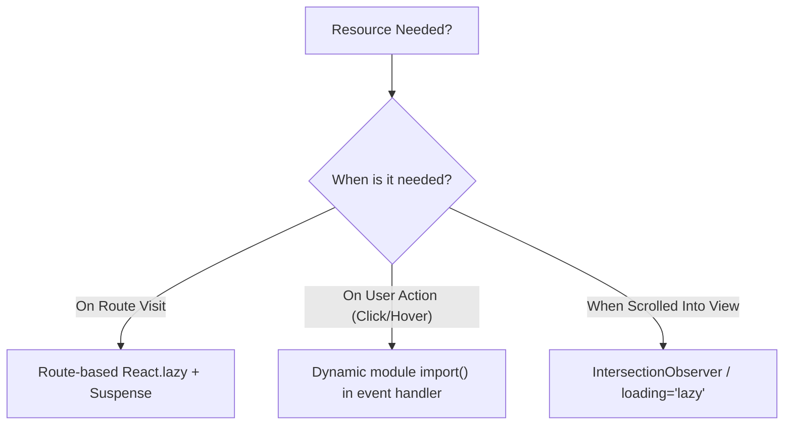

## Scenario

> **How would you implement lazy loading?**

Lazy loading defers non-critical resources until the user actually needs them. Interviewers look for comprehensive coverage across code (routes/modules), DOM components, and media assets.

## Fast Revision (10-Second Recall)

- **First Move:** Identify heavy assets not required for above-the-fold First Meaningful Paint.
- **Three Core Pillars:**
- 1. **Route/Component Level:** `React.lazy()` with `import()` + `Suspense`.
- 2. **Library Level:** Dynamic inline `await import("heavy-lib")` triggered by user action (e.g. clicking Export PDF).
- 3. **Asset/DOM Level:** Native `loading="lazy"` on `` / `<iframe>`, and `IntersectionObserver` for heavy custom widgets.

## The 30-Second Spoken Script

If asked this in an interview, deliver this structured response:

> *I implement lazy loading across three distinct application layers: routing, user-triggered libraries, and viewport assets.*
>
> *First, at the route level, I use React.lazy with dynamic ES import() wrapped in React Suspense to break down our application into isolated route chunks so users only download code for the page they visit.*
>
> *Second, for heavy libraries like PDF generators, Markdown editors, or chart engines, I lazy load the package dynamically inside the event handler itself using async import(). This keeps 300kB of third-party code out of the initial bundle until the user actually clicks 'Generate PDF'.*
>
> *Third, for media and DOM widgets, I utilize native HTML loading='lazy' for images and iframes, and create custom IntersectionObserver hooks to defer rendering below-the-fold components until they scroll within 200 pixels of the viewport.*

## Diagnostic Lifecycle



## Root Causes & Solutions Matrix

| Suspected Layer | Symptoms & Evidence | Immediate Resolution |
| :--- | :--- | :--- |
| **Route Chunks** | Landing page bundle includes admin dashboard code. | Wrap route components in `React.lazy(() => import("./Admin"))`. |
| **Heavy Library (e.g. PDF/Excel)** | xlsx / jspdf bundled into main bundle, bloating initial load by 800kB. | Import inside button click handler: `const { jsPDF } = await import("jspdf")`. |
| **Below-the-fold Images** | 50 product images downloaded on initial render before user even scrolls. | Add `loading="lazy"` and `decoding="async"` attributes to `` tags. |
| **Heavy Offscreen Widgets** | Complex footer comments section renders immediately, blocking LCP. | Render null until an `IntersectionObserver` triggers entry into viewport. |

## Practical Debugging Commands & Code

### Dynamic Module Import on User Action + Viewport Lazy Loading
```typescript
import React, { useState, useEffect, useRef } from 'react';

// 1. Viewport Lazy Loader using IntersectionObserver
export function LazyViewportWrapper({ children }: { children: React.ReactNode }) {
  const [isVisible, setIsVisible] = useState(false);
  const containerRef = useRef<HTMLDivElement | null>(null);

  useEffect(() => {
    const observer = new IntersectionObserver(
      ([entry]) => {
        if (entry.isIntersecting) {
          setIsVisible(true);
          observer.disconnect(); // Stop observing once loaded
        }
      },
      { rootMargin: '200px' } // Pre-load 200px before appearing
    );

    if (containerRef.current) observer.observe(containerRef.current);
    return () => observer.disconnect();
  }, []);

  return <div ref={containerRef}>{isVisible ? children : <div className="h-64" />}</div>;
}

// 2. On-Demand Library Loading inside Event Handler
export function ExportButton() {
  const [exporting, setExporting] = useState(false);

  const handleExport = async () => {
    setExporting(true);
    try {
      // Library is only downloaded when the user clicks!
      const { utils, writeFile } = await import('xlsx');
      const ws = utils.json_to_sheet([{ id: 1, name: 'Alice' }]);
      const wb = utils.book_new();
      utils.book_append_sheet(wb, ws, 'Users');
      writeFile(wb, 'Export.xlsx');
    } finally {
      setExporting(false);
    }
  };

  return (
    <button onClick={handleExport} disabled={exporting}>
      {exporting ? 'Generating Excel...' : 'Export to Excel'}
    </button>
  );
}
```

## Prevention & Senior Best Practices

1. **Prefetch on Intent:** When a user hovers over a link or navigation tab, call `const componentPromise = import("./NextPage")` to eliminate the loading spinner entirely.
2. **Provide Meaningful Skeletons:** Always wrap lazy routes in skeletons matching exact layouts to prevent Cumulative Layout Shift (CLS).
3. **Analyze Bundle with Source Map Explorer:** Regularly audit chunk files to ensure third-party modules did not accidentally leak into the entry chunk.
