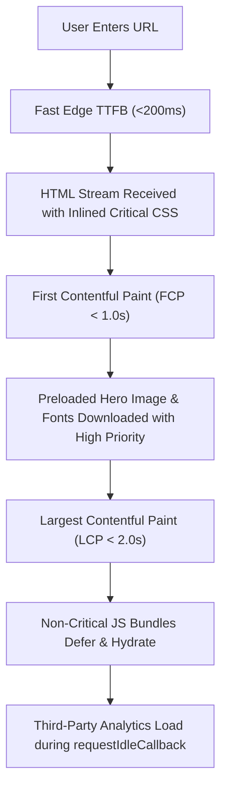

## Scenario

> **How would you improve the initial page load?**

Initial page load speed is directly correlated with user conversion rates and SEO rankings. Interviewers want you to demonstrate deep mastery of the browser Critical Rendering Path.

## Fast Revision (10-Second Recall)

- **First Move:** Audit Web Vitals (FCP, LCP, TTFB, CLS) using **Lighthouse / WebPageTest** under mobile 4G conditions.
- **Critical Path Checklist:**
- 1. **Server / Edge:** Reduce TTFB with Edge caching, CDN, or streaming SSR.
- 2. **HTML `<head>`:** Inline critical CSS, preload primary font & hero image, defer non-critical scripts.
- 3. **Bundle:** Code split routes with `React.lazy`; keep initial JS bundle under 100kB gzipped.
- 4. **Third Parties:** Defer tag managers, Google Analytics, and chat widgets until after hydration.

## The 30-Second Spoken Script

If asked this in an interview, deliver this structured response:

> *To improve initial page load performance, I optimize each stage of the browser's Critical Rendering Path: DNS/connection, server TTFB, resource download, and rendering.*
>
> *First, I minimize Time to First Byte (TTFB). I deploy pages to Edge CDNs (such as Cloudflare or Vercel Edge Network), cache static HTML where possible, or use Streaming SSR to begin piping the HTML head to the browser immediately.*
>
> *Second, I eliminate render-blocking resources. I ensure all non-essential script tags have the defer attribute, inline critical CSS directly into the HTML head, and preload the primary web font with font-display: swap to prevent FOIT (Flash of Invisible Text).*
>
> *Third, I optimize Largest Contentful Paint (LCP). If the LCP element is text, preloading the font solves it. If it is an image, I preload the hero asset with fetchpriority='high'.*
>
> *Finally, I defer all third-party tracking scripts until after the page reaches idle using requestIdleCallback, ensuring the main thread remains responsive for early user interactions.*

## Diagnostic Lifecycle



## Root Causes & Solutions Matrix

| Suspected Layer | Symptoms & Evidence | Immediate Resolution |
| :--- | :--- | :--- |
| **High TTFB (>1.5s)** | White screen while waiting for the origin server to generate HTML. | Cache static pages on CDN edge or implement streaming SSR (`renderToPipeableStream`). |
| **Render-Blocking CSS** | Browser blocks DOM rendering while downloading 500kB of global CSS. | Extract and inline critical above-the-fold CSS; load remaining CSS asynchronously. |
| **Flash of Invisible Text (FOIT)** | Text is invisible for 2 seconds while custom web font downloads. | Add `font-display: swap;` in `@font-face` and `<link rel="preload">` the primary WOFF2. |
| **Heavy Tag Managers** | GTM, Intercom, and Hotjar execute on load, consuming 800ms of CPU time. | Defer third-party scripts with Partytown or execute during `requestIdleCallback`. |

## Practical Debugging Commands & Code

### Optimized HTML Head Structure & Critical Resource Hints
```html
<!DOCTYPE html>
<html lang="en">
<head>
  <meta charset="UTF-8">
  <meta name="viewport" content="width=device-width, initial-scale=1.0">
  <title>High Performance App</title>

  <!-- 1. DNS Prefetch & Preconnect to critical third parties -->
  <link rel="preconnect" href="https://fonts.gstatic.com" crossorigin>
  <link rel="preconnect" href="https://cdn.example.com">

  <!-- 2. Preload Primary Web Font -->
  <link 
    rel="preload" 
    href="/fonts/inter-variable.woff2" 
    as="font" 
    type="font/woff2" 
    crossorigin
  />

  <!-- 3. Preload Above-the-fold LCP Image -->
  <link 
    rel="preload" 
    href="/images/hero.webp" 
    as="image" 
    type="image/webp" 
    fetchpriority="high"
  />

  <!-- 4. Inline Critical CSS to render above-the-fold content immediately -->
  <style>
    body { font-family: 'Inter', sans-serif; margin: 0; background: #fff; }
    .hero-skeleton { min-height: 400px; display: flex; align-items: center; }
  </style>

  <!-- 5. Asynchronous Non-Blocking JavaScript -->
  <script type="module" src="/src/main.js" defer></script>
</head>
<body>
  <div id="root">
    <!-- Server Rendered or Inlined Skeleton for instantaneous FCP -->
    <header>...</header>
    <main class="hero-skeleton">...</main>
  </div>
</body>
</html>
```

## Prevention & Senior Best Practices

1. **Enforce Performance Budgets:** Fail PRs in GitHub Actions if mobile Lighthouse performance score drops below 90.
2. **Audit Third-Party Scripts:** Question every marketing script; isolate tracking tags in web workers using libraries like Partytown.
3. **Use Modern SSR Frameworks:** Leverage Astro, Next.js, or Remix for automatic server-side rendering, island architecture, and zero-JS defaults.
