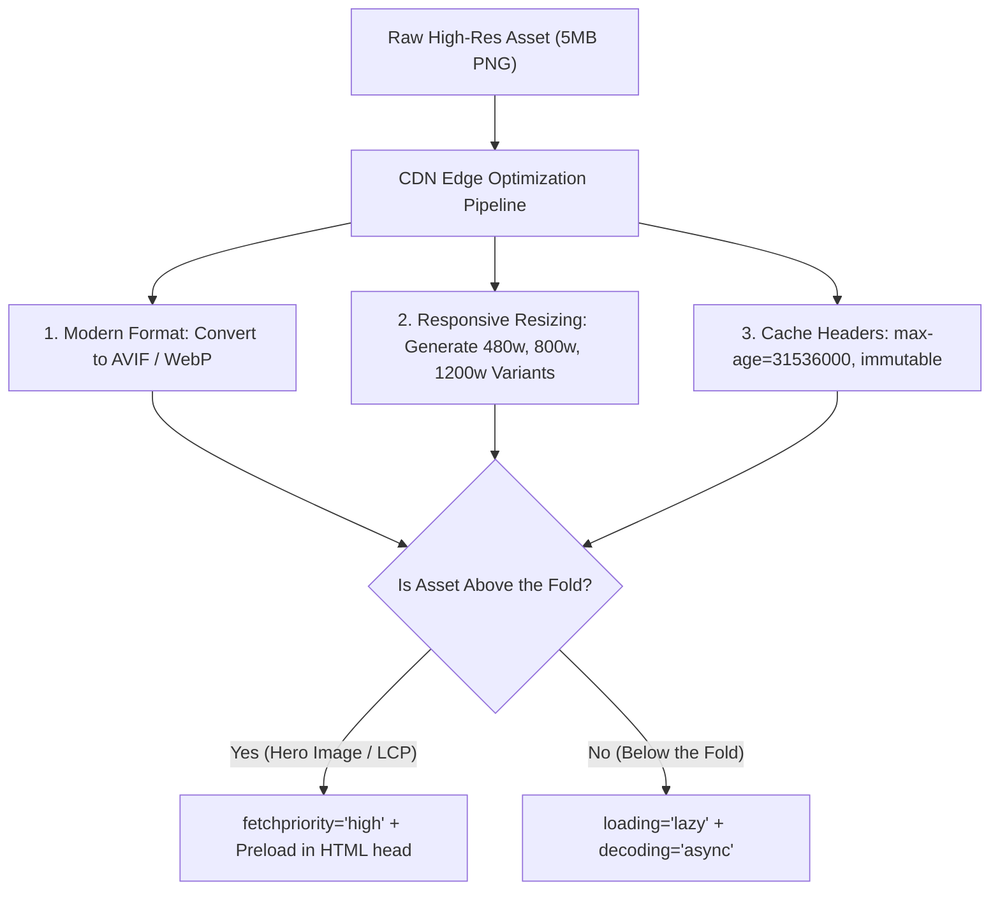

## Scenario

> **How would you optimize images and static assets?**

Images and media typically account for 60-80% of total page weight. Improving image delivery directly improves Largest Contentful Paint (LCP) and Cumulative Layout Shift (CLS).

## Fast Revision (10-Second Recall)

- **First Move:** Convert legacy JPG/PNG formats to next-generation **WebP and AVIF** (50-80% smaller).
- **The 4 Core Optimizations:**
- 1. **Responsive Delivery:** Use `<picture>` and `srcset` with `sizes` so mobile devices download mobile-sized images.
- 2. **LCP Priority:** Add `fetchpriority="high"` and `<link rel="preload">` to the primary above-the-fold hero image.
- 3. **Prevent CLS:** Always specify explicit `width` and `height` (or CSS `aspect-ratio`).
- 4. **Lazy Loading:** Add `loading="lazy"` and `decoding="async"` to all below-the-fold media.

## The 30-Second Spoken Script

If asked this in an interview, deliver this structured response:

> *To optimize images and static assets, I focus on format efficiency, responsive delivery, and Core Web Vitals alignment.*
>
> *First, I ensure all images are converted to modern formats like AVIF and WebP, which provide significantly better compression ratios than JPEG or PNG without visible quality loss.*
>
> *Second, I implement responsive images using the picture element and srcset. A 400px mobile viewport should never download a 2000px desktop asset. I configure our CDN—such as Cloudflare or Cloudinary—to perform dynamic edge resizing and format negotiation based on the browser's Accept header.*
>
> *Third, for Core Web Vitals:
To optimize Largest Contentful Paint (LCP), I preload the hero image and set fetchpriority='high', ensuring the browser prioritizes it before running JavaScript.
To eliminate Cumulative Layout Shift (CLS), I always declare explicit aspect-ratio or width and height attributes so the browser reserves space before the image loads. Finally, all below-the-fold images receive loading='lazy'.*

## Diagnostic Lifecycle



## Root Causes & Solutions Matrix

| Suspected Layer | Symptoms & Evidence | Immediate Resolution |
| :--- | :--- | :--- |
| **Format Inefficiency** | Product catalogue serves 3MB uncompressed PNGs. | Convert to WebP/AVIF using Sharp or Cloudflare Polish; saves ~70% bandwidth. |
| **Cumulative Layout Shift (CLS)** | Images load late and push text content down abruptly. | Always set `width`, `height`, or CSS `aspect-ratio` to reserve layout boxes. |
| **Delayed LCP Element** | Hero banner starts downloading late after JS bundles execute. | Add `<link rel="preload" as="image" href="..." fetchpriority="high">` in `<head>`. |
| **Uncached Static Chunks** | Repeat visits re-download identical logos and SVGs. | Set `Cache-Control: public, max-age=31536000, immutable` with content hashes. |

## Practical Debugging Commands & Code

### High-Performance Responsive Image Implementation
```html
<!-- 1. Preload Hero Image in <head> for fast LCP -->
<head>
  <link 
    rel="preload" 
    as="image" 
    href="/images/hero-800.avif" 
    type="image/avif" 
    fetchpriority="high"
  />
</head>

<!-- 2. Responsive, Multi-Format, CLS-Protected Image Element -->
<picture>
  <!-- Serve modern AVIF to supporting browsers -->
  <source 
    type="image/avif"
    srcset="/images/hero-400.avif 400w, /images/hero-800.avif 800w, /images/hero-1200.avif 1200w"
    sizes="(max-width: 640px) 100vw, (max-width: 1024px) 800px, 1200px"
  />

  <!-- Fallback to WebP -->
  <source 
    type="image/webp"
    srcset="/images/hero-400.webp 400w, /images/hero-800.webp 800w, /images/hero-1200.webp 1200w"
    sizes="(max-width: 640px) 100vw, (max-width: 1024px) 800px, 1200px"
  />

  <!-- Final Fallback JPG with explicit dimensions to prevent CLS -->
  
</picture>
```

## Prevention & Senior Best Practices

1. **Automate Image Pipelines:** Integrate `@astrojs/image`, `next/image`, or Sharp into your build pipeline so engineers cannot commit uncompressed assets.
2. **Use SVG for UI Icons:** Replace PNG icons with SVGs or icon sprites; optimize with SVGO to strip editor metadata.
3. **Avoid Base64 Inlining for Large Images:** Base64 increases byte size by ~33% and prevents independent browser caching.
