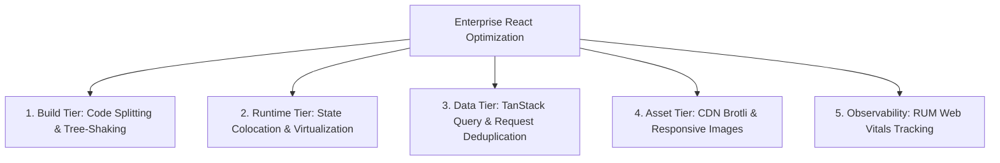

## Scenario

> **How would you optimize a large React application?**

Enterprise React apps suffer from architectural bloat over time. Senior engineers must show holistic optimization capabilities across Build, Runtime, State, Network, and Monitoring tiers.

## Fast Revision (10-Second Recall)

- **First Move:** Profile before optimizing—audit using Lighthouse, Web Vitals, and React DevTools Flamegraph.
- **The 5 Pillars:**
- 1. **Build & Bundling:** Modern build tools (Vite/Turbopack), chunk splitting, removing duplicated transitive dependencies (`pnpm dedupe`).
- 2. **Rendering & VDOM:** Colocate state, eliminate Context cascades with Zustand, virtualize large lists.
- 3. **Network & Data:** React Query / SWR for deduplication and client-side caching, Stale-While-Revalidate.
- 4. **Assets:** Modern image formats (AVIF/WebP), self-hosted optimized fonts with `font-display: swap`.
- 5. **Monitoring:** Real User Monitoring (RUM) tracking Core Web Vitals (LCP, INP, CLS) in Datadog or Sentry.

## The 30-Second Spoken Script

If asked this in an interview, deliver this structured response:

> *Optimizing an enterprise React application requires a structured, multi-tier approach spanning build, runtime, data, and monitoring.*
>
> *First, at the build level, I audit our bundle composition using webpack-bundle-analyzer or visualizer. I enforce route-based code splitting, split out heavy third-party vendor dependencies, and ensure tree-shaking is active.*
>
> *Second, at the runtime and rendering level, I audit component re-render trees. I eliminate monolithic Context providers that trigger global re-renders, migrate to fine-grained state stores like Zustand, and virtualize any list rendering more than 100 DOM nodes.*
>
> *Third, at the data layer, I introduce TanStack Query for automatic request deduplication, optimistic mutations, and stale-while-revalidate caching.*
>
> *Finally, I implement Real User Monitoring (RUM) with web-vitals reporting to track INP, LCP, and CLS in production, backed by automated Lighthouse CI budget checks in GitHub Actions.*

## Diagnostic Lifecycle



## Root Causes & Solutions Matrix

| Suspected Layer | Symptoms & Evidence | Immediate Resolution |
| :--- | :--- | :--- |
| **Build Tier** | Initial bundle is 8MB; build takes 6 minutes. | Migrate to Vite/Rspack, configure dynamic imports, and audit duplicate npm packages. |
| **Runtime VDOM** | Typing in a global search box exhibits 150ms input lag (bad INP). | Use `useDeferredValue` or `startTransition` to prioritize input responsiveness over filtering. |
| **Data Tier** | Navigating between 3 tabs refetches the exact same user profile API 3 times. | Set `staleTime: 5 * 60 * 1000` in TanStack Query to serve cached data instantly. |
| **Asset Tier** | Custom fonts cause text to flash (FOIT/FOUT) and shift layout. | Use `font-display: swap`, preload primary WOFF2 font files, and inline critical CSS. |

## Practical Debugging Commands & Code

### Decoupling Heavy Computations with useTransition & Web Worker
```typescript
import React, { useState, useTransition, useDeferredValue } from 'react';

// Keeping UI interactive during heavy filtering
export function LargeDatasetSearch({ dataset }: { dataset: string[] }) {
  const [searchTerm, setSearchTerm] = useState('');
  const [isPending, startTransition] = useTransition();

  // Defer filtered list computation without blocking user keystrokes
  const deferredSearch = useDeferredValue(searchTerm);

  const filteredItems = React.useMemo(() => {
    if (!deferredSearch) return [];
    return dataset.filter(item => item.toLowerCase().includes(deferredSearch.toLowerCase()));
  }, [dataset, deferredSearch]);

  const handleInputChange = (e: React.ChangeEvent<HTMLInputElement>) => {
    // Urgent update: Updates input immediately
    setSearchTerm(e.target.value);
  };

  return (
    <div>
      <input
        type="text"
        value={searchTerm}
        onChange={handleInputChange}
        placeholder="Search 50,000 records..."
        className="border p-2 rounded"
      />
      {isPending && <span className="text-sm text-gray-500">Updating list...</span>}
      
      <ul className="mt-4">
        {filteredItems.slice(0, 50).map((item, idx) => (
          <li key={idx}>{item}</li>
        ))}
      </ul>
    </div>
  );
}
```

## Prevention & Senior Best Practices

1. **Real User Monitoring (RUM):** Measure p75/p95 Interaction to Next Paint (`INP < 200ms`) across real devices in the wild.
2. **Strict Bundle Budgets:** Block pull requests that increase initial chunk size by more than 5%.
3. **Architecture Reviews:** Ban global state stores for local UI state; enforce state colocation.
