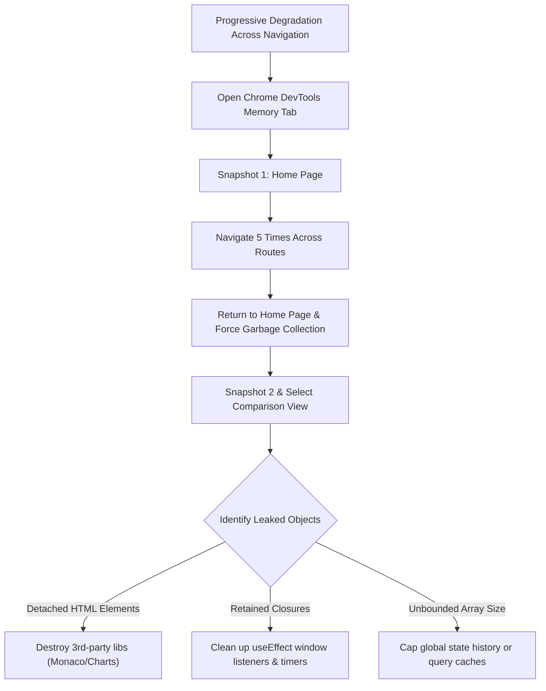

## Scenario

> **Your page becomes slow after navigating between multiple pages. How would you debug it?**

When an SPA degrades only after the user navigates across routes, the issue is almost always a memory leak, uncancelled interval/subscription, or uncontrolled global state accumulation. The interviewer expects hands-on DevTools memory profiling skills.

## Fast Revision (10-Second Recall)

- **First Move:** Take **Heap Snapshots** in Chrome DevTools Memory tab: Baseline on page 1 $\rightarrow$ Navigate 5 times $\rightarrow$ Return to page 1 $\rightarrow$ Force GC $\rightarrow$ Take Snapshot 2 and inspect Comparison.
- **Primary Suspects:** Uncleaned `addEventListener` / `setInterval` in `useEffect`, persistent detached DOM nodes retained in closures, growing array in global state (Redux/Zustand), or unreleased RxJS / WebSocket subscriptions.
- **Key Fix:** Always return cleanup functions from `useEffect` / `onDestroy`, unsubscribe from observables, and clean up canvas/chart instances before unmount.

## The 30-Second Spoken Script

If asked this in an interview, deliver this structured response:

> *When an SPA gets slower the longer a user navigates, it points directly to frontend memory leaks or accumulated background tasks.*
>
> *My first diagnostic step is reproducing the behavior with the Chrome DevTools Memory tab. I take a heap snapshot, navigate between routes 5 times, return to the initial page, trigger browser garbage collection, and take a second snapshot. *
>
> *Using the Comparison view, I inspect delta allocations. I look for detached HTML elements, retained arrays, and lingering closures. *
>
> *Common culprits include uncleaned window event listeners, forgotten setIntervals, open RxJS subscriptions, or third-party chart/editor libraries that weren't destroyed on unmount. Once identified, I implement robust cleanup functions in component unmount lifecycles and verify that memory stabilizes to baseline.*

## Diagnostic Lifecycle



## Root Causes & Solutions Matrix

| Suspected Layer | Symptoms & Evidence | Immediate Resolution |
| :--- | :--- | :--- |
| **Dangling Event Listeners** | Scroll or resize callbacks trigger 50 times per scroll after 5 page changes. | Remove event listeners in `useEffect` cleanup return function using identical function references. |
| **Uncleaned Timers** | `setInterval` continues polling API in background indefinitely after component unmounts. | Call `clearInterval(timerId)` inside cleanup phase. |
| **Detached DOM Trees** | DOM nodes deleted from document tree remain in memory because JS references retain them. | Nullify DOM references and call `.destroy()` on third-party libraries (Chart.js, TinyMCE, Leaflet). |
| **Unbounded Global Store** | Search query history, navigation audit logs, or notifications array grows without bounds. | Implement FIFO eviction policies or LRU cache capping on client-side state. |

## Practical Debugging Commands & Code

### Detecting & Cleaning Up Subscriptions and Chart Instances
```typescript
import React, { useEffect, useRef } from 'react';
import Chart from 'chart.js/auto';

export function DashboardWidget() {
  const canvasRef = useRef<HTMLCanvasElement | null>(null);
  const chartInstanceRef = useRef<Chart | null>(null);

  useEffect(() => {
    // 1. Initialize 3rd party instance
    if (canvasRef.current) {
      chartInstanceRef.current = new Chart(canvasRef.current, {
        type: 'line',
        data: { datasets: [] }
      });
    }

    // 2. Global event listener
    const handleResize = () => {
      console.log('Resizing widget...');
    };
    window.addEventListener('resize', handleResize);

    // 3. Strict Cleanup Function: MANDATORY to prevent memory leaks
    return () => {
      window.removeEventListener('resize', handleResize);

      if (chartInstanceRef.current) {
        chartInstanceRef.current.destroy(); // Releases canvas & internal DOM references
        chartInstanceRef.current = null;
      }
    };
  }, []);

  return <canvas ref={canvasRef} />;
}
```

## Prevention & Senior Best Practices

1. **Lint with `react-hooks/exhaustive-deps`:** Catch missing dependencies and uncleaned effect returns during PR reviews.
2. **Automated Memory Leak Testing:** Run Playwright or Puppeteer E2E tests checking `performance.memory.usedJSHeapSize` delta before and after multi-page journeys.
3. **Store Eviction Policies:** Never allow append-only collections in state stores; always cap arrays to finite sizes (e.g., max 50 recent items).
