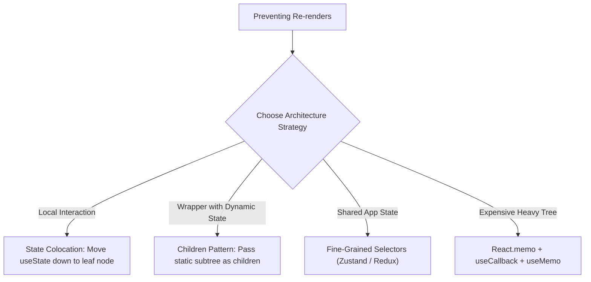

## Scenario

> **How would you prevent unnecessary component re-renders?**

Every frontend engineer knows about React.memo, but senior engineers understand that component architecture and state placement prevent re-renders far better than defensive memoization.

## Fast Revision (10-Second Recall)

- **First Move:** Apply **Component Composition (lifting content up / children pattern)** before adding `React.memo` everywhere.
- **Key Patterns:**
- 1. **State Colocation:** Push state down to leaf components.
- 2. **Children as Props:** Pass expensive subtrees as `children` or JSX slots; parents can re-render without touching children.
- 3. **Atomic Selectors:** Use Zustand / Jotai / Redux with fine-grained selectors rather than monolithic Context.
- 4. **Refs for Ephemeral Data:** Use `useRef` for tracking values that do not affect the rendered UI (e.g., scroll positions, timer IDs).

## The 30-Second Spoken Script

If asked this in an interview, deliver this structured response:

> *While most developers reach immediately for React.memo and useMemo, my primary strategy is architectural: component composition and state colocation.*
>
> *First, by colocating state down into the specific widget that actually needs it—like an input field or a dropdown menu—the parent container and sibling components never re-render in the first place.*
>
> *Second, I utilize the 'children as props' pattern. When state lives in a wrapper component, passing the expensive child tree as a children prop ensures React skips re-rendering the children when the wrapper's local state changes, because the children's VDOM reference remains identical.*
>
> *Third, when shared state is unavoidable, I replace large Context providers with selector-based state stores like Zustand, ensuring components only re-render when the exact slice of state they subscribe to mutates.*

## Diagnostic Lifecycle



## Root Causes & Solutions Matrix

| Suspected Layer | Symptoms & Evidence | Immediate Resolution |
| :--- | :--- | :--- |
| **Component Composition** | Clicking a dialog toggle re-renders a 5,000-element dashboard. | Extract dialog state into a wrapper component and pass dashboard via `children` prop. |
| **Monolithic State Store** | Updating user profile status re-renders navigation, sidebar, and table. | Subscribe using granular selectors: `useStore(state => state.user.status)`. |
| **Frequent Event Tracking** | Updating scroll offset or mouse position in `useState` triggers 60 renders/sec. | Store position in `useRef` or manipulate direct DOM node attributes inside requestAnimationFrame. |
| **Derived Data Recalculation** | Sorting a list of 10,000 items on every unrelated re-render. | Wrap computationally expensive transformations in `useMemo(() => sort(data), [data])`. |

## Practical Debugging Commands & Code

### Children as Props Pattern vs. Defensive React.memo
```typescript
import React, { useState } from 'react';

// Expensive component that takes 100ms to render
export function HeavyChartTree() {
  console.log('HeavyChartTree rendered!');
  return <div className="p-4 bg-gray-100">Complex Chart Visualization</div>;
}

// ANTI-PATTERN: State inside parent causes HeavyChartTree to re-render on every slider move
export function BadContainer() {
  const [zoom, setZoom] = useState(1);
  return (
    <div>
      <input type="range" value={zoom} onChange={(e) => setZoom(Number(e.target.value))} />
      <HeavyChartTree /> {/* Re-renders every slider tick! */}
    </div>
  );
}

// SENIOR PATTERN: Composition via children prop
export function ZoomController({ children }: { children: React.ReactNode }) {
  const [zoom, setZoom] = useState(1);
  return (
    <div style={{ transform: `scale(${zoom})` }}>
      <input type="range" value={zoom} onChange={(e) => setZoom(Number(e.target.value))} />
      {/* children is passed from above; its reference is stable, so it does NOT re-render */}
      {children}
    </div>
  );
}

export function App() {
  return (
    <ZoomController>
      <HeavyChartTree />
    </ZoomController>
  );
}
```

## Prevention & Senior Best Practices

1. **Avoid Premature Memoization:** Do not wrap every trivial component in `React.memo`; the shallow comparison has memory and CPU overhead. Reserve it for confirmed expensive subtrees.
2. **Separate Context by Update Frequency:** Keep static/rarely updated config (theme, auth token) separate from high-frequency state (active inputs, mouse coordinates).
3. **Use Signals or Observables:** For hyper-frequent updates (stock tickers, cursors), consider Preact Signals or direct DOM ref updates to bypass the VDOM reconciliation cycle completely.
