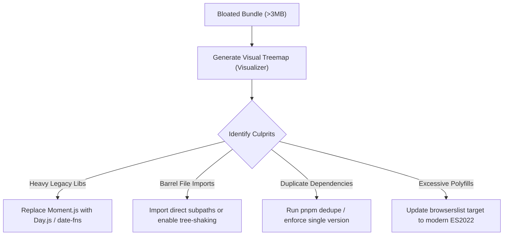

## Scenario

> **How would you reduce JavaScript bundle size?**

Every kilobyte of JavaScript has a double cost: network download time and CPU parse/compile time on mobile devices. Interviewers want concrete, actionable reduction tactics.

## Fast Revision (10-Second Recall)

- **First Move:** Run **`webpack-bundle-analyzer`** or **`rollup-plugin-visualizer`** to generate a treemap of all chunk contents.
- **Common Reductions:**
- 1. Replace bloated libraries (Moment.js $\rightarrow$ date-fns / Day.js, Lodash $\rightarrow$ native ES6 or lodash-es).
- 2. Fix broken tree-shaking caused by CommonJS imports or side-effects.
- 3. Eliminate duplicate library versions (`npm dedupe` / `pnpm.overrides`).
- 4. Target modern browsers (`es2022`) to eliminate unnecessary polyfills (`core-js`).

## The 30-Second Spoken Script

If asked this in an interview, deliver this structured response:

> *To reduce JavaScript bundle size, I begin with visual data rather than assumptions.*
>
> *I run rollup-plugin-visualizer or webpack-bundle-analyzer to generate an interactive treemap of our production bundle. This immediately exposes the largest dependencies, duplicate packages, and accidentally bundled dev tools.*
>
> *Next, I target high-impact wins:
First, replacing heavyweight legacy libraries like Moment.js (which bundles hundreds of un-treeshakable locales) with Day.js or date-fns, and switching monolithic imports like lodash to native JavaScript methods or modular ES imports.*
>
> *Second, I ensure package.json specifies 'sideEffects: false' where applicable, allowing bundlers to safely strip unused exported functions.*
>
> *Third, I update our browserslist target to modern ES2022 to eliminate heavy legacy polyfills like core-js. Finally, I enforce size-limit in our CI pipeline so PRs fail if bundle size increases.*

## Diagnostic Lifecycle



## Root Causes & Solutions Matrix

| Suspected Layer | Symptoms & Evidence | Immediate Resolution |
| :--- | :--- | :--- |
| **Moment.js / Lodash** | Moment.js accounts for 400kB alone due to international locale bundling. | Replace with native `Intl.DateTimeFormat` or `date-fns` / `dayjs`. |
| **Accidental Full Icon Bundles** | Importing one icon from `lucide-react` or `react-icons` pulls in 3,000 SVG components. | Use named ES imports or direct path imports (`lucide-react/dist/esm/icons/check`). |
| **Duplicate Dependencies** | Bundle contains both `lodash@4.17.15` and `lodash@4.17.21` due to nested transitive dependencies. | Run `npm dedupe` or add package overrides in `package.json`. |
| **Legacy Polyfills** | `core-js` polyfilling Promises and Array methods for IE11 in 2026. | Adjust `browserslist` to `defaults, not IE 11, >0.5%`. |

## Practical Debugging Commands & Code

### Bundle Reduction Config: Rollup Visualizer & Selective Imports
```typescript
// 1. vite.config.ts - Visualizer & Modern Target
import { defineConfig } from 'vite';
import { visualizer } from 'rollup-plugin-visualizer';

export default defineConfig({
  build: {
    target: 'es2022', // Avoids transpiling modern syntax into verbose polyfills
    rollupOptions: {
      plugins: [
        visualizer({
          filename: './dist/stats.html',
          open: false,
          gzipSize: true,
          brotliSize: true,
        }),
      ],
    },
  },
});

// 2. Code Level: Bad vs Good Import Patterns

// ❌ BAD: Pulls entire 70kB lodash package into chunk
import _ from 'lodash';
const result = _.cloneDeep(data);

// ✅ GOOD: Pulls only native structuredClone (0kB added)
const result = structuredClone(data);

// ❌ BAD: Moment bundles all world locales
import moment from 'moment';
const formatted = moment().format('YYYY-MM-DD');

// ✅ GOOD: Native modern browser Intl API
const formatted = new Intl.DateTimeFormat('en-US').format(new Date());
```

## Prevention & Senior Best Practices

1. **Size-Limit GitHub Action:** Set up `size-limit` to comment on PRs with the exact delta (+4.2kB) and fail if thresholds are exceeded.
2. **Audit `package.json` Before Adding Libs:** Check `bundlephobia.com` before approving any new dependency; reject libraries with heavy transitive footprints.
3. **Use Lightweight Alternatives:** Prefer `zustand` (1kB) over `redux-toolkit` (12kB), or `ky` / `fetch` (1kB) over `axios` (14kB) if features are not needed.
