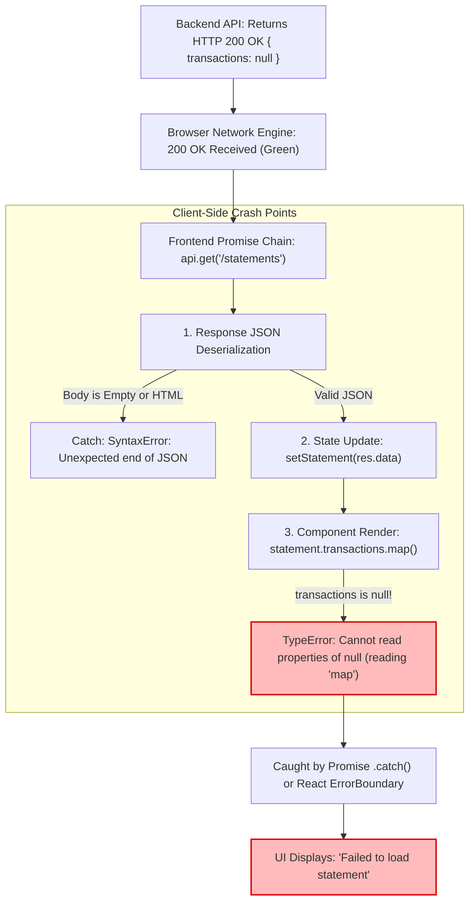

## Fast Revision (10-Second Recall)
- **The Core Paradox:** The network tab shows `HTTP 200 OK` with green status, but the user interface renders an error banner or crashes with a blank screen.
- **Top 5 Root Causes:**
  1. *JSON Parsing Failure:* Backend returns empty string `""`, HTML (e.g. Nginx error page with 200), or malformed JSON; calling `res.json()` in the frontend throws an unhandled SyntaxError into the `catch` block.
  2. *Missing / Incomplete DTO Fields:* Frontend component executes `user.address.street` without optional chaining; if `address` is null, JavaScript throws `TypeError: Cannot read properties of null`, caught by the API promise catch block.
  3. *HTTP Client Library Quirks:* Axios throws an error if `validateStatus` fails, or if a custom response interceptor rejects the promise based on a custom business code (e.g. `{ code: "WARN_INVENTORY_LOW" }`).
  4. *React Error Boundary Catch:* The API call succeeded, but rendering the resulting data inside the React component tree threw an error, triggering the parent `<ErrorBoundary>` fallback.
  5. *CORS Header Missing on 200:* Backend processed the request and committed database changes, but omitted `Access-Control-Allow-Origin`; the browser blocks the frontend JavaScript from reading the response and triggers an error!

## The 30-Second Spoken Script
> "When the browser Network tab shows that an API request returned HTTP 200 OK but the UI displays an error banner, the failure is occurring inside the client-side JavaScript execution pipeline after the network bytes arrived.
>
> We diagnose this by checking three specific failure points:
> First, **Response Parsing Failures**: We check if calling `response.json()` threw a SyntaxError. This happens frequently when an API endpoint returns an empty body (`204 No Content` or empty 200), or when a proxy intercepts the call and returns an HTML error page with a 200 status code.
> Second, **Component Render Crashes Caught by Error Handlers**: The API response arrived, but when the component attempted to render the data, it accessed a property on an undefined object (such as `data.profile.avatar.url` when `avatar` was null). If the state update occurred inside the `.then()` block, the resulting render exception is caught by the `.catch()` block, falsely displaying an 'API Failed' message.
> Third, **CORS Blocking on Successful Responses**: A subtle browser security trap: if the backend processes the request, mutates the database, and returns 200 OK, but omits the `Access-Control-Allow-Origin` header, the browser's security engine blocks the frontend from reading the body, throwing `TypeError: Failed to fetch` directly into the catch block."

## Scenario / Problem Context
An online banking platform allowed customers to view their monthly credit card statements. A user navigated to `/statements/october-2026`.

The screen flashed and displayed a red alert banner:
`"Failed to load statement. Please contact customer support."`

The developer opened Chrome DevTools Network tab:
- Request: `GET /api/v1/statements/stmt_10029`
- Status: **200 OK**
- Time: 45ms
- Response Payload:
```json
{
  "statementId": "stmt_10029",
  "billingPeriod": "October 2026",
  "totalDue": 1250.00,
  "transactions": null
}
```

The backend developer stated: *"The API returned 200 OK with valid data. The bug is on the frontend."*
The frontend developer stated: *"My catch block caught an error, so the API is failing."*

The team needs an exact debugging procedure to isolate why a successful 200 OK request results in a client error banner.

## Architectural Workflow / Sequence


## Deep-Dive Analysis & Root Causes

### 1. The Async Catch-All Anti-Pattern
A pervasive bug in modern React code:
```typescript
async function loadData() {
  try {
    const res = await fetch('/api/v1/data');
    const data = await res.json();
    setData(data); // State update triggers immediate component render!
    // If the component crashes while rendering 'data',
    // the TypeError bubbles directly into this catch block!
  } catch (err) {
    // Shows misleading "API Error" when the bug is actually a frontend render crash!
    setErrorMessage('API request failed'); 
  }
}
```
If `setData(data)` triggers a synchronous React render, and the component attempts `data.transactions.map()` when `transactions` is null, the `TypeError` is caught by `loadData`'s `catch` block! The developer mistakenly blames the API.

### 2. Response Body Mismatches (`res.json()` on Empty Body)
When backend developers return `res.status(200).send()` or `res.status(204).end()`:
- The HTTP response body contains 0 bytes.
- When frontend code executes `await res.json()`:
- The JSON parser throws `SyntaxError: Unexpected end of JSON input`.
- The promise rejects and enters the error handler.

### 3. Missing CORS Headers on 200 OK Responses
In cross-origin architectures:
- The browser sends the request.
- The backend processes the request and commits database mutations.
- The backend returns 200 OK, but forgot `res.setHeader('Access-Control-Allow-Origin', 'https://app.company.com')`.
- The browser refuses to expose the response body to JavaScript, throwing `TypeError: NetworkError when attempting to fetch resource`.

## Practical Debugging Commands & Code

### Step 1: Isolating Network Success from Component Render Crashes
Decouple API fetching from state updates, and use safe defensive rendering:

```typescript
// frontend/src/components/StatementView.tsx
import React, { useState, useEffect } from 'react';

export function StatementView({ statementId }: { statementId: string }) {
  const [statement, setStatement] = useState<any>(null);
  const [apiError, setApiError] = useState<string | null>(null);

  useEffect(() => {
    let isMounted = true;

    async function fetchStatement() {
      try {
        const res = await fetch(`/api/v1/statements/${statementId}`);

        // 1. Explicitly verify HTTP Status
        if (!res.ok) {
          throw new Error(`HTTP Error: ${res.status} ${res.statusText}`);
        }

        // 2. Safe JSON Parsing (Handle empty body gracefully)
        const text = await res.text();
        const data = text ? JSON.parse(text) : null;

        if (isMounted) {
          setStatement(data);
        }
      } catch (err: any) {
        console.error('Real Network/API Failure:', err);
        if (isMounted) setApiError(err.message);
      }
    }

    fetchStatement();
    return () => { isMounted = false; };
  }, [statementId]);

  if (apiError) return <div className="alert-error">Network Error: {apiError}</div>;
  if (!statement) return <div>Loading statement...</div>;

  return (
    <div>
      <h2>{statement.billingPeriod}</h2>
      <p>Total Due: ${statement.totalDue}</p>

      {/* 3. DEFENSIVE RENDERING: Optional chaining & fallback array prevents TypeError! */}
      <h3>Transactions</h3>
      {statement.transactions?.length > 0 ? (
        <ul>
          {statement.transactions.map((tx: any) => (
            <li key={tx.id}>{tx.description}: ${tx.amount}</li>
          ))}
        </ul>
      ) : (
        <p>No transactions recorded for this period.</p>
      )}
    </div>
  );
}
```

### Step 2: Adding a Global React Error Boundary
Catch render-phase crashes and prevent them from confusing network handlers:

```typescript
// frontend/src/components/ErrorBoundary.tsx
import React, { Component, ErrorInfo, ReactNode } from 'react';

interface Props { children: ReactNode; }
interface State { hasError: boolean; error: Error | null; }

export class ErrorBoundary extends Component<Props, State> {
  public state: State = { hasError: false, error: null };

  public static getDerivedStateFromError(error: Error): State {
    return { hasError: true, error };
  }

  public componentDidCatch(error: Error, errorInfo: ErrorInfo) {
    console.error('COMPONENT RENDER CRASH (Not an API failure!):', error, errorInfo);
  }

  public render() {
    if (this.state.hasError) {
      return (
        <div className="p-4 bg-red-100 text-red-800">
          <h3>UI Component Rendering Error</h3>
          <p>{this.state.error?.message}</p>
        </div>
      );
    }
    return this.props.children;
  }
}
```

### Step 3: Fast CLI Diagnostic via cURL
Verify the exact raw response body and headers returned by the server:
```bash
# Fetch with raw headers and body
curl -i -X GET https://api.company.com/api/v1/statements/stmt_10029 \
  -H "Authorization: Bearer test_token" \
  -H "Accept: application/json"

# Check:
# 1. Is Content-Type application/json?
# 2. Is the body non-empty?
# 3. Are expected fields null?
```

## Prevention & Senior Best Practices
1. **Always Use Optional Chaining on DTOs:** Never write `data.user.profile.name`; always use `data?.user?.profile?.name ?? 'Unknown'` to prevent null pointer render crashes.
2. **Never Call `res.json()` on Empty Bodies:** If an API endpoint returns no data, return `HTTP 204 No Content` and check `res.status === 204` before attempting to parse JSON.
3. **Wrap Views in React Error Boundaries:** Use Error Boundaries around major UI modules so component render bugs display localized UI warnings rather than masquerading as network failures.
4. **Enforce TypeScript Strict Null Checks:** Enable `"strict": true` and `"strictNullChecks": true` in `tsconfig.json` so the TypeScript compiler catches unhandled `null` or `undefined` properties at compile time.
5. **Always Set Explicit Content-Type Headers:** Ensure backend APIs always return `Content-Type: application/json; charset=utf-8` on JSON endpoints to prevent browser MIME-sniffing discrepancies.

