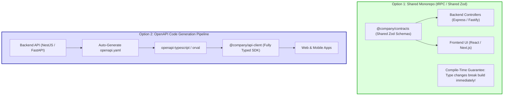

## Fast Revision (10-Second Recall)
- **The Core Problem:** The frontend expects `{ user: { name, role } }`, but the backend returns `{ data: { user_name, user_role } }`. Handcrafted types on both sides inevitably diverge over time ("Contract Drift").
- **Root Cause:** Decentralized contract ownership where frontend and backend teams independently write TypeScript interfaces or read outdated Notion/Postman documentation.
- **The 3 Modern Solutions:**
  1. *Shared Monorepo Schema (tRPC / Zod):* Single shared npm package or Turborepo package containing schemas used by both frontend and backend.
  2. *OpenAPI Code Generation:* Backend code generates OpenAPI 3.0 spec $\rightarrow$ CI automatically generates typed TypeScript client SDK (`openapi-typescript-codegen`) for the frontend.
  3. *Backend-for-Frontend (BFF):* Deploy a lightweight Node.js/GraphQL layer owned by the frontend team that transforms diverse microservice payloads into exact UI expectations.
- **Consumer-Driven Contract Testing:** Use Pact to automatically fail backend CI builds if backend payload changes violate registered frontend expectations.

## The 30-Second Spoken Script
> "When the backend and frontend have mismatched API response expectations, the fundamental architectural failure is **lack of a single source of truth for API contracts**.
>
> In high-performing engineering teams, we resolve this through automated schema synchronization rather than manual coordination:
> First, **Code Generation from OpenAPI or Shared Schemas**: In a monorepo, we maintain a shared TypeScript package using Zod or tRPC, where the API request/response types are defined once and imported directly by both Express controllers and React components. If the monorepo is split, we treat the OpenAPI 3.0 specification as our source of truth. Every backend commit automatically regenerates a strongly typed frontend client SDK using `openapi-typescript`. A breaking backend change will cause the frontend TypeScript build to fail at compile time before code ever merges.
> Second, **Backend-for-Frontend (BFF) Pattern**: When frontend applications (Web, iOS, Android) require different payload shapes from complex internal microservices, we introduce a BFF layer. The frontend team owns the BFF, aggregating and shaping downstream API responses into the exact, optimized view models required by the UI."

## Scenario / Problem Context
An online food delivery startup operated with separate frontend (React/Next.js) and backend (Go/Java microservices) teams.

During a checkout overhaul:
- The backend team decided to standardize date formats to ISO-8601 strings: `"estimatedDeliveryTime": "2026-10-31T20:30:00Z"`.
- The frontend team's TypeScript interface had been manually copied 6 months ago, expecting an epoch integer: `estimatedDeliveryTime: number`.
- The frontend code executed:
  `const minutesLeft = Math.round((order.estimatedDeliveryTime - Date.now()) / 60000);`
- In JavaScript, `"2026-10-31T20:30:00Z" - Date.now()` evaluated to `NaN`!
- The customer checkout screen displayed: `"Your food will arrive in NaN minutes!"`

The post-mortem revealed that there were 47 other endpoints where frontend TypeScript types had drifted from actual backend JSON responses.

The organization needs an automated contract synchronization architecture that makes payload drift physically impossible.

## Architectural Workflow / Sequence


## Deep-Dive Analysis & Root Causes

### 1. The Fallacy of Manual Type Synchronization
When frontend developers manually write:
```typescript
// frontend/src/types/order.ts (Manually copied from Slack!)
export interface Order {
  id: string;
  total_cents: number;
}
```
And backend developers independently write:
```typescript
// backend/src/entities/order.ts
export class Order {
  id: string;
  totalAmount: number; // Renamed during refactor!
}
```
This is guaranteed to fail. Without an automated synchronization pipeline, human communication delays and independent sprint releases will cause contract drift across every release cycle.

### 2. The Backend-for-Frontend (BFF) Architecture
When you have multiple client form factors:
- Mobile apps on cellular need compact, minimized JSON payloads.
- Desktop web apps need rich, expanded relational data.
- Directly coupling both to core microservices creates endless arguments between teams.
- **Solution (BFF):** Each client owns its own BFF server (Node.js / GraphQL). The BFF calls the core backend microservices, handles transformations, maps legacy fields, and serves the tailored response to the client.

### 3. Consumer-Driven Contracts (Pact)
Instead of the backend dictating the contract, the frontend writes a contract test:
`"I expect GET /orders/1 to contain property 'total_cents' as a number"`
This contract is published to a central Pact Broker. Whenever the backend runs CI, it tests against all registered consumer contracts. If a backend engineer renames `total_cents`, the backend build fails immediately.

## Practical Debugging Commands & Code

### Step 1: Sharing Schemas in a Monorepo via Zod (Turborepo / Nx)
Define the contract once in a shared package:

```typescript
// packages/contracts/src/order.ts
import { z } from 'zod';

export const OrderSchema = z.object({
  id: z.string().uuid(),
  totalCents: z.number().int().positive(),
  status: z.enum(['PENDING', 'PAID', 'DELIVERED']),
  estimatedDeliveryIso: z.string().datetime(),
});

export type Order = z.infer<typeof OrderSchema>;
```

Backend controller enforces output conformity:
```typescript
// apps/backend/src/controllers/orderController.ts
import { Order, OrderSchema } from '@company/contracts';

app.get('/api/orders/:id', async (req, res) => {
  const rawOrder = await db.getOrder(req.params.id);

  // Parse and validate outgoing response! Throws error if contract is violated
  const validatedOrder: Order = OrderSchema.parse({
    id: rawOrder.id,
    totalCents: rawOrder.total_amount_cents,
    status: rawOrder.status,
    estimatedDeliveryIso: rawOrder.estimated_delivery.toISOString(),
  });

  res.json(validatedOrder);
});
```

Frontend automatically consumes the exact same type:
```typescript
// apps/frontend/src/components/OrderDetail.tsx
import React from 'react';
import { Order } from '@company/contracts'; // Exact same type!

export function OrderDetail({ order }: { order: Order }) {
  // Guaranteed type-safety: order.totalCents is strictly number, estimatedDeliveryIso is ISO string!
  const deliveryDate = new Date(order.estimatedDeliveryIso);

  return (
    <div>
      <h3>Order #{order.id}</h3>
      <p>Total: ${(order.totalCents / 100).toFixed(2)}</p>
      <p>Delivery by: {deliveryDate.toLocaleTimeString()}</p>
    </div>
  );
}
```

### Step 2: Automated SDK Generation via `openapi-typescript`
In non-monorepo architectures, generate frontend types directly from the backend OpenAPI endpoint:

```bash
# In frontend CI build: Fetch live OpenAPI spec and generate strict TypeScript interfaces
npx openapi-typescript https://api.company.com/docs/json -o src/api/schema.d.ts

# Generate typed fetch client
npx openapi-fetch src/api/schema.d.ts -o src/api/client.ts
```

Frontend code uses the auto-generated typed fetch client:
```typescript
import createClient from 'openapi-fetch';
import { paths } from './schema';

const client = createClient<paths>({ baseUrl: 'https://api.company.com' });

// Fully typed! Autocomplete works for paths, query params, and response bodies!
const { data, error } = await client.GET('/api/v1/orders/{id}', {
  params: { path: { id: '123' } },
});
```

## Prevention & Senior Best Practices
1. **Never Manually Copy TypeScript Types:** Eliminate manual copying of interfaces between frontend and backend codebases.
2. **Share Contracts via Monorepo or Generated OpenAPI SDKs:** Standardize on Zod/tRPC in monorepos or auto-generate typed TypeScript clients from OpenAPI specifications.
3. **Fail Backend CI on Contract Breaches:** Run `oasdiff` or Pact contract verifications in backend pull requests to prevent merging changes that break registered frontend expectations.
4. **Deploy a Backend-for-Frontend (BFF) Layer:** For complex multi-client platforms (Web vs Mobile), let frontend teams maintain a dedicated Node.js/GraphQL BFF layer to decouple UI views from microservices.
5. **Always Use ISO-8601 Strings for Timestamps:** Eliminate ambiguities between milliseconds, seconds, and local date strings by mandating UTC ISO-8601 strings (`2026-10-31T20:30:00.000Z`) across all APIs.

