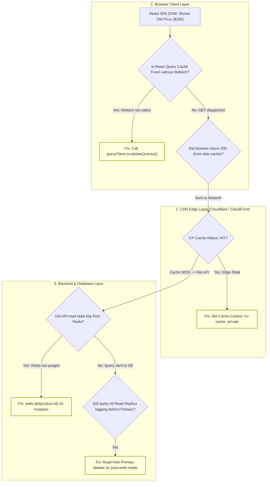

## Fast Revision (10-Second Recall)
- **The Stale Data Spectrum:** Browser In-Memory Cache (React Query/Redux) $\rightarrow$ Browser HTTP Cache (Disk/304 Not Modified) $\rightarrow$ Edge CDN Cache (Cloudflare/CloudFront) $\rightarrow$ Backend Cache (Redis) $\rightarrow$ Database Read Replica Lag.
- **Top 4 Root Causes:**
  1. *Missing Frontend Cache Invalidation:* React Query / RTK Query does not call `queryClient.invalidateQueries()` after mutation, keeping stale cached JSON in memory.
  2. *Aggressive HTTP Cache-Control:* Backend returns `Cache-Control: public, max-age=3600` on dynamic API endpoints; browser or CDN serves cached response without contacting server.
  3. *Un-Purged Redis Layer:* Backend updates PostgreSQL master but fails to invalidate or update the corresponding Redis cache key (`user:{id}`).
  4. *Database Read Replica Lag:* Backend write went to Primary, but subsequent read query hit a Read Replica lagging 2 seconds behind.
- **Immediate Diagnostic Check:** Bypass browser cache with `Ctrl + F5` (Hard Reload) or inspect response headers for `Age`, `CF-Cache-Status: HIT`, or `X-Cache: Hit from cloudfront`.

## The 30-Second Spoken Script
> "When a database record is updated but the frontend continues displaying old data, the issue is almost always a breakdown in **cache invalidation** somewhere along the response delivery path.
>
> We isolate the stale layer by working backwards from the client to the database:
> First, **Browser In-Memory State**: We check React Query, Apollo, or Redux state in DevTools. Did the mutation trigger `queryClient.invalidateQueries()`? If the frontend never refetched the data, the UI is displaying stale in-memory state.
> Second, **HTTP & CDN Edge Caching**: We inspect the Network tab for the GET request. Did it return `304 Not Modified` or `200 OK (from disk cache)`? Did response headers include `CF-Cache-Status: HIT` or `Age: 320`? If an API endpoint returns `Cache-Control: public, max-age=300`, Cloudflare or the browser will serve stale data for 5 minutes regardless of database changes.
> Third, **Backend Redis Caching**: Does the backend service cache query results in Redis? Did the update mutation purge the Redis key?
> Fourth, **Database Replication Lag**: In primary-replica architectures, writes go to the Primary, while reads query Read Replicas. If replication lag is 500ms and the frontend refetches 50ms post-update, the replica returns the old record."

## Scenario / Problem Context
An online marketplace allowed vendors to update product pricing. A vendor changed a product price from $150 to $120 and clicked "Update Price."

The vendor refreshed the page. The price still displayed as **$150**. 

The vendor panicked, assuming the system failed, and submitted a high-priority bug report.

The database administrator checked the database master:
`SELECT id, price FROM products WHERE id = 'prod_991';`
Result: `price = 120.00` (The database was completely updated!).

Yet when any user loaded the product page:
`GET /api/v1/products/prod_991`
The API response returned: `{ "id": "prod_991", "price": 150 }`.

The engineering team needs an exhaustive full-stack debugging playbook to identify where the stale data is cached and enforce immediate consistency.

## Architectural Workflow / Sequence


## Deep-Dive Analysis & Root Causes

### 1. HTTP Cache-Control Header Misconfigurations
If a backend developer configures global middleware:
`app.use((req, res, next) => { res.setHeader('Cache-Control', 'public, max-age=300'); next(); });`
- The browser and intermediate CDNs will cache `GET /api/v1/products/prod_991` for 5 minutes.
- When the user executes `PUT /api/v1/products/prod_991`, the database updates immediately.
- But when the browser immediately sends `GET /api/v1/products/prod_991`, the browser doesn't even make a network request! It reads from local disk cache and serves the old price.
- **Rule:** Dynamic user/authenticated APIs must **always** return:
  `Cache-Control: private, no-cache, no-store, must-revalidate`

### 2. The Read Replica Lag (Read-Your-Own-Writes Consistency)
In high-traffic architectures with AWS Aurora or PostgreSQL read replicas:
1. Vendor submits `PUT /products/prod_991` $\rightarrow$ Writes to Primary Master (Committed at $t=0.00\text{s}$).
2. React Query immediately triggers `GET /products/prod_991` at $t=0.02\text{s}$.
3. Load balancer routes the GET request to Read Replica 2.
4. Read Replica 2 is experiencing 250ms replication lag due to a heavy background report!
5. Replica 2 reads the pre-update row and returns price = $150.
6. The vendor sees old data!

### 3. Redis Cache-Aside Invalidation Failures
If using the Cache-Aside pattern:
- Read: `redis.get(key) || (db.query() && redis.set(key))`.
- Update: If the developer executes `db.update()` but forgets `redis.del(key)`, or if the Redis command fails silently, Redis continues serving the old value until TTL expires.

## Practical Debugging Commands & Code

### Step 1: Inspecting HTTP Headers for Cache Hits
Run `curl -Iv` to check where the response originated:

```bash
curl -Iv https://api.company.com/api/v1/products/prod_991 \
  -H "Authorization: Bearer token"
```

Inspect the response headers:
```text
HTTP/2 200
cf-cache-status: HIT        <-- Cloudflare served stale cache!
age: 240                    <-- Stale by 240 seconds!
cache-control: public, max-age=300
```
If `cf-cache-status: HIT`, the request never reached your server!

### Step 2: Enforcing No-Cache on Dynamic Authenticated Endpoints
```typescript
// src/middleware/noCache.ts
import { Request, Response, NextFunction } from 'express';

export function disableHttpCache(req: Request, res: Response, next: NextFunction) {
  // Prevent browser and CDN caching on dynamic API routes
  res.setHeader('Cache-Control', 'no-store, no-cache, must-revalidate, proxy-revalidate');
  res.setHeader('Pragma', 'no-cache');
  res.setHeader('Expires', '0');
  res.setHeader('Surrogate-Control', 'no-store');
  next();
}
```

### Step 3: Proper React Query Invalidation on Mutation
Ensure the UI refetches the latest database state upon mutation success:

```typescript
// frontend/src/hooks/useUpdateProduct.ts
import { useMutation, useQueryClient } from '@tanstack/react-query';

export function useUpdateProductPrice() {
  const queryClient = useQueryClient();

  return useMutation({
    mutationFn: async ({ productId, newPrice }: { productId: string; newPrice: number }) => {
      const res = await fetch(`/api/v1/products/${productId}`, {
        method: 'PATCH',
        headers: { 'Content-Type': 'application/json' },
        body: JSON.stringify({ price: newPrice }),
      });
      return res.json();
    },
    onSuccess: (updatedProduct, variables) => {
      // 1. Invalidate query cache so active views refetch immediately
      queryClient.invalidateQueries({ queryKey: ['product', variables.productId] });
      
      // 2. Or directly update the cache with the server response!
      queryClient.setQueryData(['product', variables.productId], updatedProduct);
    },
  });
}
```

### Step 4: Solving Read Replica Lag (Read-Your-Own-Writes via Pinning)
Pin users who recently performed writes to read from the Primary Master for 5 seconds:

```typescript
// src/database/readWriteSplitter.ts
import { Request } from 'express';

export function getDatabaseConnectionForUser(req: Request) {
  const userId = (req as any).user?.id;
  
  // If user performed a write in the last 5 seconds, route GET to PRIMARY master!
  const hasRecentWrite = userRecentWriteCache.has(userId);

  if (hasRecentWrite || req.method !== 'GET') {
    return primaryMasterConnection; // Guarantees Read-Your-Own-Writes consistency!
  }

  // Otherwise, safely load balance across read replicas
  return readReplicaPool.getRandomConnection();
}
```

## Prevention & Senior Best Practices
1. **Never Send `Cache-Control: public` on Authenticated APIs:** Dynamic API endpoints returning user-specific or mutable data must always return `Cache-Control: no-store`.
2. **Implement Read-Your-Own-Writes Session Pinning:** When a user executes a mutating request (POST, PUT, DELETE), pin their subsequent read requests to the Primary Master database for 3-5 seconds to outlast replication lag.
3. **Invalidate React Query Caches on Mutation:** Ensure all mutations call `queryClient.invalidateQueries()` or update cache in-place with the response object.
4. **Purge Redis Keys in the Same Transaction:** Invalidate Redis cache keys immediately following database commits; never rely solely on TTL expiration for critical business entities.
5. **Add Cache Invalidation Tracing:** Include a response header like `X-Cache-Source: DB_PRIMARY`, `DB_REPLICA`, or `REDIS` in development mode to make cache routing obvious during debugging.

