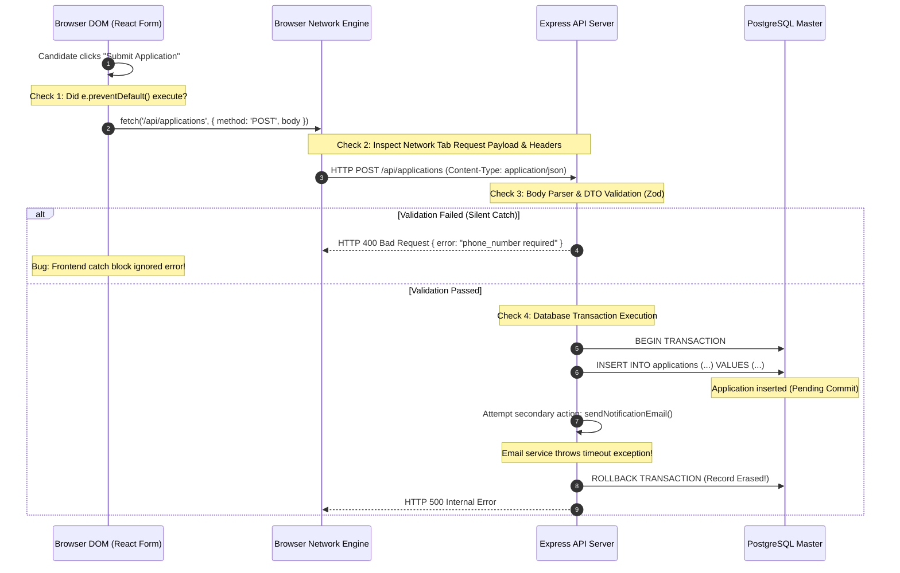

## Fast Revision (10-Second Recall)
- **The End-to-End Triage Path:** Browser Form Submit Event $\rightarrow$ Network Tab (Payload & Headers) $\rightarrow$ API Gateway / CORS $\rightarrow$ Route Controller / DTO Validation $\rightarrow$ Database Transaction / Commit $\rightarrow$ Database Inspection.
- **Top 5 Failure Points:**
  1. *Frontend Event Cancellation:* Missing `e.preventDefault()`, causing the browser to submit a standard form POST and cancel the async `fetch()` promise during page reload.
  2. *Payload / Header Mismatch:* Missing `Content-Type: application/json` causing backend body parser to parse an empty `{}` object.
  3. *Silent Schema Validation Rejection:* Backend validation middleware (Zod, class-validator) rejects payload with 400, but frontend catch-block swallows the error.
  4. *Uncommitted Transaction:* Backend executes `INSERT` inside an open transaction but throws an unhandled error before `COMMIT`, triggering an automatic rollback.
  5. *Database Connection / Replica Query:* Backend wrote to Primary, but the developer checked a stale Read Replica or wrong database environment.

## The 30-Second Spoken Script
> "When a user submits a form and the record is not saved, jumping directly into backend code is a mistake. I trace the data flow systematically through the full stack across five inspection gates:
>
> 1. **Browser Layer**: I inspect DevTools Console and Network tabs. Did the form fire `e.preventDefault()`? What were the exact HTTP status, request headers, and payload sent? Did the network request complete, or was it aborted by a page refresh?
> 2. **Ingress and Middleware Layer**: Did the request reach the API gateway? Was it rejected by CORS or request body size limits? Does the request body match the backend's expected JSON format?
> 3. **Controller & Business Logic**: I check application logs using the request's Correlation ID. Did the request pass DTO validation, or was it rejected with HTTP 422? Did an unhandled exception occur in a downstream service?
> 4. **Database & Transaction Layer**: Did the SQL `INSERT` execute? Was the transaction explicitly committed, or did a subsequent step throw an error causing an automatic `ROLLBACK`?
> 5. **Persistence Verification**: I query the primary database master directly using `psql`, ensuring I am not querying a read replica suffering from replication lag or the staging environment."

## Scenario / Problem Context
A SaaS applicant tracking system allowed candidates to submit job applications with their resumes. A candidate filled out a 15-field application form, clicked "Submit Application," and saw the submit button briefly disable. 

However, HR recruiters reported that the candidate's application never appeared on their dashboard.

The developer checked the database:
`SELECT * FROM applications WHERE email = 'alex@example.com';`
Result: 0 rows found.

The frontend developer claimed: *"The form calls the API without errors."*
The backend developer claimed: *"The API is working fine; there are no recent error logs."*

The team needs a step-by-step diagnostic methodology to locate the exact breakdown point in the end-to-end data pipeline.

## Architectural Workflow / Sequence


## Deep-Dive Analysis & Root Causes

### 1. Frontend: The Missing `e.preventDefault()` Trap
In standard HTML forms:
```typescript
function handleSubmit(e: React.FormEvent) {
  // MISSING: e.preventDefault();
  fetch('/api/v1/applications', { method: 'POST', body: JSON.stringify(data) });
}
```
If `e.preventDefault()` is omitted, the browser triggers a native form submission simultaneously, immediately reloading the page. The browser's networking engine cancels the in-flight asynchronous `fetch()` request (`net::ERR_ABORTED`), and the backend never receives the complete payload.

### 2. Middleware & Body Parser Mismatches
If the client submits data with `headers: { 'Content-Type': 'multipart/form-data' }` or forgets `headers: { 'Content-Type': 'application/json' }`:
- Express `express.json()` middleware ignores the request body.
- `req.body` is initialized as empty `{}`.
- If the controller does not enforce validation, it executes `INSERT INTO applications (name, email) VALUES (null, null)`, which fails silently or gets rejected without proper logging.

### 3. The Uncommitted Database Transaction (Ghost Writes)
A classic backend bug:
```typescript
const runner = dataSource.createQueryRunner();
await runner.startTransaction();
await runner.manager.save(application); // Insert executed in DB engine!
await sendSlackNotification(); // Throws Error: Network unreachable
await runner.commitTransaction(); // NEVER REACHED!
```
Because the secondary operation threw an error, the catch block executed `await runner.rollbackTransaction()`. The record was inserted into the database engine, held temporarily in memory, and then completely rolled back.

## Practical Debugging Commands & Code

### Step 1: Frontend Network Tab Inspection
Open Chrome DevTools $\rightarrow$ Network $\rightarrow$ filter by `Fetch/XHR`:
- **Status:** Is it `200`, `400`, `500`, or `(canceled)`?
- **Payload:** Inspect `Request Payload`. Is it formatted as valid JSON? Are fields named identically to backend DTO expectations (`firstName` vs `first_name`)?
- **Response:** Inspect the error envelope returned by the backend.

### Step 2: Backend Validation Middleware with Explicit Error Envelopes (Zod)
Prevent silent body drops by enforcing strict schema parsing:

```typescript
// src/middleware/validate.ts
import { Request, Response, NextFunction } from 'express';
import { ZodSchema } from 'zod';

export const validateRequest = (schema: ZodSchema) => {
  return (req: Request, res: Response, next: NextFunction) => {
    const result = schema.safeParse(req.body);

    if (!result.success) {
      console.warn('Form validation failed:', JSON.stringify(result.error.issues, null, 2));
      return res.status(400).json({
        error: 'VALIDATION_FAILED',
        details: result.error.issues.map((i) => ({ field: i.path.join('.'), message: i.message })),
      });
    }

    req.body = result.data; // Overwrite with sanitized, typed data
    next();
  };
};
```

### Step 3: Hardened Database Transaction Pattern (Isolated Side Effects)
Never put non-critical side effects (like emails or analytics) inside the database transaction:

```typescript
// src/services/applicationService.ts
export async function createJobApplication(data: ApplicationInput) {
  let savedApplicationId: string;

  // 1. Database Transaction strictly encapsulates database persistence
  const queryRunner = dataSource.createQueryRunner();
  await queryRunner.connect();
  await queryRunner.startTransaction();

  try {
    const app = queryRunner.manager.create(Application, data);
    const saved = await queryRunner.manager.save(app);
    savedApplicationId = saved.id;

    // COMMIT immediately once database write is complete!
    await queryRunner.commitTransaction();
  } catch (err) {
    await queryRunner.rollbackTransaction();
    throw err;
  } finally {
    await queryRunner.release();
  }

  // 2. Secondary side effects run OUTSIDE the transaction!
  // If email fails, the candidate's application is STILL safely saved in DB!
  try {
    await sendConfirmationEmail(data.email);
  } catch (emailErr) {
    console.error('Non-critical: Confirmation email failed to send:', emailErr);
  }

  return { id: savedApplicationId };
}
```

### Step 4: Database Live Query Inspection
Check PostgreSQL for recent transaction rollbacks and locks:
```sql
-- Check total rollbacks vs commits on the database
SELECT datname, xact_commit, xact_rollback FROM pg_stat_database WHERE datname = 'app_db';

-- Search PostgreSQL logs for constraint violations
-- grep -i "violates" /var/log/postgresql/postgresql.log
```

## Prevention & Senior Best Practices
1. **Always Isolate Non-Database Side Effects:** Never execute external HTTP calls, email dispatches, or file uploads inside an open database transaction block. Commit database state first.
2. **Never Swallow Errors in Frontend Catch Blocks:** Ensure every `try/catch` in UI form handlers displays a user-visible toast error message with server validation details.
3. **Use Shared TypeScript Schemas (Zod / tRPC):** Share validation schemas between frontend and backend to guarantee that payload property names and types never diverge.
4. **Log Request Payloads on Validation Failure:** Log all HTTP 400 validation failures with incoming payloads and IP addresses so support can reconstruct candidate submissions.
5. **Enforce Database Primary-Master Queries:** Ensure write verification scripts and customer-facing read queries immediately post-submission route to the primary database to prevent read-replica lag confusion.

