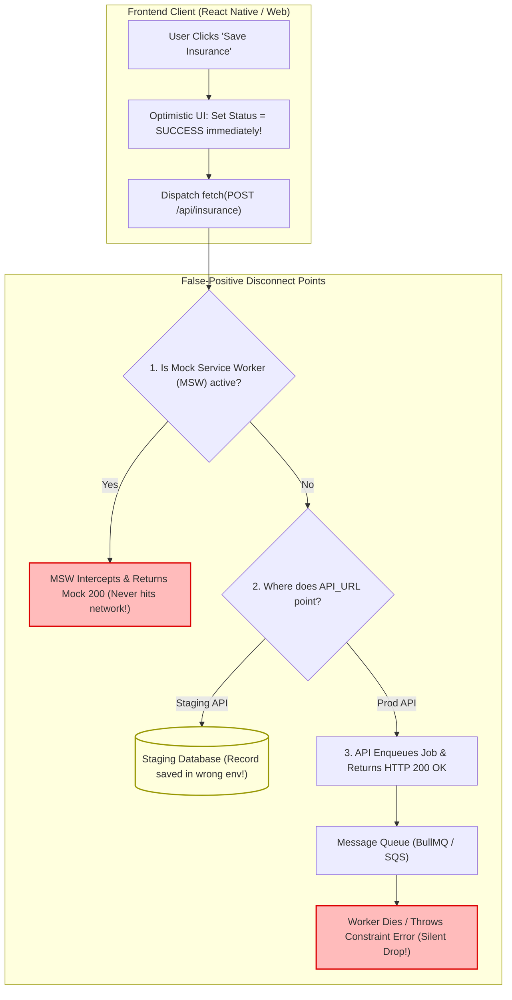

## Fast Revision (10-Second Recall)
- **Top 5 Root Causes:**
  1. *Un-Reverted Mock Service Worker (MSW):* Frontend is intercepting requests in development/staging and returning synthetic 200 OK responses without hitting any real network server.
  2. *Asynchronous Fire-and-Forget Job Queue:* The API accepted the request (`HTTP 202 Accepted` or `200 OK`) and placed it on a background queue; the background worker subsequently crashed or failed silently.
  3. *Optimistic UI Update Error Swallowing:* The UI updated immediately on user click, but the subsequent network request failed and the error handler failed to roll back the UI state.
  4. *Environment / Database Target Drift:* The frontend sent the request to the staging cluster (`api-staging.company.com`), while the engineer inspected the production database.
  5. *In-Memory ORM Fixtures:* Backend repository is configured to use in-memory SQLite or mock repository instead of real PostgreSQL connection.

## The 30-Second Spoken Script
> "When the frontend UI displays a green success confirmation but the database contains zero records, we are dealing with a **false-positive feedback loop**.
>
> In professional engineering, we investigate four primary culprits:
> First, **Network Interception & Leftover Mocks**: We check the browser Network tab. Does the request have a real remote IP address, or does the response header say `x-powered-by: msw`? Frontend teams frequently leave Mock Service Worker (MSW) or MirageJS enabled in staging builds, which returns synthetic 200 OK responses directly in the browser without touching the network.
> Second, **Asynchronous Queue Failure**: In modern event-driven architectures, the API responds with success as soon as the message is enqueued into Kafka, RabbitMQ, or BullMQ. If the background worker fails to process the job—due to a database constraint or deserialization error—the database will never receive the record despite the API's initial success.
> Third, **Un-Reverted Optimistic UI Updates**: Many modern React apps optimistically render the success state before the network promise resolves. If the promise subsequently rejects and the catch block swallows the error without rolling back local state, the user sees success while the database write failed.
> Fourth, **Cross-Environment Divergence**: We verify that the environment variables (`API_BASE_URL` vs `DATABASE_URL`) point to the exact same environment."

## Scenario / Problem Context
An online healthcare portal allowed patients to register their health insurance cards. A patient uploaded their insurance card details and clicked "Save Insurance."

The screen displayed a green banner:
`"Your insurance details have been saved successfully!"`

Two days later, when the patient arrived for a clinic appointment, the receptionist informed them that there was no insurance on file. The patient showed their phone screen with the success banner.

The database administrator checked the production database:
`SELECT * FROM patient_insurances WHERE patient_id = 'pat_8829';`
Result: 0 rows returned.

The development team investigated:
- The backend logs showed no record of an insurance save API request at that timestamp.
- The patient's mobile app had clearly received a success response.

The team needs an exhaustive full-stack debugging playbook to uncover why the user experienced a false success state.

## Architectural Workflow / Sequence


## Deep-Dive Analysis & Root Causes

### 1. Mock Service Worker (MSW) Leaking into Preview Builds
In modern frontend workflows, developers use MSW to develop against unbuilt APIs.
- If the MSW initialization check is:
  `if (process.env.NODE_ENV !== 'production') worker.start();`
  In preview, staging, or CI/CD branch deployments where `NODE_ENV=development` is preserved, MSW intercepts network traffic in the browser.
- Network requests return HTTP 200 instantaneously (0ms), but zero packets traverse the internet.

### 2. The Asynchronous Queue Contract
When an API responds:
```typescript
app.post('/api/v1/insurance', async (req, res) => {
  await queue.add('save-insurance', req.body); // Pushed to Redis in 2ms
  res.json({ success: true }); // Returns 200 OK to frontend!
});
```
The HTTP 200 only proves that the job was **enqueued**, not that it was **persisted**! If the worker crashes or the payload violates a database constraint, the database remains empty while the user received a 200 OK.

### 3. Flawed Optimistic UI Implementations
In React Query or Redux Toolkit:
```typescript
const mutation = useMutation({
  onMutate: async (newData) => {
    // Optimistically update cache to show green success state
    queryClient.setQueryData(['insurance'], newData);
  },
  onError: (err, newData, context) => {
    // BUG: Developer forgot to roll back cache!
    // queryClient.setQueryData(['insurance'], context.previousData);
    console.error(err); // Swallowed silently in console!
  }
});
```
If the network call fails with HTTP 500 or timeout, the UI continues displaying the optimistic cached data as if the save succeeded!

## Practical Debugging Commands & Code

### Step 1: Inspecting the Browser Network Request for Real Network Transport
Open Chrome DevTools $\rightarrow$ Network $\rightarrow$ Select Request:
1. **Remote Address:** Does it show a real IP address (e.g. `52.21.14.88:443`), or does it say `(ServiceWorker)`? If it says `(ServiceWorker)`, MSW is intercepting the call!
2. **Timing Tab:** Did the request take 0.5ms? A real round-trip network call to cloud infrastructure takes at least 20ms to 100ms.
3. **Response Headers:** Check for `x-powered-by` or mock headers.

### Step 2: Eliminating MSW from Non-Local Environments
Ensure MSW can NEVER boot outside local developer machines:

```typescript
// frontend/src/mocks/browser.ts
export async function enableMocking() {
  // CRITICAL: Only allow MSW if explicitly enabled via local environment flag!
  if (process.env.NODE_ENV !== 'development' || process.env.REACT_APP_ENABLE_MOCKS !== 'true') {
    return;
  }

  const { worker } = await import('./handlers');
  await worker.start({
    onUnhandledRequest: 'bypass',
  });
  console.warn('MSW active: Network requests are being mocked locally.');
}
```

### Step 3: Hardened Optimistic UI with Guaranteed Rollback (React Query)
```typescript
// frontend/src/hooks/useSaveInsurance.ts
import { useMutation, useQueryClient } from '@tanstack/react-query';
import { toast } from 'react-hot-toast';

export function useSaveInsurance() {
  const queryClient = useQueryClient();

  return useMutation({
    mutationFn: async (insuranceData: InsurancePayload) => {
      const res = await fetch('/api/v1/insurance', {
        method: 'POST',
        headers: { 'Content-Type': 'application/json' },
        body: JSON.stringify(insuranceData),
      });

      if (!res.ok) {
        const errorData = await res.json();
        throw new Error(errorData.message || 'Failed to save insurance');
      }

      return res.json();
    },
    onMutate: async (newRecord) => {
      // 1. Snapshot previous state for rollback
      await queryClient.cancelQueries({ queryKey: ['insurance'] });
      const previousState = queryClient.getQueryData(['insurance']);

      // 2. Optimistically update local UI cache
      queryClient.setQueryData(['insurance'], newRecord);

      // Return context with snapshot
      return { previousState };
    },
    onError: (err, newRecord, context) => {
      // 3. CRITICAL: Roll back UI immediately on failure!
      if (context?.previousState) {
        queryClient.setQueryData(['insurance'], context.previousState);
      }
      // 4. Alert user with visual error banner
      toast.error(`Save failed: ${err.message}. Please try again.`);
    },
    onSuccess: () => {
      toast.success('Insurance details saved successfully!');
    },
  });
}
```

### Step 4: Investigating Dead Letter Queues in Backend
If using background job queues, inspect failed jobs:
```bash
# Check Redis BullMQ failed queue directly
redis-cli LLEN "bull:save-insurance:failed"

# View recent failed job errors in Redis
redis-cli HGETALL "bull:save-insurance:failed:job_9921"
```

## Prevention & Senior Best Practices
1. **Never Show Success on Enqueue:** If an API operation is processed asynchronously via queues, show a `PENDING / PROCESSING` status banner, NOT a permanent `SAVED` banner, until confirmed.
2. **Always Implement Optimistic UI Rollbacks:** Any frontend mutation that updates local cache optimistically must restore the snapshot in `onError` and notify the user.
3. **Guard Mocking Systems with Production Assertions:** Add build-time assertions in Webpack/Vite that strip MSW and mock handlers entirely from production bundles.
4. **Log Correlated Job IDs Across Queues:** Log the `jobId` when enqueued and when processed by workers so customer success inquiries can verify job execution history.
5. **Verify Multi-Environment Configuration:** Print the resolved `API_URL` and database host in application boot logs to ensure clients and databases align across staging and production.

