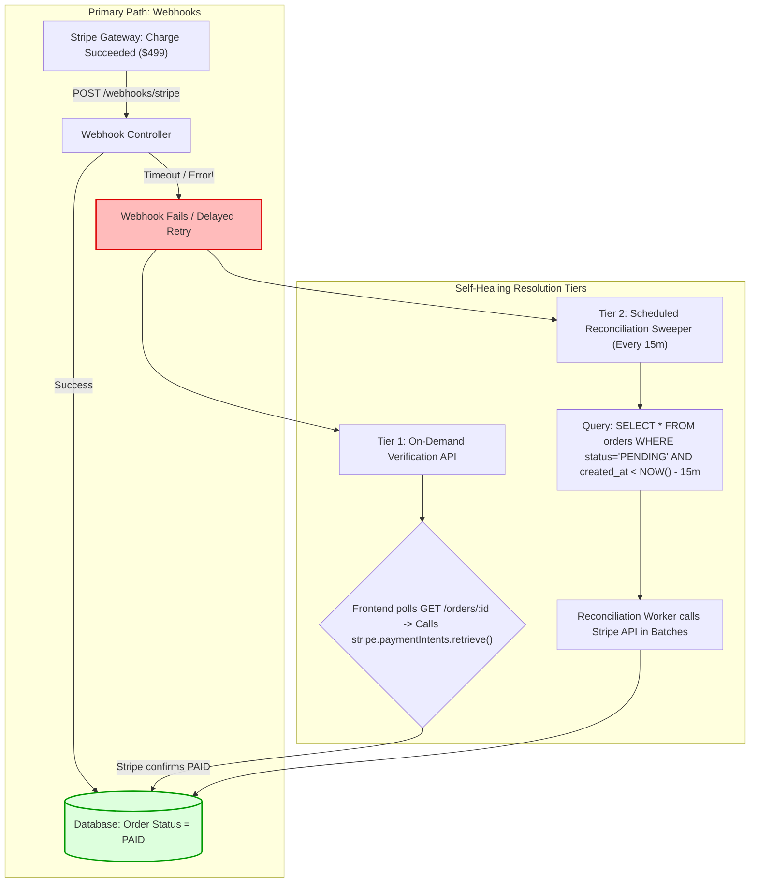

## Fast Revision (10-Second Recall)
- **The Core Problem:** The customer's credit card was charged $200 by Stripe/PayPal, but the internal database table shows `status = 'PENDING'`. The order is never fulfilled, leading to customer support escalations.
- **Top 3 Causes:**
  1. *Dropped / Failed Webhook:* Stripe sent the `payment_intent.succeeded` webhook, but the internal webhook endpoint timed out, returned 500, or was blocked by an edge firewall.
  2. *Asynchronous Race Condition:* The frontend queried order status immediately after checkout *before* the webhook arrived from the payment processor.
  3. *Un-Handled Webhook Event Signature:* The webhook handler received the event but crashed because of an unhandled JSON property or database deadlock.
- **The 3-Layer Solution:**
  1. *Immediate Layer:* Frontend actively polls order status with a 15-second grace window.
  2. *Direct Verification Fallback:* If status is pending after 30 seconds, the backend queries Stripe API directly: `stripe.paymentIntents.retrieve(id)`.
  3. *Reconciliation Cron Sweeper:* A scheduled background job runs every 10 minutes, querying all orders stuck in `PENDING` for over 15 minutes and syncing status directly with the payment provider.

## The 30-Second Spoken Script
> "When a payment succeeds at the gateway but the internal order status remains stuck in `PENDING`, we are facing a classic **asynchronous event delivery breakdown**.
>
> In modern payment architectures, payment settlement does not happen synchronously; it is communicated asynchronously via webhooks. If our webhook endpoint times out, throws an unhandled exception, or is dropped by a transient network blip, the internal database will never know the payment succeeded.
>
> We resolve this through a **Three-Tier Self-Healing Architecture**:
> First, **Webhook Idempotency and DLQ**: We ensure our webhook endpoint acknowledges receipt with HTTP 200 within 200 milliseconds, offloading processing to a background queue. If processing fails, the message is retried automatically by the gateway or our internal queue.
> Second, **On-Demand Gateway Verification**: When a user reaches the 'Processing Order' screen, if the order remains pending after 10 seconds, our API makes a direct synchronous verification call to the Stripe API (`stripe.paymentIntents.retrieve`), updating the database state immediately if the gateway confirms payment.
> Third, **Automated Reconciliation Sweepers**: A scheduled cron job runs every 15 minutes. It selects all orders stuck in `PENDING` for longer than 15 minutes, checks their status against the payment provider's API, and automatically promotes paid orders to `CONFIRMED` while releasing inventory on abandoned orders."

## Scenario / Problem Context
An online electronics retail store ran a flash sale for gaming consoles. Over 1,200 customers purchased consoles within 30 minutes.

Two hours later, customer service received 350 phone calls and emails from customers complaining:
*"My bank statement shows I was charged $499 by your store, but when I check my account dashboard, my order says 'Payment Pending - Awaiting Payment'!"*

The engineering team investigated:
- Stripe Dashboard confirmed: 1,200 charges had succeeded.
- PostgreSQL Database showed: 850 orders were `PAID`, but **350 orders were stuck in `PENDING`**.

What happened:
During the flash sale, the database connection pool was temporarily saturated. The Stripe webhook endpoint timed out when attempting to write `UPDATE orders SET status = 'PAID'` for 350 requests. Stripe's webhook service retried, but because the endpoint returned HTTP 504 Gateway Timeout, Stripe backed off its retries for up to several hours.

The team needs an automated reconciliation and recovery architecture that guarantees orders are never left in limbo when webhooks are delayed.

## Architectural Workflow / Sequence


## Deep-Dive Analysis & Root Causes

### 1. The Fallacy of 100% Webhook Reliability
Webhooks are distributed network calls across public internet infrastructure. They can fail due to:
- DNS resolution failures.
- Ingress rate-limiting (WAF blocking sudden webhook bursts during flash sales).
- Application database deadlocks.
- Cloud provider network outages.
- **Rule:** A production system must **never** rely exclusively on webhooks for state consistency. You must always maintain an active reconciliation fallback.

### 2. Tier 1: Just-in-Time Verification
When a customer lands on `/orders/:id/status`:
- If `order.status === 'PENDING'` and `order.created_at < Date.now() - 10000` (older than 10 seconds):
- The server does NOT just return `PENDING`.
- The server proactively calls the payment gateway:
  `const intent = await stripe.paymentIntents.retrieve(order.payment_intent_id);`
- If `intent.status === 'succeeded'`, the server updates the database to `PAID` right then and there, returning `CONFIRMED` to the customer!

### 3. Tier 2: The Reconciliation Cron Sweeper
What happens if the customer closed their laptop immediately after payment and never visited the confirmation page?
- The Just-in-Time verification is never triggered.
- A scheduled reconciliation sweeper runs every 15 minutes, selecting all orders stuck in `PENDING` between 15 minutes and 24 hours old.
- It queries the gateway in bulk, heals stuck orders, and triggers warehouse fulfillment.

## Practical Debugging Commands & Code

### Step 1: On-Demand Gateway Verification on Status Check
```typescript
// src/routes/orderStatusController.ts
import { Request, Response } from 'express';
import Stripe from 'stripe';
import { Pool } from 'pg';

const stripe = new Stripe(process.env.STRIPE_SECRET_KEY!, { apiVersion: '2023-10-16' });
const db = new Pool({ connectionString: process.env.DATABASE_URL });

export async function getOrderStatusWithAutoHealing(req: Request, res: Response) {
  const { orderId } = req.params;
  const client = await db.connect();

  try {
    const result = await client.query('SELECT * FROM orders WHERE id = $1', [orderId]);
    const order = result.rows[0];

    if (!order) return res.status(404).json({ error: 'Order not found' });

    // SELF-HEALING CHECK: If order is still PENDING after 10 seconds, actively verify with Stripe!
    const ageSeconds = (Date.now() - new Date(order.created_at).getTime()) / 1000;

    if (order.status === 'PENDING' && ageSeconds > 10 && order.payment_intent_id) {
      console.log(`Order ${orderId} is PENDING after ${ageSeconds}s. Actively verifying with Stripe...`);
      
      const paymentIntent = await stripe.paymentIntents.retrieve(order.payment_intent_id);

      if (paymentIntent.status === 'succeeded') {
        console.log(`Stripe confirmed payment for order ${orderId}! Updating DB to PAID.`);
        await client.query(
          'UPDATE orders SET status = $1, paid_at = NOW() WHERE id = $2',
          ['PAID', orderId]
        );
        order.status = 'PAID';
      }
    }

    res.json({
      orderId: order.id,
      status: order.status,
      totalAmount: order.total_amount,
    });

  } finally {
    client.release();
  }
}
```

### Step 2: Automated Scheduled Reconciliation Cron Sweeper
A background worker that runs every 15 minutes to heal orphaned orders:

```typescript
// src/cron/reconcilePendingOrders.ts
import { Pool } from 'pg';
import Stripe from 'stripe';

const db = new Pool({ connectionString: process.env.DATABASE_URL });
const stripe = new Stripe(process.env.STRIPE_SECRET_KEY!, { apiVersion: '2023-10-16' });

export async function runOrderReconciliationSweeper() {
  const client = await db.connect();
  console.log('Running Order Reconciliation Sweeper...');

  try {
    // Select all orders stuck in PENDING for more than 15 minutes but less than 24 hours
    const res = await client.query(`
      SELECT id, payment_intent_id, created_at 
      FROM orders 
      WHERE status = 'PENDING' 
        AND payment_intent_id IS NOT NULL
        AND created_at BETWEEN NOW() - interval '24 hours' AND NOW() - interval '15 minutes'
      LIMIT 100
    `);

    console.log(`Found ${res.rows.length} stuck pending orders to reconcile.`);

    for (const order of res.rows) {
      try {
        const intent = await stripe.paymentIntents.retrieve(order.payment_intent_id);

        if (intent.status === 'succeeded') {
          await client.query('UPDATE orders SET status = $1, paid_at = NOW() WHERE id = $2', ['PAID', order.id]);
          console.log(`Reconciled Order ${order.id}: Updated from PENDING to PAID.`);
          // Trigger warehouse fulfillment event...
        } else if (intent.status === 'canceled' || intent.status === 'requires_payment_method') {
          await client.query('UPDATE orders SET status = $1 WHERE id = $2', ['CANCELLED', order.id]);
          console.log(`Reconciled Order ${order.id}: Updated from PENDING to CANCELLED.`);
          // Release reserved inventory...
        }
      } catch (err: any) {
        console.error(`Failed to reconcile order ${order.id}:`, err.message);
      }
    }

  } finally {
    client.release();
  }
}
```

## Prevention & Senior Best Practices
1. **Never Rely 100% on Asynchronous Webhooks:** Always pair webhooks with on-demand active gateway verification and scheduled reconciliation sweepers.
2. **Implement Just-in-Time Status Healing:** When a client queries order status, if the order is older than 10 seconds and still pending, query the payment gateway directly before responding.
3. **Run a 15-Minute Reconciliation Sweeper:** Deploy a background cron job that scans for orders stuck in `PENDING` and syncs status directly with Stripe/PayPal APIs.
4. **Respond to Webhooks with HTTP 200 in Under 200ms:** Offload heavy webhook processing to an asynchronous queue (BullMQ/SQS); return HTTP 200 immediately to prevent gateway timeout backoffs.
5. **Release Inventory on Abandoned Orders:** If an order remains pending after 2 hours and the payment intent is uncaptured, cancel the order and release reserved stock back into available inventory.

