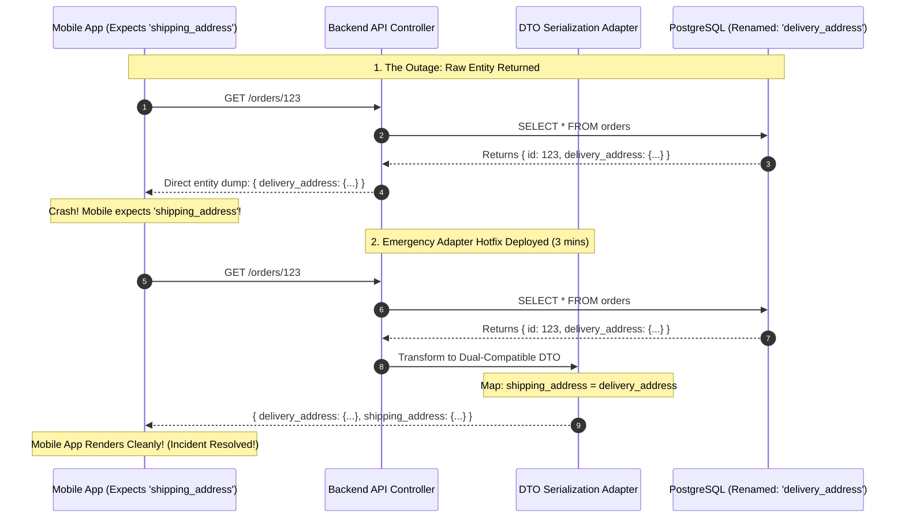

## Fast Revision (10-Second Recall)
- **The Golden Architectural Rule:** Database schema changes must **NEVER** directly modify public API response contracts! The database layer and API DTO layer must be strictly decoupled.
- **Why It Broke:** The backend was returning raw ORM database entities directly to the frontend (`res.json(userEntity)`). Renaming a database column (`user_name` $\rightarrow$ `full_name`) instantly broke the frontend JavaScript expecting `user.user_name`.
- **Immediate Triage Action (Under 2 Minutes):**
  - If the database migration was destructive (dropped/renamed column): Deploy an **emergency backend adapter hotfix** that aliases the old column name in the API DTO (`{ user_name: row.full_name, full_name: row.full_name }`).
  - Do NOT roll back the database if newer data has already been written!
- **Permanent Prevention (The Expand-Contract Pattern):** Phase 1: Expand (Add new column alongside old). Phase 2: Deploy code writing to both. Phase 3: Contract (Drop old column weeks later).

## The 30-Second Spoken Script
> "When a database schema change breaks the frontend, the architectural root cause is almost always **tight coupling between database tables and API contracts**. A backend developer modified or renamed an internal database column, and because the controller returned the raw ORM entity directly, the JSON payload shape mutated unexpectedly, crashing the frontend.
>
> In an active production incident, our priority is **restoring customer functionality immediately without data loss**:
> 1. Rather than attempting a risky, hasty database rollback—which could fail if new records have already been written to the new schema—we deploy an immediate **Backend DTO Adapter Hotfix**.
> 2. We update the API serialization layer to output both the old property name and the new property name simultaneously (e.g., returning both `user_name` and `full_name`), instantly restoring the frontend in under 3 minutes.
>
> To ensure this never happens again, we mandate the **Expand-Contract pattern**: database migrations must never rename or drop columns in a single release. Furthermore, we enforce strict TypeScript DTO mappers between ORM entities and API responses, backed by automated OpenAPI contract validation in CI."

## Scenario / Problem Context
An e-commerce mobile and web application underwent a scheduled Tuesday database migration. The backend team decided to clean up legacy column naming on the `orders` table:
```sql
-- Ran on production master database at 10:00 AM
ALTER TABLE orders RENAME COLUMN shipping_address TO delivery_address;
```

The backend developer updated the TypeORM entity and pushed a backend release.

Within 5 minutes, customer support channels exploded:
- 100% of mobile app users on iOS and Android saw the checkout screen crash with an unhandled exception: `TypeError: Cannot read properties of undefined (reading 'street')`.
- Mobile users were completely unable to complete purchases.
- Mobile native apps cannot be force-updated instantly; App Store and Google Play update propagation takes 24 to 48 hours!

The VP of Product declared a P1 revenue outage: the business is losing $8,000 every minute checkout is down.

The engineering team needs an emergency incident resolution strategy and an architectural overhaul to prevent schema changes from ever breaking client apps again.

## Architectural Workflow / Sequence


## Deep-Dive Analysis & Root Causes

### 1. The Entity-Leaking Anti-Pattern
Returning raw database models directly over HTTP:
```typescript
// DANGEROUS: Leaks internal database schema directly to external clients!
app.get('/api/orders/:id', async (req, res) => {
  const order = await orderRepository.findOne(req.params.id);
  res.json(order); 
});
```
This violates the fundamental Separation of Concerns principle. Any database optimization, index reorganization, or column refactoring immediately creates an unannounced breaking change for all web, mobile, and third-party API consumers.

### 2. The Expand-Contract (Parallel Run) Migration Pattern
To rename `shipping_address` to `delivery_address` safely:
- **Phase 1 (Expand):** Add `delivery_address` column as nullable.
- **Phase 2 (Migrate Data & Code):** Backfill data. Deploy backend code that writes to **both** columns and reads from `delivery_address`. API DTO continues returning `shipping_address` to clients!
- **Phase 3 (Client Deprecation):** Update frontend clients to consume `delivery_address`. Wait for mobile user adoption to reach 99.5%.
- **Phase 4 (Contract):** Drop the old `shipping_address` column weeks later.

### 3. Emergency Triage: Why Database Rollback is Risky
If you try to run `ALTER TABLE orders RENAME COLUMN delivery_address TO shipping_address`:
- If the application ran for 15 minutes, new orders created during those 15 minutes might have data in `delivery_address` that conflicts with old constraints.
- It is almost always 10x faster and safer to deploy a backward-compatible backend DTO adapter that maps the new database column to the old JSON key.

## Practical Debugging Commands & Code

### Step 1: Emergency Backend Hotfix: Dual-Key DTO Adapter
Deploy this immediate mapper to restore legacy clients within minutes:

```typescript
// src/dto/orderDto.ts
export interface LegacyOrderResponse {
  id: string;
  total: number;
  // Dual-Key Support: Return both names simultaneously!
  shipping_address: AddressDto; // Legacy mobile clients
  delivery_address: AddressDto; // Modern web clients
}

export function toOrderResponseDto(orderEntity: any): LegacyOrderResponse {
  const resolvedAddress = {
    street: orderEntity.delivery_address?.street || orderEntity.shipping_address?.street,
    city: orderEntity.delivery_address?.city || orderEntity.shipping_address?.city,
    postalCode: orderEntity.delivery_address?.postalCode || orderEntity.shipping_address?.postalCode,
  };

  return {
    id: orderEntity.id,
    total: orderEntity.total,
    // Output both keys! Resolves frontend crash immediately
    shipping_address: resolvedAddress,
    delivery_address: resolvedAddress,
  };
}
```

Controller implementation:
```typescript
app.get('/api/v1/orders/:id', async (req, res) => {
  const order = await orderRepository.findOneBy({ id: req.params.id });
  if (!order) return res.status(404).json({ error: 'Order not found' });

  // Always serialize through DTO!
  res.json(toOrderResponseDto(order));
});
```

### Step 2: Database View Hotfix (If Backend Cannot Be Redeployed Immediately)
If deploying code takes too long, create an emergency database view or generated column in PostgreSQL:

```sql
-- Emergency DB Patch: Add generated column aliasing the old name!
ALTER TABLE orders 
ADD COLUMN shipping_address JSONB 
GENERATED ALWAYS AS (delivery_address) STORED;
```
This instantly satisfies any raw SQL queries still expecting `shipping_address`!

### Step 3: Fast Production CLI Verification
Verify that the API returns the legacy property:
```bash
curl -s https://api.company.com/api/v1/orders/123 \
  -H "Authorization: Bearer token" | jq '.shipping_address'

# Verify it returns valid address object instead of null/undefined
```

## Prevention & Senior Best Practices
1. **Never Return Raw Database Entities Over HTTP:** Always use Data Transfer Objects (DTOs) with explicit serialization mappers (class-transformer, Zod, or manual mappers).
2. **Mandate the Expand-Contract Pattern:** Enforce a strict engineering policy: zero direct column renames or deletions in a single release.
3. **Automate API Contract Testing with Pact / OpenAPI:** Run automated contract tests in CI that compare current API output against mobile client contracts; reject builds that alter JSON property names.
4. **Support Mobile App Deprecation Windows:** Remember that native mobile apps cannot be forced to update immediately; maintain backward compatibility on public APIs for at least 6 to 12 months.
5. **Use Database Generated Columns for Emergency Aliasing:** If a rogue migration renames a critical column, use `GENERATED ALWAYS AS` in PostgreSQL to alias the old column name in seconds without downtime.

