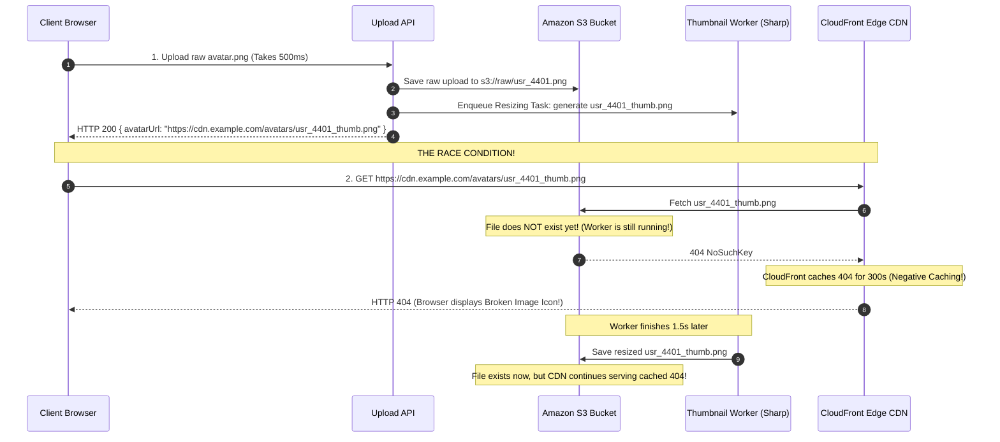

## Fast Revision (10-Second Recall)
- **The Core Triage Flow:** User Uploads $\rightarrow$ S3 Bucket File Existence $\rightarrow$ Image Transcoding / Resizing Worker $\rightarrow$ Database Image URL Field $\rightarrow$ CDN Edge Propagation $\rightarrow$ Browser DOM `` Tag.
- **Top 5 Root Causes:**
  1. *Negative CDN Caching (Cached 404s):* The frontend requested the thumbnail URL *before* the background resizing worker finished generating it. CloudFront cached the initial `404 Not Found` for 5 minutes!
  2. *Mixed Content Block:* Image URL stored as `http://` instead of `https://`. Modern browsers block insecure mixed content on HTTPS sites.
  3. *S3 Bucket Permissions & CORS:* The image exists in S3, but the S3 bucket blocks public access and lacks a valid CloudFront Origin Access Control (OAC) mapping.
  4. *Asynchronous Race Condition:* The frontend redirects immediately to the profile page, but image transcoding takes 3 seconds in a worker queue; the UI displays a broken image icon.
  5. *Corrupt MIME / File Encoding:* The file was uploaded as raw binary bytes or with a wrong MIME type (`text/plain` instead of `image/jpeg`), causing the browser to reject rendering.

## The 30-Second Spoken Script
> "When a user uploads an image and it fails to appear in the UI, the issue usually boils down to an **asynchronous race condition or CDN negative caching**.
>
> We debug this across five sequential checkpoints:
> 1. **Storage Verification**: First, I check S3 directly. Did the image actually make it to the bucket? What is the exact file size and MIME type? If the file size is 0 bytes, the upload stream failed.
> 2. **Asynchronous Worker Status**: If images are processed by a background worker (e.g. Sharp resizing avatars into 200x200 thumbnails), did the worker job complete? If the worker crashed on a corrupted EXIF header, the thumbnail was never generated.
> 3. **The Cached 404 Trap**: If the frontend requested the thumbnail URL while the worker was still processing, the CDN returned a `404 Not Found`. Many CDNs (like CloudFront) cache 404 responses for 300 seconds by default. Even after the worker creates the image, the user continues seeing a broken image due to the edge cached 404.
> 4. **Browser Security & Mixed Content**: I check the DevTools Console. Is the browser blocking the image because of a Mixed Content error (`http://` on an `https://` domain), or is it blocked by an S3 Cross-Origin Resource Sharing (CORS) policy?
> 5. **Database State**: Does the user's database record actually store the full, correct image URL or S3 key?"

## Scenario / Problem Context
A social media platform allowed users to customize their user profile avatars. A user uploaded a high-resolution selfie (`avatar.png`).

The screen updated, but the avatar placeholder remained blank, showing a broken image icon.

The developer checked the database:
`SELECT avatar_url FROM users WHERE id = 'usr_4401';`
Result: `https://cdn.example.com/avatars/usr_4401_thumb.png`. The database clearly had the URL!

When the developer clicked the URL directly in their browser:
`HTTP 404 Not Found: NoSuchKey (Amazon S3)`

Yet 10 seconds later, the developer refreshed S3 in the AWS console and saw that `usr_4401_thumb.png` **did exist** in the bucket!

Why did the browser show a broken image, and why did the CDN return a 404 for a file that exists in S3?

The team needs an end-to-end debugging procedure to eliminate upload races, negative CDN caching, and rendering failures.

## Architectural Workflow / Sequence


## Deep-Dive Analysis & Root Causes

### 1. CloudFront Negative Caching (The 404 Cache Trap)
By default, Amazon CloudFront and many CDNs implement **Negative Caching**:
- If an origin returns HTTP 404 or 500, CloudFront caches that error response for **300 seconds (5 minutes)**.
- If the frontend requests an image 200 milliseconds before the background thumbnail worker finishes writing it to S3, the CDN caches the 404!
- For the next 5 minutes, every user request to that URL will return 404, even though the file is sitting in S3!
- **Solution:** Set CloudFront Error Caching Minimum TTL to **0 seconds** for 404 and 403 responses on media distributions.

### 2. Browser Mixed Content Blocking
If an application is served over `https://app.company.com`, and the image URL in the database is generated with `http://cdn.company.com/...`:
- Chrome, Safari, and Firefox block the request immediately.
- The console logs: `Mixed Content: The page at 'https://...' was loaded over HTTPS, but requested an insecure image 'http://...'. This content should also be served over HTTPS.`
- The `` tag fails to render and shows a broken placeholder.

### 3. Missing S3 Image Content-Type
When uploading images via scripts or presigned URLs, if the client or server fails to specify `ContentType: image/png`:
- S3 defaults to `binary/octet-stream` or `text/plain`.
- Some strict browsers and CSP headers will refuse to render `binary/octet-stream` inside standard HTML `` tags.

## Practical Debugging Commands & Code

### Step 1: Inspecting the Broken Image in Chrome DevTools
Right-click broken image $\rightarrow$ **Inspect Element**:
1. Check `src` attribute: Is it an empty string, relative path, or broken URL?
2. Open Console: Check for `Mixed Content` or `CORS policy` blocks.
3. Open Network tab $\rightarrow$ Filter by `Img`:
   - Inspect status: Is it `403 Forbidden` (S3 permission error) or `404 Not Found`?
   - Inspect headers: Look for `X-Cache: Error from cloudfront` and `Age: 45`.

### Step 2: Fixing CloudFront Negative Caching (Error Caching TTL = 0)
Configure CloudFront to never cache 404s on user-uploaded media:

```hcl
# terraform/cloudfront.tf
resource "aws_cloudfront_distribution" "media_cdn" {
  # ... origin configuration ...

  # Set Error Caching TTL to 0 seconds for 404 NoSuchKey
  custom_error_response {
    error_code            = 404
    error_caching_min_ttl = 0
    response_code         = 404
  }

  custom_error_response {
    error_code            = 403
    error_caching_min_ttl = 0
    response_code         = 403
  }
}
```

### Step 3: Frontend Polling / Fallback Avatar Component (React)
Handle the asynchronous rendering delay gracefully in the UI:

```typescript
// frontend/src/components/AvatarImage.tsx
import React, { useState } from 'react';

interface Props {
  src: string;
  fallbackSrc: string;
  alt: string;
}

export function AvatarImage({ src, fallbackSrc, alt }: Props) {
  const [currentSrc, setCurrentSrc] = useState(src);
  const [retries, setRetries] = useState(0);

  const handleError = () => {
    // If thumbnail worker hasn't finished, retry after 1.5 seconds (up to 3 times)
    if (retries < 3) {
      setTimeout(() => {
        setRetries((prev) => prev + 1);
        // Append cache-buster timestamp query param to bypass intermediate caches
        setCurrentSrc(`${src}?retry=${Date.now()}`);
      }, 1500);
    } else {
      // Fallback to placeholder if thumbnail failed permanently
      setCurrentSrc(fallbackSrc);
    }
  };

  return (
    
  );
}
```

### Step 4: S3 CORS Configuration for Direct Web Rendering
```json
[
  {
    "AllowedHeaders": ["*"],
    "AllowedMethods": ["GET", "HEAD"],
    "AllowedOrigins": ["https://app.company.com"],
    "ExposeHeaders": ["ETag"],
    "MaxAgeSeconds": 3600
  }
]
```

## Prevention & Senior Best Practices
1. **Disable CDN Negative Caching for Media:** Configure CloudFront, Fastly, or Cloudflare error caching TTL to 0 seconds on 404/403 errors for media paths.
2. **Never Return Thumbnail URLs Before They Are Created:** If image processing is asynchronous, return the raw uploaded image URL or a placeholder until the thumbnail worker emits a `THUMBNAIL_READY` event.
3. **Always Enforce Protocol-Relative or HTTPS URLs:** Store image paths as relative paths (`/avatars/user.jpg`) or strictly as `https://` to prevent mixed-content browser blocking.
4. **Explicitly Set Image Content-Type on Upload:** Ensure all upload workflows set the explicit MIME header (`image/jpeg`, `image/png`, `image/webp`).
5. **Implement Client-Side Image Retries with Cache-Busters:** Add an `onError` handler to UI avatar components that appends `?t=${Date.now()}` to retry loading after a brief delay if a worker is still transcoding.

