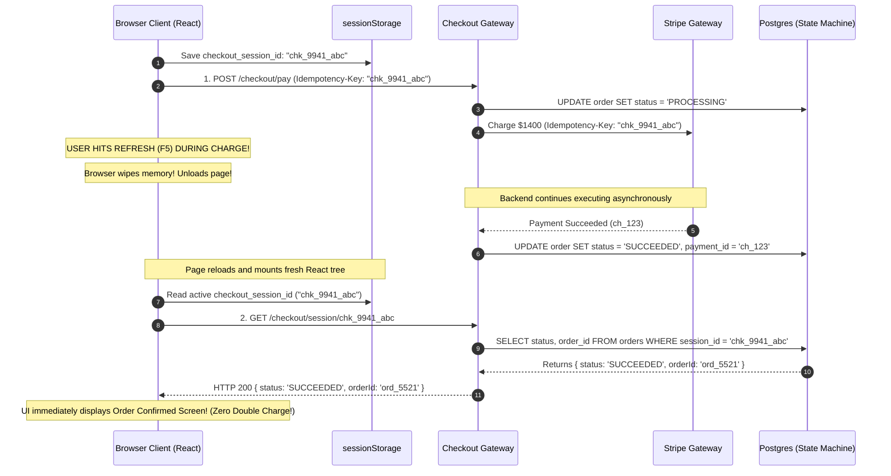

## Fast Revision (10-Second Recall)
- **The Core Risk:** When a user refreshes the page (or clicks Back) while a transaction is in flight: (1) In-flight client-side JavaScript state is wiped, (2) The user might re-click "Pay" and cause a double charge, (3) The user sees an empty cart or error while the backend was actually charging their card.
- **The Solution Architecture:**
  1. *Persistent Client-Side Intent Key:* Store an immutable `checkout_session_id` or `idempotency_key` in `sessionStorage` or URL query params.
  2. *Server-Side Transaction State Machine:* Model the transaction in PostgreSQL: `INITIATED` $\rightarrow$ `PROCESSING` $\rightarrow$ `SUCCEEDED` / `FAILED`.
  3. *Rehydration Handshake on Mount:* On page reload, the frontend immediately checks `GET /checkout/session/:sessionId`. If state is `PROCESSING`, show a loading spinner; if `SUCCEEDED`, redirect immediately to the confirmation receipt.
  4. *Browser Warning Guard:* Use `beforeunload` event to display a native browser warning: *"A transaction is currently processing. Leaving or reloading may interrupt your order."*

## The 30-Second Spoken Script
> "When a user refreshes the browser during a transaction, in-memory client state is completely destroyed, but the backend server or payment gateway may still be actively processing the charge. If unhandled, this leads to duplicate charges, lost confirmation screens, and severe customer confusion.
>
> To guarantee full consistency, we implement a **State Machine and Session Rehydration** architecture:
> First, **Persistent Checkout Sessions**: When the checkout flow starts, the client generates a unique `checkout_session_id` and persists it in `sessionStorage` or as a URL parameter. Every backend mutation requires this session ID as its `Idempotency-Key`.
> Second, **Server-Side State Machine**: In our database, the order transitions through explicit states: `INITIATED`, `PROCESSING`, `SUCCEEDED`, and `FAILED`. While in `PROCESSING`, any duplicate payment attempts submitted with the same session ID are rejected by Redis distributed locks.
> Third, **Lifecycle Rehydration on Page Mount**: When the browser reloads, the React application reads the `checkout_session_id` from `sessionStorage` and immediately queries `GET /api/v1/checkout/session/:id`. The server returns the authoritative state: if the payment succeeded while the page was reloading, the UI instantly routes to the Order Confirmed screen, displaying their receipt without re-executing any transactions."

## Scenario / Problem Context
An airline ticket booking website allowed customers to purchase international flights. A customer selected a $1,400 round-trip ticket to Tokyo and clicked "Authorize Payment."

The screen displayed a processing spinner. At second 4, anxious that the site was hanging, the user hit `Ctrl + R` (Page Reload).

What happened behind the scenes:
1. The browser's active `fetch()` POST request was abruptly aborted by the browser engine (`net::ERR_ABORTED`).
2. However, the backend server had already received the request 2 seconds earlier and was in the middle of executing the Stripe credit card charge. The Stripe charge succeeded!
3. The reloaded web page mounted with empty React state. The user saw their cart displayed as empty, with a message: *"Your cart has expired. Please select your flights again."*
4. Thinking the booking failed, the customer booked the flight a second time, charging their credit card another $1,400!
5. When the customer received two confirmation emails 10 minutes later, they demanded a refund and filed a credit card dispute.

The airline engineering team requires a full-stack transaction consistency design that prevents double booking and recovers cleanly from arbitrary browser refreshes.

## Architectural Workflow / Sequence


## Deep-Dive Analysis & Root Causes

### 1. The Disconnect Between Network Abort and Backend Execution
When a user closes or reloads a browser tab:
- The TCP socket between browser and edge proxy is closed.
- If the backend uses standard Node.js/Java without socket-abort listeners, the backend **continues executing the request to completion**.
- The credit card is charged, and database rows are committed, but the response cannot be delivered to the client because the client socket is gone.

### 2. State Machine Transitions
A robust transaction must enforce legal state transitions:
```text
[INITIATED] -> [PROCESSING] -> [SUCCEEDED]
                            -> [FAILED]
```
- If an incoming payment request arrives for an order in `PROCESSING` state: Reject with `409 Conflict: Transaction currently in progress`.
- If it arrives for `SUCCEEDED`: Return the cached receipt with HTTP 200 without executing a new payment!

### 3. Client Storage Strategy: `sessionStorage` vs `localStorage`
- **`localStorage`:** Persists across tabs and browser restarts forever. Risk: Stale checkout sessions from 2 weeks ago might auto-load.
- **`sessionStorage`:** Persists across page reloads within the same tab, but is automatically wiped when the tab is closed. Ideal for active checkout flows!

## Practical Debugging Commands & Code

### Step 1: Frontend Session Persistence & Rehydration Hook (React)
```typescript
// frontend/src/hooks/useCheckoutSession.ts
import { useState, useEffect } from 'react';
import { useNavigate } from 'react-router-dom';

export function useCheckoutSession() {
  const [sessionId, setSessionId] = useState<string | null>(null);
  const [isRehydrating, setIsRehydrating] = useState(true);
  const navigate = useNavigate();

  useEffect(() => {
    // 1. Read session ID from sessionStorage on page load/refresh
    let activeSession = sessionStorage.getItem('active_checkout_session');

    if (!activeSession) {
      // Create new session if none exists
      activeSession = `session_${crypto.randomUUID()}`;
      sessionStorage.setItem('active_checkout_session', activeSession);
    }

    setSessionId(activeSession);

    // 2. Query backend to rehydrate state (Did a transaction already complete?)
    fetch(`/api/v1/checkout/session/${activeSession}`)
      .then((res) => res.json())
      .then((data) => {
        if (data.status === 'SUCCEEDED') {
          // Already paid! Clear session and navigate to confirmation receipt!
          sessionStorage.removeItem('active_checkout_session');
          navigate(`/orders/${data.orderId}/confirmation`);
        } else if (data.status === 'PROCESSING') {
          // Payment is actively in-flight on backend: show waiting screen
          console.log('Transaction is currently processing in backend...');
        }
      })
      .finally(() => {
        setIsRehydrating(false);
      });
  }, [navigate]);

  return { sessionId, isRehydrating };
}
```

### Step 2: Native Browser Unload Guard During Active Payment
Prevent accidental reloads while payments are in flight:

```typescript
// frontend/src/components/CheckoutPaymentButton.tsx
import React, { useEffect, useState } from 'react';

export function CheckoutPaymentButton({ onPay }: { onPay: () => Promise<void> }) {
  const [isProcessing, setIsProcessing] = useState(false);

  useEffect(() => {
    const handleBeforeUnload = (e: BeforeUnloadEvent) => {
      if (isProcessing) {
        // Triggers standard native browser confirmation dialog:
        // "Changes you made may not be saved. Are you sure you want to leave?"
        e.preventDefault();
        e.returnValue = '';
      }
    };

    window.addEventListener('beforeunload', handleBeforeUnload);
    return () => window.removeEventListener('beforeunload', handleBeforeUnload);
  }, [isProcessing]);

  const handlePaymentClick = async () => {
    setIsProcessing(true);
    try {
      await onPay();
    } finally {
      setIsProcessing(false);
    }
  };

  return (
    <button onClick={handlePaymentClick} disabled={isProcessing}>
      {isProcessing ? 'Processing Payment (Do Not Refresh)...' : 'Authorize Payment'}
    </button>
  );
}
```

### Step 3: Backend Controller Enforcing State Machine and Idempotency
```typescript
// src/routes/checkoutController.ts
import { Request, Response } from 'express';
import { Pool } from 'pg';

const db = new Pool({ connectionString: process.env.DATABASE_URL });

export async function processPayment(req: Request, res: Response) {
  const { sessionId, amountCents } = req.body;
  const client = await db.connect();

  try {
    await client.query('BEGIN');

    // 1. Fetch or create order state locked with FOR UPDATE
    const orderRes = await client.query(
      'SELECT id, status, payment_id FROM orders WHERE session_id = $1 FOR UPDATE',
      [sessionId]
    );

    let order = orderRes.rows[0];

    // If order already succeeded, return the cached result immediately (Idempotent!)
    if (order && order.status === 'SUCCEEDED') {
      await client.query('ROLLBACK');
      return res.json({ status: 'SUCCEEDED', orderId: order.id });
    }

    // If order is currently being processed by another thread, reject duplicate!
    if (order && order.status === 'PROCESSING') {
      await client.query('ROLLBACK');
      return res.status(409).json({ error: 'Payment currently processing. Please wait.' });
    }

    // 2. Mark order as PROCESSING
    await client.query(
      'INSERT INTO orders (session_id, status, amount_cents) VALUES ($1, $2, $3) ON CONFLICT (session_id) DO UPDATE SET status = $2',
      [sessionId, 'PROCESSING', amountCents]
    );
    await client.query('COMMIT');

    // 3. Execute external payment gateway call with sessionId as idempotency key
    const payment = await stripe.charges.create(
      { amount: amountCents, currency: 'usd', source: 'tok_visa' },
      { idempotencyKey: sessionId }
    );

    // 4. Mark order as SUCCEEDED
    await client.query(
      'UPDATE orders SET status = $1, payment_id = $2 WHERE session_id = $3',
      ['SUCCEEDED', payment.id, sessionId]
    );

    res.json({ status: 'SUCCEEDED', orderId: order?.id });

  } catch (err: any) {
    await client.query('UPDATE orders SET status = $1, error_message = $2 WHERE session_id = $3', ['FAILED', err.message, sessionId]);
    res.status(500).json({ error: 'Payment failed' });
  } finally {
    client.release();
  }
}
```

## Prevention & Senior Best Practices
1. **Store Intent Keys in `sessionStorage`:** Persist the transaction session ID in `sessionStorage` so page reloads can rehydrate the exact in-flight transaction status.
2. **Implement the `beforeunload` Browser Guard:** Display browser reload warnings when a transaction is actively in-flight to prevent impatient users from hitting refresh.
3. **Enforce Database State Machines:** Reject duplicate POST requests with `409 Conflict` if the transaction is currently in `PROCESSING` state.
4. **Pass Deterministic Idempotency Keys to Payment Gateways:** Always pass the `sessionId` to Stripe or PayPal so that even if the backend executes twice, the card is charged only once.
5. **Rehydrate Authoritative State on Mount:** On initial React component mount, always query the backend to check if a previously initiated transaction completed before allowing a new payment attempt.

