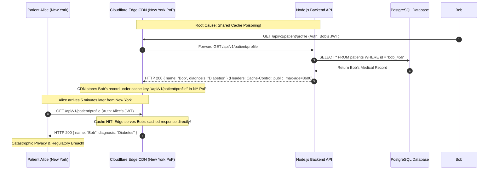

## Fast Revision (10-Second Recall)
- **The Highest Severity Incident (P0):** A user seeing another user's private data is a catastrophic privacy breach requiring immediate incident mobilization and potential GDPR/HIPAA regulatory disclosure.
- **Top 4 Architectural Causes:**
  1. *BOLA / IDOR (Broken Object Level Authorization):* Backend queries `SELECT * FROM accounts WHERE id = :id` without asserting `AND user_id = :auth_user_id`.
  2. *Shared Edge Cache Poisoning:* CDN (Cloudflare/CloudFront) cached an authenticated endpoint (`/api/me` or `/dashboard`) because the backend returned `Cache-Control: public`. Every subsequent user in that city was served the first user's cached HTML/JSON!
  3. *Node.js Global Singleton State:* Storing user session data in a module-level variable (`let currentUser;`) in Node.js. Because Node is single-threaded and shares memory across requests, Request B overwrites the variable while Request A is executing!
  4. *Connection Pool State Leak:* Using PostgreSQL session-level variables or temporary tables that leak across pooled connections.

## The 30-Second Spoken Script
> "A user seeing another user's private information is an emergency P0 security incident. The very first action is containment: if caused by an edge cache misconfiguration, we purge the CDN cache immediately and enforce `Cache-Control: private, no-store` globally.
>
> We immediately investigate across four potential breach vectors:
> First, **Broken Object Level Authorization (BOLA/IDOR)**: We audit the route controller. Does the endpoint take a resource ID in the URL parameter (e.g. `GET /invoices/:id`) and fetch it directly without validating that the authenticated session owns that invoice?
> Second, **Shared Edge Cache Poisoning**: We inspect CDN response headers for the affected endpoint. If an authenticated user profile API returns `Cache-Control: public`, the CDN caches User A's response at edge PoPs. The next user who visits the site receives User A's cached private data.
> Third, **Node.js Global Singleton State**: In Node.js, storing session data in module-level variables (e.g. `let activeUser = req.user`) causes race condition leaks. Because the event loop interleaves asynchronous operations across concurrent requests, Request B overwrites the module variable while Request A is awaiting a database query.
> Fourth, **Database Row-Level Security**: We verify why the database layer did not enforce multi-tenant isolation, and immediately patch the vulnerability using PostgreSQL Row-Level Security (RLS)."

## Scenario / Problem Context
A telehealth medical platform allowed patients to view their lab test results and medical prescriptions. 

At 11:30 AM, Patient Alice logged into her portal. She was shocked to see the complete medical diagnosis, home address, and blood test results of Patient Bob! 

Alice immediately called customer support and posted a screenshot to Twitter/X.

The engineering team panicked:
- Alice's session token and JWT claims clearly identified her as `user_id: "alice_123"`.
- When Alice refreshed the page from her office Wi-Fi, Bob's medical records continued to render!
- When an engineer tested Alice's account from the office, the engineer saw Alice's records.

The CTO declared an emergency P0 incident. The platform handles sensitive protected health information (PHI) under strict HIPAA regulations.

The team needs an immediate forensic protocol to identify how Bob's data was served to Alice and eliminate the data leak permanently.

## Architectural Workflow / Sequence


## Deep-Dive Analysis & Root Causes

### 1. Shared Edge Cache Poisoning (The Deadliest Vulnerability)
CDNs like Cloudflare and CloudFront cache responses based on the request URL path by default (`/api/v1/patient/profile`), **ignoring the Authorization header**!
- If the backend returns `Cache-Control: public, s-maxage=3600`:
- The first user (Bob) populates the edge cache.
- The next 1,000 users connecting through that same edge PoP receive Bob's cached private profile!
- **Mandatory Rule:** Any endpoint that inspects cookies or `Authorization` headers must **ALWAYS** return:
  `Cache-Control: private, no-cache, no-store, must-revalidate`

### 2. Node.js Global Singleton State (Module-Level Variables)
A common junior mistake in Node.js/Express:
```typescript
// DANGEROUS: Module-level global state in a shared process!
let currentTenantId: string;

app.use((req, res, next) => {
  currentTenantId = req.headers['x-tenant-id'] as string; // OVERWRITES GLOBALLY!
  next();
});

app.get('/api/data', async (req, res) => {
  // If concurrent request from Tenant B arrives during db.query delay,
  // currentTenantId becomes Tenant B!
  const data = await db.query('SELECT * FROM data WHERE tenant_id = $1', [currentTenantId]);
  res.json(data);
});
```
Because Node.js runs in a single process, `currentTenantId` is shared across all incoming HTTP requests. Under concurrent load, requests interleave, and User A reads data belonging to User B.
- **Solution:** Always use `AsyncLocalStorage` or attach state strictly to `req.user`.

### 3. Broken Object Level Authorization (BOLA / IDOR)
OWASP Top 10 API #1 Vulnerability:
`GET /api/v1/prescriptions/:prescriptionId`
```typescript
// VULNERABLE: Direct object lookup without tenancy ownership validation!
app.get('/api/prescriptions/:id', async (req, res) => {
  const item = await prescriptionRepo.findOne(req.params.id);
  res.json(item); // Returns record even if req.user.id !== item.patient_id!
});
```

## Practical Debugging Commands & Code

### Step 1: Emergency Triage: Purge Edge CDN Cache Immediately
If edge cache poisoning is suspected, purge the CDN cache instantly:

```bash
# Cloudflare: Purge entire cache across all edge locations immediately
curl -X POST "https://api.cloudflare.com/client/v4/zones/$ZONE_ID/purge_cache" \
  -H "Authorization: Bearer $CF_API_KEY" \
  -H "Content-Type: application/json" \
  -d '{"purge_everything": true}'

# AWS CloudFront: Create full cache invalidation
aws cloudfront create-invalidation --distribution-id $DIST_ID --paths "/*"
```

### Step 2: Global Middleware Enforcing No-Cache on Authenticated Endpoints
```typescript
// src/middleware/securityHeaders.ts
import { Request, Response, NextFunction } from 'express';

export function enforceAuthenticatedNoCache(req: Request, res: Response, next: NextFunction) {
  // If request contains authorization credentials, it must NEVER be cached by proxies
  if (req.headers.authorization || req.headers.cookie) {
    res.setHeader('Cache-Control', 'private, no-cache, no-store, must-revalidate');
    res.setHeader('Pragma', 'no-cache');
    res.setHeader('Expires', '0');
    res.setHeader('Vary', 'Authorization, Cookie');
  }
  next();
}
```

### Step 3: Hardened BOLA/IDOR Protection with Ownership Verification
```typescript
// src/controllers/prescriptionController.ts
import { Request, Response } from 'express';
import { Pool } from 'pg';

const db = new Pool({ connectionString: process.env.DATABASE_URL });

export async function getPrescriptionById(req: Request, res: Response) {
  const { prescriptionId } = req.params;
  const authenticatedPatientId = (req as any).user.id; // From verified JWT

  // SECURE: Query MUST include AND patient_id = authenticatedPatientId!
  const result = await db.query(
    'SELECT * FROM prescriptions WHERE id = $1 AND patient_id = $2',
    [prescriptionId, authenticatedPatientId]
  );

  if (result.rows.length === 0) {
    // Return 404 rather than 403 to prevent attackers from enumerating valid IDs!
    return res.status(404).json({ error: 'Prescription not found' });
  }

  res.json(result.rows[0]);
}
```

### Step 4: Defense-in-Depth with PostgreSQL Row-Level Security (RLS)
Enforce tenant isolation directly at the database engine level so application query bugs cannot leak records:

```sql
-- Enable Row-Level Security on prescriptions table
ALTER TABLE prescriptions ENABLE ROW LEVEL SECURITY;

-- Create policy ensuring queries can ONLY see rows matching current session user
CREATE POLICY patient_isolation_policy ON prescriptions
    FOR ALL
    USING (patient_id = current_setting('app.current_user_id')::UUID);

-- Before running queries, application sets the session variable:
-- SET LOCAL app.current_user_id = 'alice_123';
```

## Prevention & Senior Best Practices
1. **Never Return `Cache-Control: public` with Authorization Headers:** Configure web frameworks to automatically append `Cache-Control: no-store, private` whenever an authorization header or cookie is detected.
2. **Never Use Module-Level Global Variables for Request State:** Store request and user context strictly on `req` or within Node.js `AsyncLocalStorage`.
3. **Always Scope Queries by Authenticated User ID:** Never look up records purely by their primary key (`WHERE id = :id`); always append `AND tenant_id = :tenant_id` or `AND user_id = :userId`.
4. **Implement Database Row-Level Security (RLS):** Use PostgreSQL RLS as an architectural backstop against application-level IDOR bugs.
5. **Configure CDN `Vary: Authorization`:** If an authenticated route must be cached at the edge, configure the CDN to include the `Authorization` header in the cache key.

