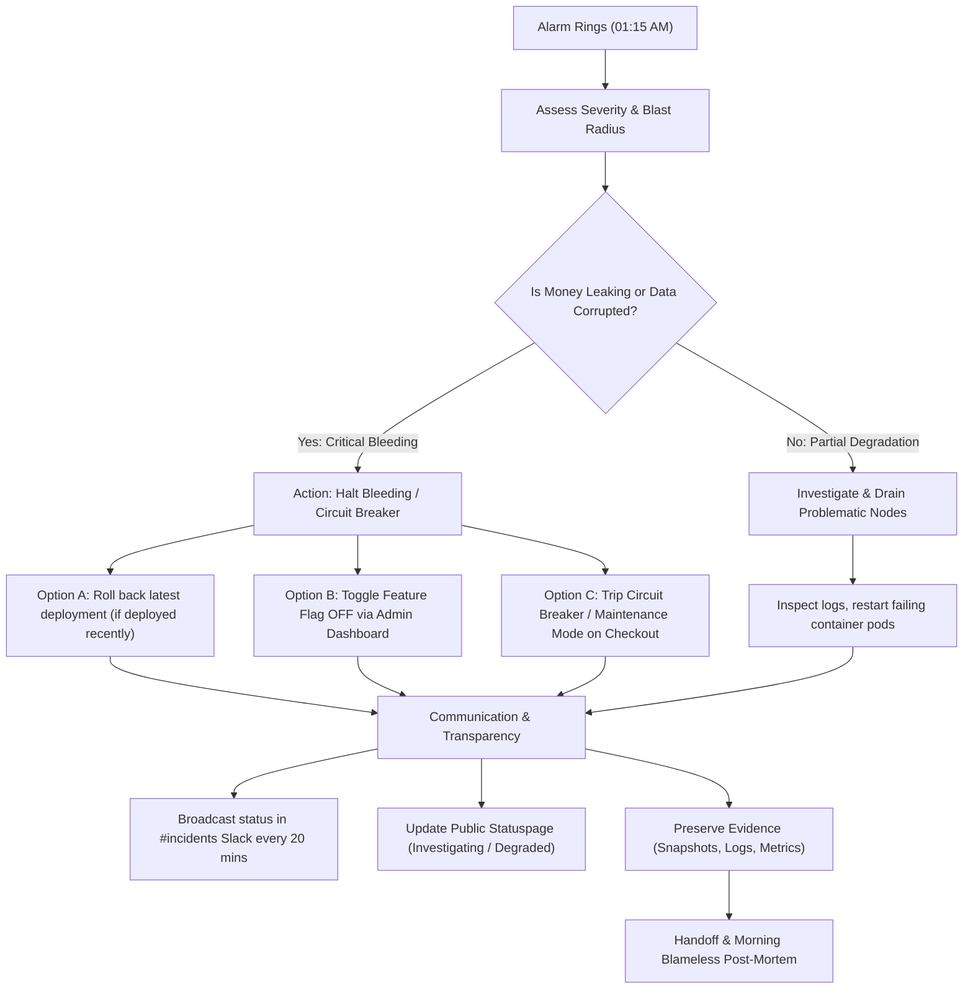

## Fast Revision (10-Second Recall)
- **Prime Directive**: Contain the blast radius and stop the bleeding immediately; do not attempt a risky cowboy fix or complex code rewrite in production at midnight.
- **Immediate Playbook**: Assess Severity (SEV-1/SEV-2) -> Check escalation tree / secondary on-call -> Roll back the latest deployment or disable feature flag -> If data corruption or financial loss is active, trigger circuit breaker or graceful degradation -> Communicate regularly on `#incident` channel -> Preserve logs and metrics for post-mortem.
- **Incident Role**: Assume the Incident Commander role: document a timestamped incident log, provide clear status updates every 20 minutes, and protect customer data above all else.

---

## The 30-Second Spoken Script
> "When a critical production bug strikes at midnight and no senior engineer is reachable, I follow a structured incident response framework focused on containment over perfection. 
>
> First, I assess the blast radius and severity: Is user data being corrupted, payments leaking, or services down? If data corruption or financial loss is occurring, my primary duty is to stop the bleeding immediately. 
>
> Second, I look for low-risk rollback levers: I check recent deployments from the last 2 hours. If a deploy occurred, I trigger an immediate rollback to the previous known good release artifact. If it is tied to a new feature, I disable its feature flag. If rollback is not viable and the system is actively leaking money or corrupting data, I enable a maintenance banner or graceful degradation mode. 
>
> Third, I follow the secondary escalation policy, communicate status every 20 minutes on the `#incident` channel, and preserve logs and memory dumps before taking aggressive action. In the morning, I run a blameless post-mortem."

---

## Scenario / Problem Context
It is 01:15 AM on a Saturday. You are the mid-level engineer on primary on-call duty. PagerDuty sounds with a high-urgency alarm:
- Payment microservice errors spiked to 65%.
- Customers are reporting double-charges on credit cards, but order confirmations are failing.
- You page the designated senior tech lead and staff architect; both phones ring out without response.
- Thousands of users are actively trying to make purchases on the live site. Every minute that passes results in unauthorized card charges and customer frustration.

```
01:15:02 AM - High Error Rate Alert: payment-service (Error rate > 50%)
01:16:40 AM - Paged Tech Lead (No response)
01:18:00 AM - Secondary Escalation: Staff Engineer (No response)
01:18:30 AM - Current Status: You are Incident Commander. Immediate decision required.
```

---

## Architectural Workflow / Sequence



---

## Deep-Dive Analysis & Root Causes

### 1. The Psychology of Midnight Incidents (Fight or Flight)
Engineers often make one of two catastrophic errors under stress:
1. **The Freeze**: Paralyzed by fear of making things worse, leaving a broken system leaking money or data for hours while waiting for someone to wake up.
2. **The Cowboy Patch**: Attempting to edit database rows directly or commit hasty untested hotfixes to main in the dark, introducing secondary bugs and destroying audit evidence.

### 2. The Four Levers of Emergency Mitigation
When operating solo, rely only on standard, well-tested recovery mechanisms:
1. **Rollback**: Revert to the previous immutable container image or git commit SHA. If the system was working 3 hours ago and broke after a 23:00 release, roll back immediately.
2. **Feature Flags**: Disable newly enabled feature flags via LaunchDarkly, Unleash, or Redis config.
3. **Traffic Throttling / WAF**: If the incident is caused by a credential-stuffing attack or runaway crawler, block the offending IP ranges or enable Cloudflare Under Attack mode.
4. **Graceful Degradation / Maintenance Banner**: Temporarily disable the checkout service or payment gateway with a friendly `"Payment maintenance in progress"` banner while leaving browse/read functionality online. A temporary checkout pause is infinitely better than charging customers twice and corrupting ledger balances.

---

## Practical Debugging Commands & Code

### 1. The Solo On-Call Triage Checklist (First 10 Minutes)

```bash
# 1. Check recent deployments across all services
kubectl rollout history deployment/payment-service -n production

# 2. Check commit history on production branch within last 6 hours
git log -n 5 --oneline origin/production

# 3. If a deployment happened recently, execute an immediate rollback!
kubectl rollout undo deployment/payment-service -n production
kubectl rollout status deployment/payment-service -n production

# 4. If container restarts are looping (CrashLoopBackOff), inspect crash logs
kubectl logs -n production -l app=payment-service --previous --tail=100
```

### 2. Emergency Feature Flag Deactivation via CLI
If the issue is isolated to a specific feature (e.g., new payment provider integration):

```bash
# Emergency disable feature flag via Redis or config store
redis-cli -h redis-config.internal set "feature:stripe_v3_checkout:enabled" "false"
```

### 3. Graceful Circuit Breaker Activation
If payments are double-charging and cannot be rolled back safely, trip the payment circuit breaker to prevent further unauthorized credit card authorizations:

```typescript
// Emergency manual breaker toggle endpoint (accessible via internal bastion / curl)
export async function emergencyTripPaymentCircuitBreaker(req: Request, res: Response) {
  const secretKey = req.headers["x-incident-commander-key"];
  if (secretKey !== process.env.EMERGENCY_OVERRIDE_KEY) {
    return res.status(403).json({ error: "Unauthorized" });
  }

  // Set distributed circuit breaker in Redis with 2-hour TTL
  await redis.set("circuit_breaker:payment_gateway:state", "OPEN", "EX", 7200);

  console.warn("CRITICAL: Payment Gateway Circuit Breaker MANUALLY TRIPPED by On-Call engineer.");
  
  // Post alert webhook to incident management Slack channel
  await notifyIncidentSlack({
    urgency: "HIGH",
    message: "Checkout disabled via emergency circuit breaker to prevent duplicate customer billing.",
  });

  return res.json({ status: "Circuit breaker OPEN", checkoutDisabled: true });
}
```

### 4. Incident Communication Template
Post this immediately in `#incidents` Slack and update every 15–30 minutes:

```markdown
**[SEV-1 INCIDENT] Payment Gateway Duplicate Charges**
- **Incident Commander**: [Your Name] (Primary On-Call)
- **Current Status**: MITIGATING
- **Impact**: ~15% of checkout transactions between 00:45 - 01:15 UTC received duplicate authorizations.
- **Action Taken**: 
  - 01:22 UTC: Reverted `payment-service` to previous stable release `v2.8.4`.
  - 01:25 UTC: Rolled back successfully; error rates dropped from 65% to 0.2%.
  - 01:30 UTC: Database query confirms no further duplicate charges are being processed.
- **Next Steps**:
  - Compiling list of affected transaction IDs for accounting refund processing.
  - Handoff scheduled for 08:00 UTC morning standup.
- **Next Update**: 01:50 UTC
```

---

## Prevention & Senior Best Practices

| Incident Stage | Risky Ad-Hoc Reaction | Senior Engineering Standard |
| :--- | :--- | :--- |
| **Escalation** | Give up when lead doesn't answer | Automated PagerDuty escalation (pings manager, then VP after 10m) |
| **Mitigation** | Live hot-patching code on production VM | Fast rollback to last known good container image (`rollout undo`) |
| **Data Protection** | Leaving broken service running | Tripping circuit breaker or serving maintenance banner |
| **Communication** | Silence until problem is solved | Broadcast incident status update every 20 minutes |
| **Aftermath** | Blaming the engineer who was asleep | Blameless post-mortem analyzing alert fatigue and automated rollbacks |

### The Blameless Post-Mortem Structure
Following the incident, lead a blameless post-mortem focusing on systemic improvements:
1. **Incident Timeline**: Precise timestamps of when the alert fired, pages sent, rollback initiated, and service restored.
2. **Root Cause Analysis (5 Whys)**: Why did the bug pass CI? Why was there no canary? Why did the on-call escalation fail?
3. **Action Items (Prevent Recurrence)**:
   - Implement canary deployments with automatic rollback on error-rate spikes.
   - Update PagerDuty escalation policy to ring secondary on-call and engineering manager if primary does not ack in 5 minutes.
   - Add automated idempotent keys to payment webhooks to prevent duplicate charges at the architectural level.

