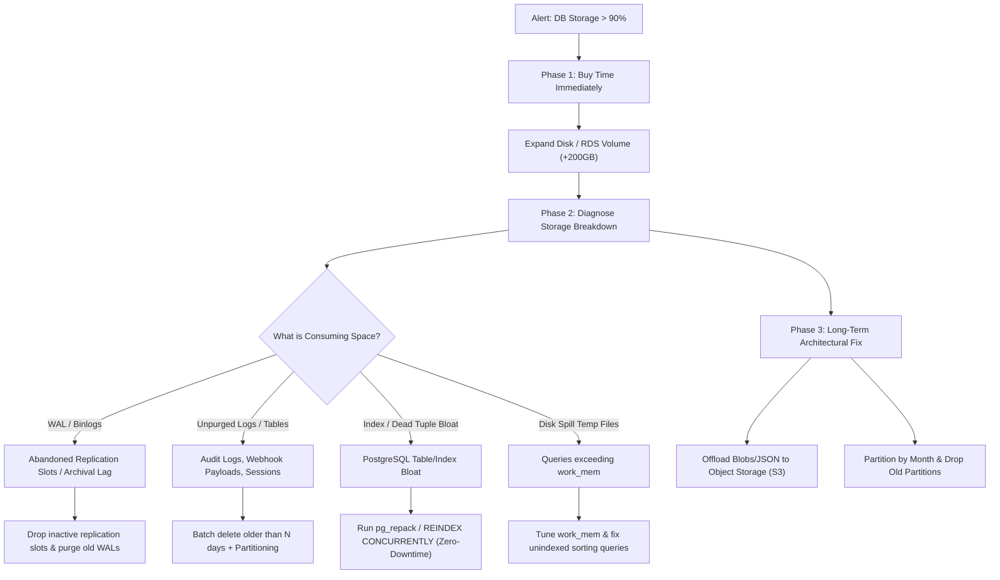

## Fast Revision (10-Second Recall)
- **Immediate Emergency Action**: Increase disk allocation immediately (e.g., AWS RDS storage autoscaling or volume expansion) to buy runway; never let a database reach 100% disk (triggers crash, read-only lock, or WAL write failure).
- **Disk Space Consumers**: Table data, secondary indexes (often 40–60% of total disk), WAL / binlog replication backlog, query temp disk spills (`work_mem`), dead tuple bloat from stalled autovacuum, and unpurged audit/log tables.
- **Remediation Ladder**: Immediate storage expansion -> Identify largest tables/indexes -> Truncate temporary/staging data -> Purge binlogs/stuck replication slots -> Online index rebuild (`REINDEX CONCURRENTLY` or `pg_repack`) -> Implement partitioning & cold storage archival to S3.

---

## The 30-Second Spoken Script
> "When a production database approaches storage exhaustion, my immediate priority is preventing a hard database shutdown, because hitting 100% disk causes PostgreSQL or MySQL to crash into recovery or switch to read-only mode. 
>
> My step one is immediate infrastructure expansion: increase allocated storage on AWS RDS or resize the cloud block volume. This buys critical breathing room. 
>
> Step two is diagnostic triage: I query the storage breakdown across tables, indexes, write-ahead logs, and temp files. Often, the culprit is unpurged application logs, bloated indexes, or abandoned replication slots preventing WAL cleanup. 
>
> Step three is safe remediation: I drop duplicate or unused indexes, drop abandoned replication slots, and run online table repacking with `pg_repack` to reclaim dead tuple bloat without locking writes. 
>
> Long term, I enforce table range-partitioning by date, offload large JSON payloads and blobs to S3, and establish retention policies with automated lifecycle pruning."

---

## Scenario / Problem Context
On Friday afternoon at 16:30, PagerDuty alerts fire for the production PostgreSQL primary:
- **Disk Utilization**: 91.2% (456 GB of 500 GB used).
- **Growth Velocity**: 4.5 GB per hour.
- **Projected Outage**: Database will reach 100% capacity in approximately 9.7 hours.
- **Application State**: Fully operational, but database failure will trigger an immediate catastrophic downtime across all microservices.

```
Mount               Total Size    Used Space    Available    Use%
------------------------------------------------------------------
/var/lib/postgresql 500 GB        456 GB        44 GB        91.2%
```

---

## Architectural Workflow / Sequence



---

## Deep-Dive Analysis & Root Causes

### 1. Abandoned Replication Slots & WAL Accumulation
In PostgreSQL, if a logical replication slot or standby replica disconnects or falls behind, PostgreSQL **retains all WAL (Write-Ahead Log) files** on disk until the replica catches up. Even if your base tables only consume 100 GB, hundreds of gigabytes of WAL files will accumulate in `pg_wal`, rapidly consuming all available disk.

### 2. High-Frequency Updates and Autovacuum Lag (Bloat)
PostgreSQL utilizes Multi-Version Concurrency Control (MVCC). When a row is updated or deleted, PostgreSQL writes a new version (tuple) and marks the old version as dead. If autovacuum cannot keep pace with high write workloads (or is blocked by long-running transactions), dead tuples accumulate, causing tables and indexes to inflate to 5x–10x their actual size.

### 3. Storing Blobs, Documents, or Giant JSON Payloads in OLTP Tables
Applications frequently dump multi-megabyte audit events, API webhook responses, or base64 files directly into `TEXT` or `JSONB` columns in relational tables. These columns expand PostgreSQL TOAST (The Oversized-Attribute Storage Technique) tables exponentially.

### 4. Excessive or Redundant Secondary Indexes
Every secondary index duplicates table column data. On tables with 15+ indexes, index storage often exceeds actual table data by 200–300%. Unused or duplicate indexes silently consume tens of gigabytes of disk and RAM buffer cache.

---

## Practical Debugging Commands & Code

### 1. Emergency Disk Inspection Queries

```sql
-- Check top 10 largest database tables and their total disk footprint
SELECT
    schemaname,
    relname AS table_name,
    pg_size_pretty(pg_total_relation_size(relid)) AS total_size,
    pg_size_pretty(pg_relation_size(relid)) AS table_data_size,
    pg_size_pretty(pg_total_relation_size(relid) - pg_relation_size(relid)) AS index_and_toast_size
FROM pg_catalog.pg_statio_user_tables
ORDER BY pg_total_relation_size(relid) DESC
LIMIT 10;
```

```sql
-- Check for inactive or lagging replication slots holding WAL files
SELECT 
    slot_name,
    plugin,
    active,
    pg_size_pretty(pg_wal_lsn_diff(pg_current_wal_lsn(), restart_lsn)) AS retained_wal_bytes
FROM pg_replication_slots;

-- Drop an abandoned replication slot immediately freeing up WAL retention
-- SELECT pg_drop_replication_slot('abandoned_cdc_worker');
```

```sql
-- Find unused indexes consuming disk space (zero scans since last stat reset)
SELECT
    schemaname || '.' || relname AS table_name,
    indexrelname AS index_name,
    pg_size_pretty(pg_relation_size(i.indexrelid)) AS index_size,
    idx_scan as number_of_scans
FROM pg_stat_user_indexes ui
JOIN pg_index i ON ui.indexrelid = i.indexrelid
WHERE NOT indisunique AND idx_scan = 0
ORDER BY pg_relation_size(i.indexrelid) DESC
LIMIT 10;
```

### 2. Reclaiming Space Without Table Locks

Standard `VACUUM FULL` acquires an `ACCESS EXCLUSIVE` lock, halting all application reads and writes for hours. Instead, use non-blocking methods:

```sql
-- 1. Rebuild bloated indexes concurrently without blocking reads or writes
REINDEX INDEX CONCURRENTLY idx_audit_logs_created_at;

-- 2. Drop identified duplicate/unused indexes
DROP INDEX CONCURRENTLY IF EXISTS idx_orders_user_id_temp;
```

```bash
# 3. For table-level bloat reclamation, use pg_repack (online table rebuild)
# Reorganizes table and indexes in the background without exclusive lock
pg_repack -h db-primary.internal -U postgres -d ecommerce_prod --table audit_events
```

### 3. Safe Chunked Purge Script for Expired Data
Executing `DELETE FROM audit_logs WHERE created_at < NOW() - INTERVAL '90 days';` on 50 million rows will blow up transaction logs, lock rows, and degrade production. Purge in safe iterative batches:

```typescript
import { Client } from "pg";

async function purgeOldAuditLogsBatch(client: Client, batchSize = 5000, daysRetained = 60) {
  let totalDeleted = 0;
  let rowsAffected = 0;

  console.log(`Starting chunked purge of audit logs older than ${daysRetained} days...`);

  do {
    // Delete in discrete batches and immediately commit
    const result = await client.query(`
      WITH rows_to_delete AS (
        SELECT id FROM audit_logs
        WHERE created_at < NOW() - INTERVAL '${daysRetained} days'
        LIMIT $1
      )
      DELETE FROM audit_logs
      WHERE id IN (SELECT id FROM rows_to_delete);
    `, [batchSize]);

    rowsAffected = result.rowCount ?? 0;
    totalDeleted += rowsAffected;
    console.log(`Purged batch of ${rowsAffected} rows. Total deleted so far: ${totalDeleted}`);

    // Pause 250ms to yield I/O to production traffic and allow autovacuum to catch up
    await new Promise((resolve) => setTimeout(resolve, 250));
  } while (rowsAffected > 0);

  console.log(`Purge completed successfully. Total rows removed: ${totalDeleted}`);
}
```

---

## Prevention & Senior Best Practices

| Storage Dimension | High-Risk Pattern | Resilient Architecture Standard |
| :--- | :--- | :--- |
| **Capacity Management** | Static volume with manual alert at 90% | Cloud storage autoscaling + tiered alerting (70%, 80%, 85%) |
| **Replication Slots** | Unmonitored CDC / replica consumers | Dead-man alerts on replication slot lag with automatic eviction |
| **High-Volume Tables** | Monolithic 500M row single table | Declarative range-partitioning by date; drop partition instantly |
| **Binary/Blob Data** | Storing files or giant JSON in DB rows | Offload payloads to AWS S3/GCS; store signed URLs/keys in DB |
| **Maintenance** | Relying solely on default autovacuum | Aggressive autovacuum tuning for high-write tables (`scale_factor = 0.05`) |

1. **Declarative Partitioning for Time-Series Data**: Tables like `audit_logs`, `events`, or `api_requests` should be partitioned monthly or daily (`PARTITION BY RANGE (created_at)`). Dropping an entire expired partition (`DROP TABLE audit_logs_2025_01;`) takes 10 milliseconds, requires zero vacuuming, and instantly frees disk space back to the operating system.
2. **PostgreSQL TOAST Offloading**: Never store large file attachments or raw JSON response bodies inside the transactional database. Offload them asynchronously to S3/Cloud Storage and store only the S3 URI and hash in the database.
3. **Automate Autovacuum Tuning for Hot Tables**: For tables undergoing thousands of updates per minute, adjust table-level storage parameters so autovacuum runs aggressively before bloat can form:
```sql
ALTER TABLE orders SET (
    autovacuum_vacuum_scale_factor = 0.05,
    autovacuum_vacuum_cost_limit = 2000
);
```

