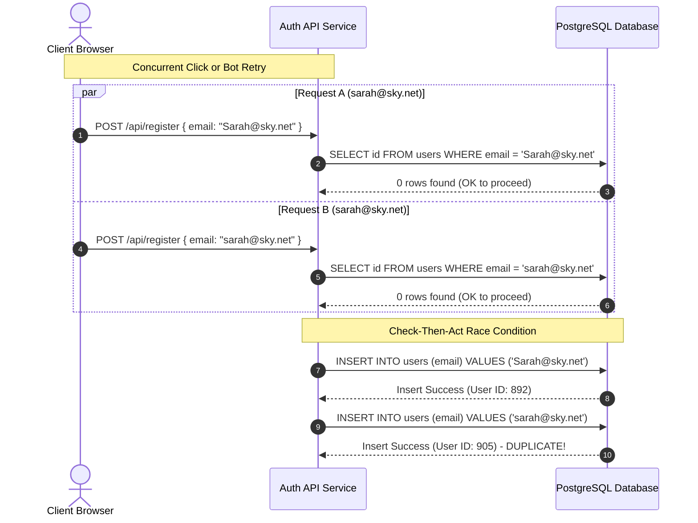

## Fast Revision (10-Second Recall)
- **Primary Root Causes**: Missing DB-level `UNIQUE` index, race condition during concurrent registration (check-then-act without constraint), case-sensitivity mismatches (`User@corp.com` vs `user@corp.com`), whitespace/homoglyphs, and soft-delete collisions.
- **Architectural Fix**: Canonicalize emails at ingestion (`trim`, `toLowerCase`, Unicode NFKC), enforce DB unique index on expression `CREATE UNIQUE INDEX idx_users_email ON users (LOWER(TRIM(email))) WHERE deleted_at IS NULL`, and handle unique violation (`23505` / `1062`) gracefully as HTTP 409 Conflict.
- **Data Cleanup Strategy**: Identify duplicate clusters via group-by query, select primary master record (most recent login or verified payment), migrate foreign keys inside an atomic transaction, archive secondary rows, and notify affected users.

---

## The 30-Second Spoken Script
> "Duplicate accounts with the same email occur when applications rely purely on application-level checks like `User.find_by(email)` before inserting, rather than enforcing a database-level unique constraint. Under concurrent signup clicks or automated retries, both threads pass the read check and insert duplicate rows. 
>
> In real-world systems, this is compounded by email normalization failures—such as case sensitivity differences in PostgreSQL text columns, trailing whitespace, or unhandled soft-deletes. 
>
> To resolve this, I first normalize emails on ingress (trim, lowercase, and Unicode NFKC normalization). Second, I enforce a partial functional unique index in the database—`LOWER(TRIM(email))` scoped to non-deleted records. If an insert conflicts, the API catches the constraint violation and returns a standard 409 Conflict. For existing duplicate accounts, I execute an automated reconciliation script inside a database transaction that merges foreign key relationships to the primary active account and soft-deletes or archives the duplicates."

---

## Scenario / Problem Context
A SaaS e-commerce platform allows users to register via standard email and password. During a high-traffic marketing campaign, support receives tickets from confused customers:
1. Customers log in and see empty order histories; on a different device, their past orders appear.
2. Password reset links randomly reset passwords for an inactive duplicate account.
3. Billing webhooks fail to apply subscriptions to the active account because Stripe customer IDs match multiple user rows.

An investigation into the `users` table reveals over 4,200 duplicate email records. 

```
 id  |         email         | created_at  | last_login_at
-----+-----------------------+-------------+---------------
 104 | sarah.connor@sky.net  | 2026-03-01  | 2026-03-01
 892 | Sarah.Connor@sky.net  | 2026-06-15  | 2026-10-30
 905 | sarah.connor@sky.net  | 2026-06-15  | NULL
```

The database had no unique constraint on `email`, and the application code used an asynchronous `SELECT` followed by an `INSERT`.

---

## Architectural Workflow / Sequence



---

## Deep-Dive Analysis & Root Causes

### 1. Check-Then-Act Concurrency Flaw (TOCTOU)
Application-level validation without database-level concurrency control is inherently broken:
```typescript
// INSECURE: Race condition vulnerable
const existing = await db.user.findFirst({ where: { email } });
if (existing) {
  throw new ConflictError("Email already in use");
}
// Thread preempted here; concurrent request inserts row
const newUser = await db.user.create({ data: { email, passwordHash } });
```
In high concurrency, multiple requests execute the `findFirst` query before either completes the insert.

### 2. Case-Sensitivity & Collation Nuances
- Standard PostgreSQL `TEXT` or `VARCHAR` columns perform case-sensitive comparisons (`'User@domain.com' != 'user@domain.com'`).
- MySQL defaults to case-insensitive collations (e.g., `utf8mb4_unicode_ci`), which prevents case-variation duplicates if a unique key exists, but PostgreSQL requires either `CITEXT` (Case-Insensitive Text extension) or an expression index: `CREATE UNIQUE INDEX ... ON users (LOWER(email))`.

### 3. Email Normalization Edge Cases
- **Trailing & Leading Whitespace**: User copy-pasting an email often introduces `" user@domain.com "`.
- **Subaddressing (Plus-Addressing)**: `user+promo@domain.com` and `user@domain.com` route to the same mailbox on Gmail, Fastmail, and Outlook, but represent distinct strings to the database.
- **Gmail Dot-Blindness**: `john.doe@gmail.com` and `johndoe@gmail.com` are identical mailboxes in Google Workspace, allowing duplicate account generation or coupon abuse.

### 4. Soft-Deletes Colliding with Global Unique Constraints
When a system uses soft deletes (`deleted_at TIMESTAMP`), a naive `UNIQUE(email)` constraint prevents a previously deleted user from re-registering with their old email. Conversely, removing the constraint allows infinite duplicate active accounts.

---

## Practical Debugging Commands & Code

### 1. Audit Script to Detect Existing Duplicates
Run this SQL query to identify all duplicate clusters and associated record counts:

```sql
-- Find all duplicate clusters ignoring case and whitespace
SELECT 
    LOWER(TRIM(email)) AS normalized_email,
    COUNT(*) AS account_count,
    ARRAY_AGG(id ORDER BY created_at ASC) AS user_ids,
    ARRAY_AGG(last_login_at ORDER BY created_at ASC) AS login_timestamps
FROM users
WHERE deleted_at IS NULL
GROUP BY LOWER(TRIM(email))
HAVING COUNT(*) > 1
ORDER BY account_count DESC;
```

### 2. Migration Script to Deduplicate Accounts Safely
Before applying a unique index, existing duplicates must be merged into a single canonical record:

```sql
BEGIN;

-- Create temporary mapping table: duplicate_user_id -> canonical_user_id
CREATE TEMP TABLE user_merge_map AS
WITH ranked_users AS (
    SELECT 
        id,
        LOWER(TRIM(email)) AS norm_email,
        ROW_NUMBER() OVER (
            PARTITION BY LOWER(TRIM(email)) 
            ORDER BY 
                CASE WHEN last_login_at IS NOT NULL THEN 0 ELSE 1 END,
                last_login_at DESC NULLS LAST,
                created_at ASC
        ) AS rank_order
    FROM users
    WHERE deleted_at IS NULL
)
SELECT 
    r.id AS secondary_id,
    c.id AS primary_id
FROM ranked_users r
JOIN ranked_users c ON r.norm_email = c.norm_email AND c.rank_order = 1
WHERE r.rank_order > 1;

-- Reassign dependent foreign keys (Orders, Subscriptions, Audit Logs)
UPDATE orders o
SET user_id = m.primary_id
FROM user_merge_map m
WHERE o.user_id = m.secondary_id;

UPDATE subscriptions s
SET user_id = m.primary_id
FROM user_merge_map m
WHERE s.user_id = m.secondary_id;

-- Soft-delete secondary accounts and rename email to free up unique constraint
UPDATE users u
SET 
    email = u.email || '_duplicate_merged_' || u.id,
    deleted_at = NOW()
FROM user_merge_map m
WHERE u.id = m.secondary_id;

-- Normalize primary accounts to lowercase trimmed string
UPDATE users u
SET email = LOWER(TRIM(email))
WHERE id IN (SELECT primary_id FROM user_merge_map);

COMMIT;
```

### 3. Applying the Production Database Constraint
```sql
-- Create partial unique index to support soft deletes and case insensitivity
CREATE UNIQUE INDEX CONCURRENTLY idx_users_email_unique_active
ON users (LOWER(TRIM(email)))
WHERE deleted_at IS NULL;
```

### 4. Resilient Backend Ingestion & Race-Condition Handling
```typescript
import { Request, Response } from "express";
import { Prisma } from "@prisma/client";
import prisma from "../lib/prisma";

export function normalizeEmail(rawEmail: string): string {
  if (!rawEmail || typeof rawEmail !== "string") {
    throw new Error("Invalid email input");
  }
  // Trim whitespace, apply Unicode NFKC canonical decomposition, lowercase
  let email = rawEmail.trim().normalize("NFKC").toLowerCase();
  
  // Optional: Handle Gmail dot-blindness for abuse prevention
  const [localPart, domainPart] = email.split("@");
  if (domainPart === "gmail.com" || domainPart === "googlemail.com") {
    const cleanLocal = localPart.replace(/\./g, "").split("+")[0];
    email = `${cleanLocal}@gmail.com`;
  }
  return email;
}

export async function registerUserHandler(req: Request, res: Response) {
  try {
    const normalizedEmail = normalizeEmail(req.body.email);
    const { passwordHash, fullName } = req.body;

    // Do NOT rely on pre-flight select. Insert directly and handle constraint violation.
    const user = await prisma.user.create({
      data: {
        email: normalizedEmail,
        passwordHash,
        fullName,
      },
      select: { id: true, email: true, createdAt: true },
    });

    return res.status(201).json({ success: true, user });
  } catch (error: any) {
    // PostgreSQL unique_violation code is '23505', Prisma error code is 'P2002'
    if (error instanceof Prisma.PrismaClientKnownRequestError && error.code === "P2002") {
      return res.status(409).json({
        error: "Conflict",
        message: "An account with this email address already exists.",
      });
    }

    console.error("User registration failed:", error);
    return res.status(500).json({ error: "InternalServerError", message: "Failed to register" });
  }
}
```

---

## Prevention & Senior Best Practices

| Area | Fragile Pattern | Production-Grade Standard |
| :--- | :--- | :--- |
| **Integrity Enforcement** | Application-level `findFirst` check | Database-level unique constraint (`UNIQUE INDEX`) |
| **Casing Strategy** | Storing raw string `Sarah@Domain.COM` | Normalizing to lowercase + Unicode NFKC before persistence |
| **Soft Deletes** | Global unique constraint preventing re-registration | Partial unique index (`WHERE deleted_at IS NULL`) |
| **Race Conditions** | Optimistic non-atomic checks | Catching DB constraint error code (`23505` in PG, `1062` in MySQL) |
| **Account Merging** | Manual manual SQL updates in prod | Automated, audited migration script with FK re-pointing |

1. **Defense in Depth**: Application validation provides user-friendly error messages, but the database constraint is the non-negotiable source of truth.
2. **Handle Database Error Codes Specifically**: Never catch generic errors when unique violations occur. Inspect specific SQLState codes (`23505` for PostgreSQL, `1062` for MySQL) to distinguish genuine duplicate collisions from storage or connection errors.
3. **Audit Trail for Merged Accounts**: When merging duplicate user records, write an entry into an `account_merge_audits` table detailing the old IDs, new master ID, timestamp, and triggering admin or script.

