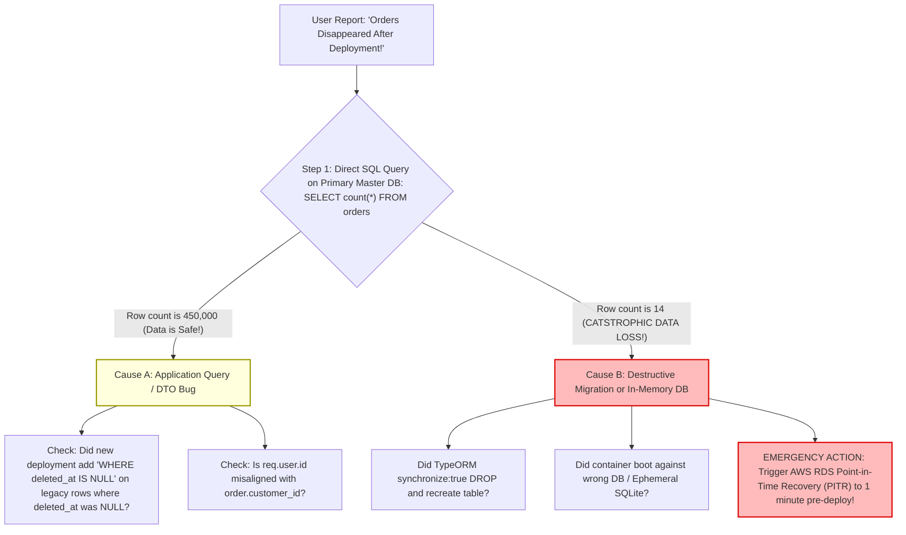

## Fast Revision (10-Second Recall)
- **The Top 4 Deployment Disappearance Causes:**
  1. *Destructive ORM Synchronization (`synchronize: true`):* TypeORM/Hibernate `synchronize: true` or `prisma db push` was left enabled in production, executing `DROP TABLE orders` during container startup to match code changes.
  2. *Ephemeral SQLite / In-Memory Database Fallback:* Database connection string failed; application silently fell back to an in-memory SQLite database (`:memory:`) inside the container that wiped upon container restart.
  3. *Tenant ID / Soft-Delete Query Filtering Bug:* The orders exist in the database, but a newly deployed global filter (`WHERE is_deleted = false` or `WHERE tenant_id = :id`) is filtering them out due to unmigrated legacy NULL values.
  4. *Multi-Cluster / Environment Routing Drift:* Ingress route or DNS switched to a new staging cluster or wrong database instance during the blue-green release.
- **Immediate Triage Action:** Check database row counts immediately via direct CLI (`psql`). If row count is zero, check database backup snapshots (AWS RDS Point-in-Time Recovery) immediately!

## The 30-Second Spoken Script
> "When users report that orders disappear immediately following a deployment, our first step is to verify whether this is an **actual data loss event** or an **application query/filtering illusion**.
>
> We immediately open direct database connections to our primary master:
> 1. We run `SELECT count(*) FROM orders`. If the count is unchanged, the data is physically safe! The bug is in the new deployment's query logic—typically a new soft-delete filter (`WHERE is_deleted = false`) hiding records containing legacy NULL values, a broken user session tenant ID, or an API serializer dropping fields.
> 2. If the count is zero or significantly reduced, we are facing an emergency data destruction incident. The most notorious culprit is an ORM flag like TypeORM's `synchronize: true` or a destructive migration that dropped and recreated the table during container startup. Another common issue is an environment variable misconfiguration where the new container failed to connect to RDS and silently booted an ephemeral in-memory SQLite instance.
>
> If data was dropped, we immediately trigger **AWS RDS Point-in-Time Recovery (PITR)** to restore the database to the exact minute prior to deployment, while rolling back the container image to prevent further corruption."

## Scenario / Problem Context
An e-commerce company deployed version 2.4.0 on a Thursday afternoon. Ten minutes after the release was promoted to 100% traffic, customer service received a flurry of emergency calls:
*"All my past orders from the last 2 years are gone! My order history is completely empty!"*

The developers checked the web UI: every customer's order history page showed `"No orders found"`.

The on-call engineer logged into the production PostgreSQL database:
`SELECT count(*) FROM orders;`
Result: `count = 14`. Only 14 orders existed—all created in the last 10 minutes! Over 450,000 historical customer orders were gone.

The VP of Engineering called an all-hands P0 emergency:
1. Did the deployment delete the database?
2. Was the data dropped or moved?
3. How do we recover 450,000 lost customer orders before irreversible damage occurs?

The engineering team needs an emergency forensic and recovery playbook.

## Architectural Workflow / Sequence


## Deep-Dive Analysis & Root Causes

### 1. The `synchronize: true` Catastrophe in TypeORM / Hibernate
In TypeORM:
```typescript
// DANGEROUS: synchronize should NEVER be true in production!
TypeOrmModule.forRoot({
  type: 'postgres',
  synchronize: process.env.NODE_ENV !== 'production', // IF ENV VAR TYPO OCCURS: WIPES DB!
  entities: [Order],
});
```
If an entity property name changes, or if an environment variable typo causes `synchronize: true` to evaluate on production:
- TypeORM inspects the existing table schema.
- Seeing differences, it executes: `DROP TABLE orders CASCADE; CREATE TABLE orders (...);`.
- All historical records are wiped in milliseconds!

### 2. Silent In-Memory Fallback
If the application configuration includes a fallback:
`DATABASE_URL = process.env.DATABASE_URL || 'sqlite::memory:';`
If a Kubernetes Secret fails to mount or an AWS IAM role secret fails to fetch:
- The app boots without crashing.
- It connects to an in-memory SQLite database inside the container.
- New orders are saved to memory; old orders are invisible.
- When the container restarts, even the new orders evaporate!

### 3. The Soft-Delete Null Filter Trap (Data is Intact, but Invisible)
A common non-destructive bug:
The new release adds a soft-delete column: `is_active BOOLEAN DEFAULT true`.
- On old records, existing rows have `is_active = NULL`.
- The new code queries: `SELECT * FROM orders WHERE is_active = true`.
- In SQL three-valued logic, `NULL = true` evaluates to `UNKNOWN` (falsy)!
- None of the 450,000 historical orders are returned. The data is 100% intact, but completely hidden from the application!

## Practical Debugging Commands & Code

### Step 1: Immediate Database Row Count and Schema Forensics
```bash
# 1. Connect to production primary database
psql -h postgres-prod.internal -U app_user -d commerce

# 2. Check row count and table creation timestamp
SELECT count(*) FROM orders;

# 3. Check table creation / modification timestamp
SELECT relname, n_live_tup, n_dead_tup, last_vacuum, last_autovacuum 
FROM pg_stat_user_tables WHERE relname = 'orders';

# 4. Search PostgreSQL WAL logs for destructive DDL commands in the last 2 hours
# grep -E "DROP TABLE|TRUNCATE|ALTER TABLE" /var/log/postgresql/postgresql.log
```

### Step 2: Emergency AWS RDS Point-in-Time Recovery (PITR)
If the table was dropped, restore the database to the exact minute prior to deployment:

```bash
# Restore RDS database to 10:14 AM UTC (1 minute before the 10:15 AM deployment)
aws rds restore-db-instance-to-point-in-time \
  --source-db-instance-identifier commerce-prod-db \
  --target-db-instance-identifier commerce-restored-recovery \
  --restore-time 2026-10-31T10:14:00.000Z \
  --db-instance-class db.r6g.2xlarge

# Once restored, dump the missing orders and import into active database:
pg_dump -h commerce-restored-recovery.internal -U app_user -d commerce \
  -t orders --data-only > orders_recovered.sql

psql -h postgres-prod.internal -U app_user -d commerce < orders_recovered.sql
```

### Step 3: Fixing the Three-Valued Logic NULL Filter Bug
If the data was hidden due to `NULL` column values:

```sql
-- Fix legacy records where column is NULL
UPDATE orders SET is_active = true WHERE is_active IS NULL;

-- Enforce NOT NULL with DEFAULT so future inserts cannot be NULL
ALTER TABLE orders ALTER COLUMN is_active SET DEFAULT true;
ALTER TABLE orders ALTER COLUMN is_active SET NOT NULL;
```

### Step 4: Production Guardrail: Hard-Banning `synchronize: true`
Ensure application startup fails if `synchronize` is ever enabled:

```typescript
// src/config/database.ts
export function getDatabaseConfig() {
  const isProduction = process.env.NODE_ENV === 'production';

  // PRODUCTION FAIL-SAFE: Throw hard error if synchronize is attempted!
  if (isProduction && process.env.TYPEORM_SYNCHRONIZE === 'true') {
    throw new Error('CRITICAL SECURITY ERROR: TYPEORM_SYNCHRONIZE CANNOT BE TRUE IN PRODUCTION!');
  }

  return {
    type: 'postgres',
    url: process.env.DATABASE_URL,
    synchronize: false, // ALWAYS FALSE! Migrations only!
    migrationsRun: true,
  };
}
```

## Prevention & Senior Best Practices
1. **Never Enable ORM Synchronize in Production:** Strictly ban `synchronize: true` or `prisma db push` in production. Enforce code-review and CI linter checks.
2. **Never Provide Default In-Memory Fallbacks:** If the database connection string is missing or invalid, crash the container immediately (`process.exit(1)`); never silently fall back to SQLite or in-memory fixtures.
3. **Always Test Migrations on Full Staging Snapshots:** Run migrations against a replica of production data to catch three-valued NULL logic bugs on legacy records.
4. **Enforce Automated RDS Point-in-Time Recovery (PITR):** Verify that automated RDS backups have 7-30 days of retention with 5-minute transaction log archiving.
5. **Revoke DDL Permissions from Application DB Users:** In production, the runtime application database user should only have `SELECT, INSERT, UPDATE, DELETE` permissions; revoke `DROP TABLE` and `TRUNCATE` permissions.

