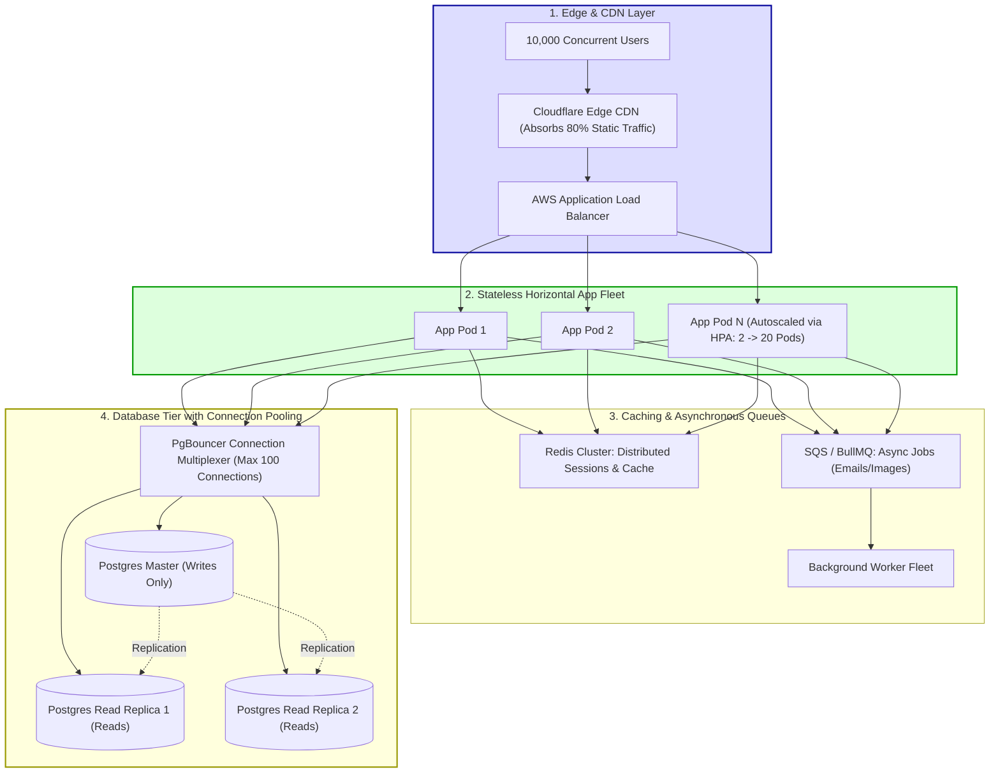

## Fast Revision (10-Second Recall)
- **The Core Scaling Law:** What works for 100 users is a single server with local in-memory sessions, synchronous email dispatch, direct database queries, and a single relational database. At 10,000 users, every single component must be decoupled and horizontally scaled.
- **The 5 Non-Negotiable Transformations:**
  1. *Stateless Application Fleet:* Move in-memory sessions to Redis/JWT; scale application containers horizontally behind a cloud Load Balancer (ALB).
  2. *Database Connection Multiplexing:* Introduce **PgBouncer**; 10,000 users opening direct DB connections will crash PostgreSQL.
  3. *Read/Write Splitting:* Send 80% read traffic to **PostgreSQL Read Replicas**; reserve the Primary Master for writes.
  4. *Multi-Layer Caching:* Cache static assets on Cloudflare CDN and hot database records in Redis (Cache-Aside pattern).
  5. *Asynchronous Offloading:* Move emails, image processing, and PDF generation off HTTP threads into background queues (BullMQ/SQS).

## The 30-Second Spoken Script
> "When scaling an application from 100 to 10,000 concurrent users, the architecture must transition from a stateful, vertically scaled monolith to a horizontally scaled, decoupled distributed system.
>
> We execute five sequential architectural shifts:
> First, **Make Application Pods Stateless**: We extract local in-memory state and session files into Redis and object storage (S3). This allows us to scale application containers horizontally from 2 to 20 replicas behind an AWS Application Load Balancer using Kubernetes HPA.
> Second, **Database Connection Decoupling with PgBouncer**: 10,000 concurrent web requests cannot open 10,000 direct connections to PostgreSQL. We place PgBouncer in transaction pooling mode in front of the database, multiplexing thousands of client connections into 50 physical database connections.
> Third, **Read/Write Splitting with Read Replicas**: Because 85% of web traffic is read-heavy (catalog browsing, user profiles), we add two read replicas to absorb read traffic, keeping the Primary Master dedicated to writes.
> Fourth, **Caching Layers**: We deploy Cloudflare at the edge for static assets and CDN caching, and implement Redis Cache-Aside for expensive SQL queries.
> Fifth, **Asynchronous Processing**: All non-critical side effects (emails, notifications, analytics) are pushed to SQS queues, freeing web workers to handle immediate user interactions in under 50ms."

## Scenario / Problem Context
A SaaS productivity startup built an MVP on a single large virtual machine (16GB RAM, 8 vCPUs) running Node.js, PostgreSQL, and local disk file storage. 

For 100 beta users, the app was blazing fast:
- Latency was 35ms.
- Database CPU was at 2%.
- The team assumed the system was production-ready.

The startup launched on Product Hunt and was featured on a major tech news outlet. Within 45 minutes, 10,000 active concurrent users flooded the website:
1. The single Node.js process hit 100% CPU on its single event loop thread, failing to service incoming HTTP requests.
2. The server ran out of file descriptors and TCP sockets, throwing `EMFILE: Too many open files`.
3. The database crashed because the app tried to open 1,200 concurrent database connections, exhausting server memory.
4. The entire website crashed, resulting in a public launch disaster.

The founders need a definitive architectural scaling roadmap to transform the fragile prototype into a resilient system capable of handling 10,000+ concurrent users with zero downtime.

## Architectural Workflow / Sequence


## Deep-Dive Analysis & Root Causes

### 1. The Scaling Milestones Comparison

| Architectural Dimension | Prototype (100 Users) | Enterprise (10,000 Users) |
| :--- | :--- | :--- |
| **Compute Topology** | 1 Monolithic Server | Horizontally Scaled Pods (K8s / ECS) |
| **Session State** | In-Memory (`express-session`) | Stateless JWT or Redis Session Store |
| **Database Connections** | Direct connection per app instance | **PgBouncer** Transaction Pooling |
| **Database Topology** | Single Master (Reads + Writes) | Primary Master + Multiple Read Replicas |
| **Caching** | None (All queries hit SQL) | Cloudflare Edge CDN + Redis Cache-Aside |
| **File Storage** | Local Server Disk (`/uploads/`) | Amazon S3 + Presigned Direct Uploads |
| **Long Operations** | Synchronous inside HTTP route | Asynchronous BullMQ / SQS Worker Pool |

### 2. Why Connection Pooling is Critical at 10,000 Users
PostgreSQL spawns a separate OS process for every connected client. Each process consumes ~10MB of RAM.
- 100 connections = 1GB RAM (Manageable).
- 2,000 connections = 20GB RAM (Database server exhausts memory and crashes).
- **PgBouncer** sits between the 20 application pods and PostgreSQL:
  - Thousands of application connections connect to PgBouncer.
  - PgBouncer multiplexes queries into an active pool of **50 physical PostgreSQL connections**, keeping database CPU and RAM utilization low and fast.

### 3. Read/Write Query Separation
In virtually all SaaS and e-commerce applications:
- 85% to 95% of queries are `SELECT` reads (viewing profiles, searching products, rendering dashboards).
- 5% to 15% are `INSERT / UPDATE` writes.
- By provisioning 2 Read Replicas, you increase read capacity by 300% without touching the master database.

## Practical Debugging Commands & Code

### Step 1: Database Connection Splitting (TypeORM Primary/Replica)
Configure the application to automatically route writes to Master and reads to Replicas:

```typescript
// src/config/database.ts
import { DataSource } from 'typeorm';

export const AppDataSource = new DataSource({
  type: 'postgres',
  replication: {
    master: {
      host: process.env.DB_MASTER_HOST || 'postgres-master.internal',
      port: 5432,
      username: 'app_user',
      password: process.env.DB_PASSWORD,
      database: 'production_db',
    },
    slaves: [
      {
        host: 'postgres-replica-1.internal',
        port: 5432,
        username: 'app_user',
        password: process.env.DB_PASSWORD,
        database: 'production_db',
      },
      {
        host: 'postgres-replica-2.internal',
        port: 5432,
        username: 'app_user',
        password: process.env.DB_PASSWORD,
        database: 'production_db',
      },
    ],
  },
  entities: ['dist/**/*.entity.js'],
  synchronize: false,
});
```

### Step 2: Redis Cache-Aside Pattern for Expensive Queries
```typescript
// src/services/productService.ts
import Redis from 'ioredis';
import { db } from '../database';

const redis = new Redis(process.env.REDIS_URL || 'redis://localhost:6379');

export async function getProductDetails(productId: string) {
  const cacheKey = `cache:product:${productId}`;

  // 1. Check Redis Cache First (Takes 1ms!)
  const cached = await redis.get(cacheKey);
  if (cached) {
    return JSON.parse(cached);
  }

  // 2. Cache Miss: Query Database Read Replica
  const product = await db.query('SELECT * FROM products WHERE id = $1', [productId]);
  if (!product) return null;

  // 3. Write to Redis with 5-minute TTL
  await redis.set(cacheKey, JSON.stringify(product), 'EX', 300);

  return product;
}
```

### Step 3: Kubernetes Horizontal Pod Autoscaler (HPA)
Automatically scale application pods as traffic scales up to 10,000 users:

```yaml
apiVersion: autoscaling/v2
kind: HorizontalPodAutoscaler
metadata:
  name: api-service-hpa
  namespace: production
spec:
  scaleTargetRef:
    apiVersion: apps/v1
    kind: Deployment
    name: api-service
  minReplicas: 3
  maxReplicas: 30
  metrics:
    - type: Resource
      resource:
        name: cpu
        target:
          type: Utilization
          averageUtilization: 60
```

## Prevention & Senior Best Practices
1. **Never Store State in Application Pods:** Session state must live in Redis; uploaded files must live in S3. Application pods must be 100% disposable and stateless.
2. **Always Deploy PgBouncer for High Concurrency:** Never connect hundreds of application pods directly to PostgreSQL; route through PgBouncer in transaction pooling mode.
3. **Split Reads and Writes:** Route `SELECT` queries to database read replicas to preserve primary master capacity for writes.
4. **Cache Hot Static Assets at Cloudflare / CloudFront:** Configure CDN caching for images, CSS, JavaScript, and public API data to absorb 80% of incoming requests before they hit your cloud.
5. **Decouple Heavy Work with Asynchronous Queues:** Never send emails, resize images, or generate PDF exports synchronously on web request threads; offload to BullMQ/SQS.

