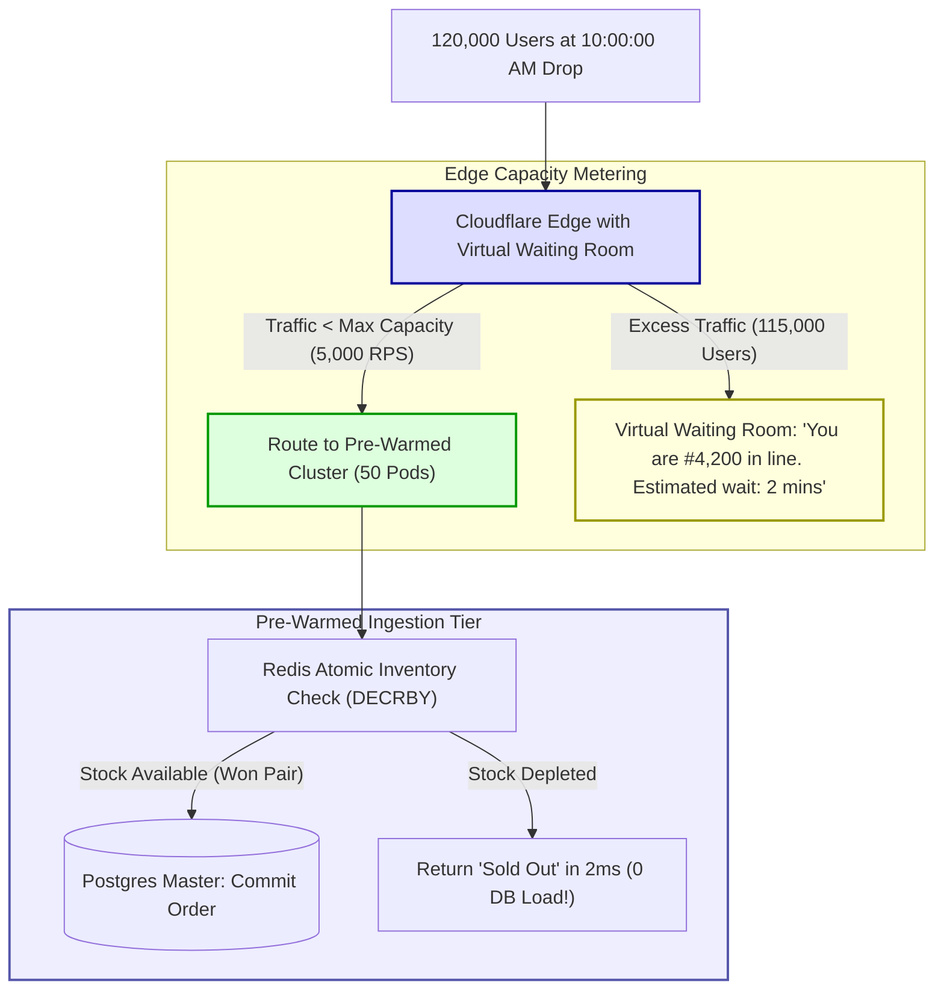

## Fast Revision (10-Second Recall)
- **The Flash Sale Dynamic:** Traffic does NOT ramp up smoothly over 30 minutes; it spikes from 500 RPS to 50,000 RPS in **3 seconds** at the top of the hour. Reactive autoscaling (HPA) is too slow!
- **Top 4 Preparation Strategies:**
  1. *Infrastructure Pre-Warming:* Manually scale Kubernetes pods, database read replicas, and NAT gateways 30 minutes before the sale drops.
  2. *Virtual Waiting Rooms (Cloudflare Waiting Room):* Buffer excess users at the edge; meter traffic entering the application at an exact sustainable rate (e.g. 2,000 users/minute).
  3. *Load Shedding / Graceful Degradation:* Disable non-essential background features (recommendation engines, reviews, real-time analytics) to preserve CPU for checkout.
  4. *Aggressive Edge Caching:* Serve the flash-sale catalog and product details from Cloudflare CDN with `stale-while-revalidate` (99% cache hit ratio).
- **Inventory Locking:** Protect PostgreSQL inventory using Redis atomic decrements (`DECRBY`) rather than heavy relational database row locks.

## The 30-Second Spoken Script
> "Preparing for a massive flash sale requires abandoning the assumption that reactive autoscaling will save you. A sudden burst of 50,000 concurrent users at 12:00:00 will overwhelm a cluster before Kubernetes Horizontal Pod Autoscalers can even spin up new container nodes.
>
> We prepare for flash sales using a four-tier architecture:
> First, **Infrastructure Pre-Warming**: Thirty minutes before the drop, we manually scale our Kubernetes API deployment from 5 to 50 pods, provision additional PostgreSQL read replicas, and submit an AWS Load Balancer pre-warming ticket to ensure edge proxies don't drop initial connection floods.
> Second, **Edge Traffic Regulation with Virtual Waiting Rooms**: We deploy Cloudflare Waiting Room at the CDN layer. When traffic exceeds our verified system capacity (say, 5,000 checkouts/minute), overflow users enter an interactive branded queue page without touching our backend servers.
> Third, **Degradation and Load Shedding**: We toggle feature flags to disable non-critical, compute-heavy features—turning off personalized product recommendations, related item carousels, and search autocomplete—preserving 100% of database CPU for the checkout path.
> Fourth, **Redis-Based Inventory Counters**: We store inventory stock counts in Redis. Purchasing users atomically decrement the Redis counter via Lua scripts. Only the winning buyers are permitted to proceed to the database checkout transaction, shielding PostgreSQL from 49,000 losing queries."

## Scenario / Problem Context
A sneaker streetwear marketplace scheduled a limited-edition sneaker drop (5,000 pairs available) at 10:00 AM on a Saturday.

The engineering team relied on their standard Kubernetes autoscaling policy:
`Target CPU: 70%, Min: 4 pods, Max: 60 pods`.

At 09:59:58 AM, traffic was sitting at a calm 300 requests per second across 4 pods.
At 10:00:01 AM, over **120,000 sneakerheads and automated bots** hit the landing page simultaneously:
1. Kubernetes detected CPU at 100% at 10:00:15 AM and requested 40 new EC2 nodes. AWS EC2 took 3 minutes to provision and join the nodes to the cluster.
2. By 10:00:30 AM, while waiting for the nodes, the 4 existing pods ran out of memory and entered `CrashLoopBackOff`.
3. The database connection pool hit its maximum limit of 500 connections. 120,000 users trying to acquire database locks on the same 5,000 inventory rows created a complete PostgreSQL deadlock.
4. The entire website crashed, displaying `502 Bad Gateway` for 45 minutes.

The company suffered massive reputational damage and lost millions in potential revenue.

The executive team mandates an airtight engineering playbook to prepare for and withstand high-concurrency flash sales.

## Architectural Workflow / Sequence


## Deep-Dive Analysis & Root Causes

### 1. The Autoscaling Latency Lag
Autoscaling works well for gradual traffic changes (e.g. morning wake-up trends over 2 hours). It completely fails during flash sales:
- Metric Scraping Interval: 15 to 30 seconds.
- HPA Calculation & Threshold evaluation: 15 seconds.
- Cloud VM Node Provisioning (AWS EC2 / GCP Compute Engine): 2 to 4 minutes!
- Pod Container Image Pull & Boot: 30 to 60 seconds.
- Total delay: 3 to 6 minutes. During a flash sale, the event is completely over before the first autoscaled pod is ready!
- **Rule:** Pre-warm infrastructure 30 minutes before the drop.

### 2. Virtual Waiting Rooms (Edge Metering)
Instead of letting 120,000 users hit your web servers simultaneously:
- Cloudflare Waiting Room sits at the CDN edge.
- You configure: `Total Active Users: 5,000` and `New Users per Minute: 1,500`.
- The CDN meters users through to the application at a steady, mathematically safe rate that matches your database capacity.
- Waiting users see a dynamic, animated queue page with live countdowns, consuming **zero backend compute**.

### 3. Redis Atomic Inventory Decrements (Offloading DB Locks)
If 50,000 users attempt `SELECT ... FOR UPDATE` on 5,000 rows in PostgreSQL:
- 50,000 database transactions compete for the same row locks.
- Postgres lock queues exhaust memory and CPU.
- **Solution:** Seed inventory in Redis: `SET inventory:sneaker_42 5000`.
- A single atomic Lua script executes `DECRBY`. If the count is $\ge 0$, the user wins the right to purchase. If the count drops below 0, the script returns "SOLD OUT" in 1 millisecond.
- Exactly 5,000 users hit the database; the other 45,000 users are turned away at the Redis layer with zero database load!

## Practical Debugging Commands & Code

### Step 1: Pre-Warming Kubernetes Cluster via CLI
Run 30 minutes before the scheduled flash sale:

```bash
# 1. Pre-warm Kubernetes worker deployment from 4 to 40 pods
kubectl scale deployment/api-service --replicas=40 -n production

# 2. Pre-warm background worker deployment
kubectl scale deployment/order-worker --replicas=20 -n production

# 3. Verify all pods are running and ready
kubectl rollout status deployment/api-service -n production --timeout=180s
```

### Step 2: Atomic Redis Inventory Reservation via Lua Script
Guarantee race-condition-free inventory allocation in 1ms:

```typescript
// src/services/flashSaleInventory.ts
import Redis from 'ioredis';

const redis = new Redis(process.env.REDIS_URL || 'redis://localhost:6379');

// Atomic Lua script: Checks stock and decrements in a single atomic Redis operation
const RESERVE_STOCK_LUA = `
  local stock = redis.call('get', KEYS[1])
  if not stock or tonumber(stock) <= 0 then
    return 0 -- Sold out
  end
  redis.call('decr', KEYS[1])
  return 1 -- Successfully reserved!
`;

export async function reserveFlashSaleItem(itemId: string, userId: string): Promise<boolean> {
  const stockKey = `inventory:${itemId}`;

  // Execute atomic Lua script
  const result = await redis.eval(RESERVE_STOCK_LUA, 1, stockKey);

  if (result === 1) {
    // User won the item! Enqueue order for database persistence
    console.log(`User ${userId} successfully claimed 1 unit of ${itemId}`);
    return true;
  } else {
    // Out of stock
    return false;
  }
}
```

### Step 3: Cloudflare Waiting Room Configuration (Terraform)
```hcl
# Configure Edge Virtual Waiting Room
resource "cloudflare_waiting_room" "flash_sale_queue" {
  zone_id                    = var.cloudflare_zone_id
  name                       = "Sneaker Drop Waiting Room"
  host                       = "shop.company.com"
  path                       = "/drop/exclusive"
  total_active_users         = 5000   # Max concurrent users on checkout
  new_users_per_minute       = 1500   # Throttled ingress rate
  session_duration           = 10     # Minutes allowed to complete purchase
  queueing_method            = "fifo"
}
```

## Prevention & Senior Best Practices
1. **Never Rely on Reactive Autoscaling for Flash Sales:** Always manually scale up application pods, worker nodes, and database connections 30 minutes in advance.
2. **Deploy Edge Virtual Waiting Rooms:** Protect backend infrastructure from sudden traffic surges by metering users through Cloudflare Waiting Room or AWS Virtual Waiting Room.
3. **Use Redis Lua Scripts for Inventory Counters:** Decouple flash-sale stock reservation from relational database locks; turn away losing requests in 1ms at the Redis layer.
4. **Implement Feature Flag Load Shedding:** Turn off non-essential, heavy features (reviews, related products, recommendation models) during peak drop minutes.
5. **Request AWS ALB Pre-Warming:** If expecting traffic to jump by more than 50% in under 5 minutes, submit an AWS Support ticket to pre-warm your Application Load Balancers.

